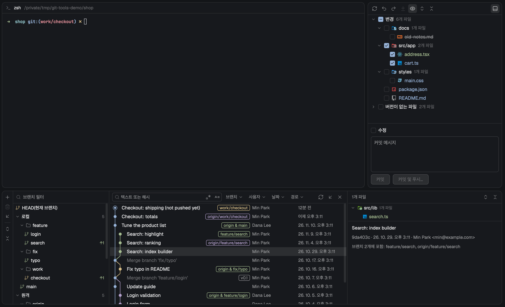

# herdr-git

[English](README.md) | **한국어**

[Herdr](https://herdr.dev) 데스크톱 앱에 Git 도구를 더하는 mod입니다. 탭 바의
Changes 버튼으로 여는 Commit panel, Files 버튼으로 여는 Files panel, 작업 영역 아래의 Git
Log panel이 있습니다. 커밋할 파일을 골라 커밋하거나 고쳐 쓰고, 미리 보고 푸시하고, 파일을
되돌리고 되살리고, 지운 브랜치를 되살리고, 파일을 git 상태와 함께 둘러보고, 커밋 그래프와
검색·필터로 브랜치와 기록을 살펴봅니다. 같은 화면에서 스태시, 병합, 리베이스, 풀, 체리픽,
되돌리기, 재설정을 하고, 충돌을 나란히 보며 풀고, 지난 커밋을 고치고, 브랜치와 리비전을
비교합니다.



- **Commit panel**(Changes 버튼, `cmd-k`): 바뀐 파일과 추적하지 않는 파일을 체크박스
  트리로 보여 줍니다. git에 스테이징된 것과 상관없이 체크한 파일만 커밋합니다. Amend,
  Commit and Push…, Rollback…, Restore Rolled-Back Changes…, Show Diff가 있습니다. Amend를
  켜면 마지막 커밋의 파일이 맨 아래에 보입니다. 스태시가 하나라도 있으면 **커밋** 옆에
  **스태시** 탭이 생깁니다. 병합, 리베이스, 체리픽, 되돌리기가 진행 중이면 그 상태와 충돌
  파일, **해결** 링크를 보이고, 커밋 버튼이 그 동작을 이어 갑니다.
- **Files panel**(Files 버튼): 포커스된 pane의 폴더를 트리로 보여 줍니다. 이름은 git 상태의
  색으로, 안에 바뀐 파일이 있는 폴더는 옆에 점으로 표시하고, 경로의 일부로 파일을 찾는
  찾기 칸과 누른 파일의 읽기 전용 미리보기가 있습니다. 줄을 우클릭하면 Show Diff, Copy
  Path, Copy Relative Path, Reveal in Finder가 있습니다.
- **Log panel**(Changes 옆의 Git 버튼, `cmd-shift-g`): Branch tree(현재 브랜치, 즐겨찾기,
  이름순으로 놓고 체크아웃, 새 브랜치, 병합, 리베이스, 업데이트, 이름 변경, 비교, 삭제, 삭제된
  브랜치, 페치, 즐겨찾기, 내 브랜치 표시), 그래프와 함께 보는 모든 커밋, 글자나 해시로 찾기,
  Branch / User / Date / Path 필터, 그래프 옵션과 옵션 표시, 해시/브랜치/태그로 이동, 고른 커밋의
  파일과 메시지. Shift·Cmd 클릭으로 여러 커밋을 고릅니다. 커밋이나 파일을 우클릭하면 아래
  동작들이 있습니다.
- **VCS 위젯**(macOS는 Git 버튼 왼쪽, 다른 OS는 Log panel 툴바 왼쪽 끝): 현재 브랜치와 받을
  커밋 수(↓)·보낼 커밋 수(↑), 또는 진행 중인 동작과 이어 가기 ≫·중단 ■을 보입니다. macOS에서는
  블록 폭이 브랜치 이름에 맞춰집니다. 누르면 바로 아래에 팝업이 열려 프로젝트 업데이트, 커밋, 푸시,
  새 브랜치, 새 워크트리, 태그 또는 리비전 체크아웃과 최근·로컬·원격 브랜치(즐겨찾기가 먼저)·태그를
  보이고, 브랜치의 메뉴는 팝업 안에서 그 줄 옆에 열립니다.
- **VCS 작업 팝업**(`cmd-shift-v`): Git 메뉴를 번호 붙은 팝업 하나로 모았습니다. 커밋, 푸시,
  프로젝트 업데이트, 풀, 페치, 병합, 리베이스, 브랜치, 새 브랜치, 새 태그, HEAD 재설정, 새 워크트리,
  Git 로그 표시, 패치(패치 생성, 패치 적용, 클립보드에서 패치 적용), 커밋되지 않은 변경 내용(변경
  내용 스태시, 변경 내용 스태시 취소, 롤백), 원격 관리, Git 콘솔. 번호를 누르면 실행합니다.
- **진행 막대**: git-tools가 git 쓰기(커밋, 풀, 푸시, 페치 등)를 하는 동안 Commit panel과 Log
  panel 아래에 그 이름과 좌우로 오가는 막대를 보입니다.
- **Diff tab**: 파일 하나의 통합 diff를 줄 번호와 함께 보여 줍니다. 어느 패널에서든
  엽니다. 작업 파일의 탭은 파일이 바뀌면 따라서 바뀝니다.

### git 동작

- **스태시**: 메시지와 함께, 색인 유지나 추적 중지된 항목 포함을 골라 넣습니다. 스태시 탭에서
  적용, 팝(색인 복구, 새 브랜치로), 삭제, 지우기를 합니다.
- **병합, 리베이스, 풀, 프로젝트 업데이트**: 브랜치 메뉴에서 바로, 또는 옵션을 고르는 창에서
  합니다. 프로젝트 업데이트는 페치한 뒤 현재 브랜치를 병합이나 리베이스로 맞추고(또는 원격
  브랜치로 재설정하고), **업데이트 정보** 탭에 들어온 커밋을 보입니다. 업데이트는 체크아웃하지
  않은 브랜치를 원격 브랜치까지 옮깁니다.
- **Cherry-Pick**과 **커밋 되돌리기**: 커밋 하나나 여럿, 또는 커밋의 일부 파일(선택한 변경 내용
  체리픽, 선택한 변경 내용 되돌리기)에 합니다.
- **현재 브랜치를 여기로 재설정…**(소프트, 혼합, 하드, 유지)과 **HEAD 재설정…**. 하드 리셋은
  로컬 변경을 먼저 기록합니다. 복원으로 스테이징까지 되살리고, 다른 커밋 위에도 되살립니다.
- **지난 커밋 고치기**: 커밋 실행 취소, 커밋 메시지 편집, 픽스업, 다음으로 스쿼시, 커밋 삭제,
  커밋 스쿼시, 커밋의 일부 파일 추출·삭제, 여기부터 대화식으로 리베이스(순서 바꾸기, 선택, 편집
  중단, 수정, 스쿼시, 픽스업, 삭제를 한 창에서). `main`이나 `master`에 이미 푸시한 커밋은 고칠 수
  없습니다.
- **충돌**: 동작이 충돌로 멈추면 충돌 창이 열립니다. 파일마다 내 쪽이나 상대 쪽을 수락하거나,
  모든 간단한 충돌을 한 번에 풀거나, 세 칸으로 보는 병합 창에서 덩어리마다 고릅니다.
- **스마트 동작**: 로컬 변경이 체크아웃, 병합, 풀, 리베이스, 체리픽, 되돌리기, 지난 커밋 고치기(체크한
  변경을 커밋하는 픽스업과 다음으로 스쿼시는 빼고)를 막으면 그 파일을
  보이고, 변경을 스태시에 넣고 실행한 뒤 되돌려 줍니다. 강제 체크아웃은 버리기 전에 변경을
  기록합니다.
- **새 태그, 브랜치 이름 변경, 여기까지의 내용을 모두 푸시, 태그 푸시.**
- **원격**: 원격 관리에서 모든 원격을 URL과 함께 보고 추가, 편집, 제거합니다(Branch tree의 원격
  폴더에서도 편집·제거).
- **패치**: 커밋(Log panel)이나 체크한 로컬 변경(VCS 작업 팝업)으로 패치를 만들어 파일이나
  클립보드로 보냅니다. 파일이나 클립보드의 패치를 적용할 때는 적용할 파일을 고릅니다. 맞지 않는
  패치는 3-way 병합으로 적용하고, 충돌이 나면 충돌 창이 열립니다.
- **비교와 보기**(space 탭): 두 브랜치에 서로 없는 커밋, 브랜치나 커밋과 작업 트리의 차이, 두
  커밋의 차이, 파일과 그 커밋의 부모 사이의 차이, 리비전의 저장소, 여기까지의 기록,
  리비전·브랜치에서 가져오기. 이 탭에 포커스가 있는 동안 패널들은 그 탭을 연 저장소를 보입니다.
- **새 워크트리**: 브랜치에서 만들어 새 space로 엽니다.
- **Git 콘솔**: git-tools가 실행한 git 명령과 그 출력을 보이는 탭입니다. URL 안의 비밀번호와
  토큰은 `***`로 가립니다. 모든 오류 띠에 콘솔에서 보기가 있습니다.

### 롤백과 브랜치 삭제 되살리기

- **Rollback**은 버릴 파일들을 먼저 저장소 안에 기록합니다. 롤백 직후 Commit panel 아래에
  `N개 파일을 롤백했습니다.`(영어 화면은 `Rolled back N files.`)와 **복원…** 버튼이 있는
  줄이 뜹니다. 나중에는 툴바의 **롤백된 변경 내용 복원…**(Restore Rolled-Back Changes…)이
  최근 롤백 50개를 보여 줍니다. 하나를 고르고 파일을 체크해(더블클릭하면 그 diff를 봅니다)
  복원을 누릅니다. 롤백한 뒤 다시 고친 파일은 덮지 않고 건너뛰며 이유를 알려 줍니다.
  기록된 그대로 디스크에 남아 있는 새 파일(추가된 파일의 로컬 복사본 삭제를 끄고 롤백한
  경우)은 복원한 것으로 셉니다. 스테이징했던 것도 돌아와서 `git status`가 롤백 전과 같아집니다.
  그사이 다른 내용을 스테이징한 파일은 그 스테이징을 그대로 두고, 창이 그렇다고 알려 줍니다.
- **브랜치를 지우면** 먼저 저장소에 기록한 뒤 Log panel 아래에 `삭제된 브랜치: 'x' (1a2b3c4)`(영어
  화면은 `Deleted branch 'x' (1a2b3c4).`)와 **복원** 버튼이 있는 줄이 뜹니다. 같은 커밋, 같은
  추적 브랜치로 되살리고 체크아웃하지는 않습니다. 나중에는 Branch tree의 **삭제된 브랜치…**
  (Deleted Branches…) 버튼이 이 저장소에서 지운 브랜치를 최신순으로 보여 줍니다. 여러 개를
  체크하고 복원을 누릅니다. git이 약 30일 동안 보관합니다. 그사이 같은 이름의 브랜치가
  생겼으면 그대로 둡니다. 다른 worktree에서 체크아웃한 브랜치는 지우지 않고, 오류가 그
  worktree를 알려 줍니다.

### User 필터

몇 글자만 치면 저장소의 작성자 목록이 좁혀집니다. 클릭하거나 ↑ ↓와 Enter로 여러 명을
체크하면 그 가운데 누구의 커밋이든 남습니다. 아무 줄도 고르지 않고 Enter를 누르면 친
글자를 이름·이메일의 일부로 찾는 조건으로 더합니다.

### 파일 아이콘

변경 파일 트리와 Files panel의 파일·폴더, Diff tab 머리줄에
[Atom Material Icons](https://github.com/AtomMaterialUI/iconGenerator) 아이콘이
보입니다(Herdr의 밝음·어두움에 맞는 변형). 라이선스는 아래 "아이콘과 크기"에 있습니다.

### 언어

컴퓨터의 첫 번째 선호 언어가 한국어면 화면이 한국어, 그 밖에는 영어입니다. mod 안에서
바꾸는 방법은 없습니다. macOS는 시스템의 선호 언어 목록을, Linux는 `LC_ALL`,
`LC_MESSAGES`, `LANG` 변수를, Windows는 표시 언어를 읽습니다(Windows는 아직 실제 기기에서
확인하지 못했습니다). 다른 머신의 space에서도
창이 있는 컴퓨터의 언어를 따릅니다. 시스템 언어를 바꾸면 Herdr를 다시 시작하세요. git
자신의 메시지는 git이 쓴 그대로 보입니다.

모두 Herdr의 `main`을 복사한 `main-git` 레이아웃 안에 있습니다. Herdr의 원래 레이아웃과
Changes·Files 패널은 그대로 둡니다.

## 추가하기 전에

- **실행하는 프로그램**: 포커스된 pane의 저장소에서 `git`을 실행합니다(space가 다른
  머신에 있으면 그 머신에서). git에 `GIT_TERMINAL_PROMPT=0`을 넘기려고 `env`도
  실행합니다. Files panel은 space가 도는 곳에서 `sh`(Windows 컴퓨터의 폴더는 PowerShell)로
  폴더를 읽고, Reveal in Finder는 `open -R`을 실행합니다. 언어를 고르려고 내 컴퓨터에서
  `defaults read -g AppleLanguages`(macOS), `LC_ALL`, `LC_MESSAGES`, `LANG`을 찍는
  `sh -c 'printf …'`(Linux), `powershell -NoProfile -Command "(Get-UICulture).Name"`(Windows)를
  실행합니다. 다른 머신의 space에서 병합 결과를 저장할 때는 그 머신에서 `sh`(`mktemp`, `cp -p`,
  `mv`)를 실행합니다.
- **네트워크**: 페치, 풀, 프로젝트 업데이트, 업데이트, 체크아웃 후 업데이트를 누르거나 "원격으로
  가져오기"를 켜고 원격을 저장하면 `git fetch`, 풀과 브랜치 메뉴의 풀 처리는 `git pull`, Push,
  Force Push, 태그 푸시를 누르면 `git push`를 합니다. 그 밖에는 밖으로 나가지 않습니다.
- **저장소에 쓰는 일**: 버튼을 누르거나 메뉴 항목을 골랐을 때만 씁니다(커밋, 롤백, 체크아웃,
  브랜치, 스태시, 병합, 리베이스, 풀, 체리픽, 되돌리기, 재설정, 지난 커밋 고치기, 태그, 원격, fetch,
  push와 위의 동작들). 옵션 없는 `--force`는 쓰지 않습니다. `reset --hard`는 재설정에서 하드를
  골랐을 때와 프로젝트 업데이트의 "원격 브랜치로 재설정"에서만, 강제 체크아웃은 "강제 체크아웃"을
  눌렀을 때만 쓰고, 둘 다 먼저 로컬 변경을 기록합니다(롤백된 변경 내용 복원… 목록에 재설정·체크아웃으로
  보입니다). 기록하지 못하면 하지 않습니다. 지난 커밋 고치기는 git-tools가 쓴 할 일 목록으로
  `git rebase -i`를 돌리고, `main`이나 `master`에 이미 푸시한 커밋은 건드리지 않습니다. 한
  저장소에서는 쓰기가 하나만 돌고, 도는 동안에는 그 저장소를 보여 주는 모든 git-tools 화면에서
  다른 쓰기 버튼이 꺼집니다. git 설정은 그대로 두고, 저장소의 로컬 설정에 git-tools 자신의 키만
  씁니다: `gittools.favorite`과 `gittools.unfavorite`(즐겨찾기 브랜치), `gittools.smart-stash`(멈춘
  스마트 동작의 스태시).
- **롤백 기록**: Rollback마다 숨은 ref `refs/git-tools/rollback`(과 그 reflog)에 커밋 객체를
  하나 더하고, git 폴더에 비워 둔 파일 `git-tools-rollback-index-<id>` 하나를 그곳에서
  롤백이나 복원을 한 Commit panel 식별자마다 남깁니다(`<id>`는 사본의 저장소에 두는
  식별자라 같은 props로 연 사본들은 하나를 함께 쓰고, 저장소를 쓸 수 없는 사본은 실행마다
  파일이 하나씩 늡니다. SHA-1 저장소에서 65바이트, SHA-256 저장소에서 89바이트). 브랜치나 태그가 아니어서 푸시되지
  않지만, **가장 최근 기록 하나는 `git log --all`과 모든 ref를 그리는 도구에 커밋으로
  보입니다**(`git stash`와 같습니다). ref가 더 가리키지 않는 기록은 30일 뒤 `gc` 때 git의
  reflog 정리로 사라지고(기본값), 가장 최근 기록은 ref가 가리키는 동안 남습니다.
  git-tools가 직접 지우지는 않습니다. 기록은 스테이징했던 것도 담는데, 이것은 두 번째
  커밋이라 `git log --all`에서 가장 최근 기록 옆에 보입니다.
- **지운 브랜치 기록**: Delete마다 지우기 전에 브랜치를 숨은 ref
  `refs/git-tools/deleted-branches`의 reflog에 기록합니다. 이 ref는 HEAD 역사의 첫 커밋에
  서 있어서 `git log --all`에 새 커밋이 보이지 않습니다(첫 커밋에 이 ref의 이름만 붙습니다).
  기록은 약 30일 뒤 `gc` 때 git의 reflog 정리로 사라지고, git-tools가 직접 지우거나 이를 위해
  git 설정을 바꾸지 않습니다. 기록은 그 클론에만 있습니다: `push --all`과 clone은 옮기지
  않습니다. 지운 브랜치를 복원하면 그 브랜치의 `branch.<name>.remote`, `.merge` 설정도
  되돌립니다.
- **Herdr 앱 홈의 파일**(`~/.config/herdr-app` 또는 `$HERDR_APP_HOME`): `install.sh`가
  `mods/git-tools/`와 `layouts/main-git.json`을 쓰고 `keys.json`에 키 세 개를 더합니다.
  mod는 `shared.json`에 작은 값 다섯 개를 둡니다. `git-tools.bus`는 화면끼리 저장소가
  바뀌었다고 알리는 데, `git-tools.lock`은 어느 저장소에서 git-tools의 쓰기가 돌고 있는지
  적는 데, `git-tools.lang`은 마지막으로 읽은 시스템 언어(`"en"` 또는 `"ko"`)를 적는 데,
  `git-tools.menus`는 열린 메뉴 수를 적어 툴팁이 메뉴를 가리지 않게 하는 데,
  `git-tools.tabs`는 열린 git-tools 탭과 각 탭을 연 저장소를 적는 데 씁니다. 그곳의
  `git-tools` 폴더에는 `console.jsonl`(Git 콘솔, 최대 512 KiB)과
  `settings.json`(프로젝트 업데이트 방법, 풀 창의 브랜치, 그래프 옵션과 옵션 표시, 브랜치 패널
  설정, "다시 묻지 않음")을 두고, 병합 결과를 저장하거나 클립보드의 패치를 적용하는 동안
  `git-tools-result.*` 파일을 잠깐 둡니다. 클립보드에는 Copy Revision Number, Copy Path, Copy
  Relative Path, 클립보드로 보내는 패치 생성에서만 쓰고, 클립보드에서 패치 적용에서만 읽습니다.

구조와 주의점은 [RECIPE.md](RECIPE.md)에 있습니다.

## 설치

실행 중인 Herdr와 `node`, 그리고 space가 도는 모든 머신에 `git` 2.37 이상이 필요합니다.

```sh
git clone https://github.com/ukkiee/herdr-git
cd herdr-git && ./install.sh
```

`install.sh`는 mod를 복사하고(설치된 것과 다른 파일만), 지금의 `main` 레이아웃으로 `main-git`을 만들어 그리로
바꾸고, 키를 더합니다. `main` 레이아웃의 구조가 예상과 다르면 어느 부분이 없는지 알리고
아무것도 바꾸지 않습니다.

### 키

| 키 | 하는 일 |
|---|---|
| `cmd-k` | Commit panel을 엽니다 |
| `cmd-shift-g` | Log panel을 보이거나 숨깁니다 |
| `cmd-shift-v` | VCS 작업 팝업을 엽니다(Commit panel이나 Log panel이 보일 때) |

세 키는 `main-git` 레이아웃에서만 동작합니다. 이미 다른 기능에 쓰는 키는 건드리지
않습니다. `install.sh`가 그 사실을 알려 주니, `keys.json`에서 다른 키에 묶으면 됩니다.

### Herdr를 업데이트한 뒤

`main-git`은 복사본이라 Herdr가 `main`에 준 변경을 따라가지 않습니다. **Herdr를
업데이트할 때마다 `./install.sh`를 다시 실행하세요**(이 저장소를 `git pull`한 뒤에도).
지금의 `main`으로 `main-git`을 다시 만듭니다. `main-git.json`을 손으로 고친 내용은 이때
사라집니다.

### `main`으로 돌아가기

`cmd-shift-l`(Herdr의 레이아웃 전환 키)을 누르세요. 누를 때마다 다음 레이아웃으로
넘어가니, 레이아웃이 둘보다 많으면 `main`이 보일 때까지 누릅니다. Herdr의 원래 Changes
패널이 그대로 있습니다. 돌아오려면 `main-git`이 보일 때까지 누르거나 `./install.sh`를
실행하세요.

### 지우기

먼저 `main`으로 바꾼 뒤, 앱 홈에서 `mods/git-tools/`, `git-tools/`, `layouts/main-git.json`을
지우고 `keys.json`의 `layout:main-git` 절을 지우세요. Herdr가 `layouts/.state/main-git.json`과
`shared.json`의 `git-tools.bus`, `git-tools.lock`, `git-tools.lang`, `git-tools.menus`,
`git-tools.tabs` 키를 남겨 두었을 수
있는데, 모두 지워도 됩니다. 롤백 기록과 지운 브랜치 기록은 git이 정리할 때까지 각 저장소에
남습니다. 그 저장소에서 `git update-ref -d refs/git-tools/rollback`과
`git update-ref -d refs/git-tools/deleted-branches`를 실행하면 바로 지워집니다(그 뒤에는
복원할 수 없습니다). `git config --remove-section gittools`는 즐겨찾기(와 `gittools.scripted`)를
지웁니다.

## 강제 푸시

- Force Push는 Push dialog의 Push 옆 ▾ 안에 있습니다. 언제나 `--force-with-lease`라서,
  마지막 fetch 뒤에 누군가 그 원격 브랜치에 푸시했으면 git이 거부합니다. 옵션 없는
  `--force`는 쓰지 않습니다.
- `main`과 `master`에서는 비활성입니다. 원격의 `main`이나 `master`로 푸시하는 브랜치도
  마찬가지입니다.
- 비밀번호, 암호 문구, GPG PIN을 입력할 곳이 없습니다. 입력을 요구하는 원격에서는 멈춰
  기다리지 않고 푸시가 실패하며, 창에 credential helper나 SSH agent를 설정하라는 안내와
  그다음 git의 오류를 보여 줍니다. 커밋은 이미 되어 있으니 설정하고 Push를 다시 누르면
  됩니다. 원격이나 훅이 거절한 푸시에는 git의 오류만 보여 줍니다.

## 아이콘과 크기

- 파일·폴더 아이콘은 Elior "Mallowigi" Boukhobza의 **Atom Material Icons**(MIT 라이선스)이고,
  [`AtomMaterialUI/iconGenerator`](https://github.com/AtomMaterialUI/iconGenerator)의 커밋
  `90e051eecb393c6380be18a1941c3096170c15d6`에서 가져왔습니다(Atom Material Icons
  210.0.2의 규칙과 아이콘). 파일 아이콘 1,797개와 폴더 아이콘
  351개(닫힘·열림)입니다. 라이선스 전문과 출처는
  [`mods/git-tools/icons/theme/LICENSE`](mods/git-tools/icons/theme/LICENSE)와
  [`NOTICE.md`](mods/git-tools/icons/theme/NOTICE.md)에 있습니다. 제품의 로고나 상표를
  그린 아이콘은 그 소유자의 것입니다.
- 이 아이콘들로 저장소와 설치된 mod 폴더가 **파일 2,502개, 약 5.6 MB** 커집니다.
- 버튼과 메뉴의 아이콘도 같은 저자의 Atom Material Icons(MIT 라이선스)이고,
  [`AtomMaterialUI/a-file-icon-idea`](https://github.com/AtomMaterialUI/a-file-icon-idea)의 커밋
  `12c2ce7a0dd4c00f92437034417d44dfbc8f7976`(플러그인 210.0.2)에서 바꾸지 않고 가져왔습니다. 파일
  61개, 약 24 KB이고, 라이선스와 출처는
  [`mods/git-tools/icons/ui/LICENSE`](mods/git-tools/icons/ui/LICENSE)와
  [`NOTICE.md`](mods/git-tools/icons/ui/NOTICE.md)에 있습니다. 툴바·메뉴의 동작과 브랜치
  행(브랜치, 현재 브랜치, 태그, 별)은 아이콘 자신의 색으로, 트리 화살표, 폴더, 검색 칸 돋보기,
  메뉴 체크는 글자색으로 그립니다. 꺼진 버튼은 같은 모양을 흐린 회색 한 색으로 그립니다. 24px
  버튼 안에 16px로 그리고, 어두운 변형이 있는 8개는 버튼 바탕에 따라 바뀝니다.
- `node tools/gen-icon-theme.mjs <압축을 푼 iconGenerator 폴더>`로 다시 만듭니다. 폴더를
  받는 방법은 스크립트 머리말에 있습니다.

## 알려진 한계

- 한 번에 저장소 하나, 포커스된 pane의 저장소만 보여 줍니다. 서브모듈은 따로 보여 주지
  않습니다.
- 비밀번호, 암호 문구, GPG PIN을 입력할 곳이 없습니다. 입력을 요구하는 원격에서는 푸시, 페치,
  풀, 업데이트, 태그 푸시가 바로 실패하고, credential helper나 SSH agent를 설정하라는 안내와
  그다음 git의 글을 보여 줍니다.
- 메뉴 막대 메뉴가 없습니다. Git 메뉴는 VCS 작업 팝업(`cmd-shift-v`)이고, Commit panel이나 Log
  panel이 보일 때만 열립니다.
- 알림에는 버튼을 하나까지만 달 수 있어서, 편집을 위해 멈춘 리베이스 알림은 계속·중단 버튼 대신
  어디서 이어 갈지(VCS 위젯이나 Commit panel)를 알려 줍니다.
- F2는 Branch tree보다 Herdr(탭 이름 바꾸기)가 먼저 받습니다. 브랜치 이름은 우클릭 메뉴의 이름
  변경…으로 바꿉니다.
- Branch tree와 Commit list의 메뉴에는 하위 메뉴가 없습니다. 현재 브랜치의 추적된 브랜치와 태그의
  태그 푸시는 두 번째 메뉴로 열립니다. 브랜치의 메뉴를 줄 옆에 그리는 것은 VCS 위젯 팝업뿐입니다.
- VCS 위젯 팝업의 별은 즐겨찾기를 보이기만 합니다. 즐겨찾기는 Branch tree에서 바꿉니다. 위젯이
  360px보다 넓어질 만큼 긴 브랜치 이름은 줄여 보입니다.
- 멈춘 스쿼시나 픽스업에서 메시지를 고쳤을 때 바로 뒤에 스쿼시가 또 있으면, 고친 메시지가 그 다음
  커밋의 메시지까지 대신합니다.
- 편집하려고 멈춘 리베이스에서 그 위에 커밋을 더 만든 뒤 메시지를 고쳐 Continue하면, git의 기본
  Continue가 돌고 고친 메시지는 쓰이지 않습니다.
- 패치 적용에는 파일을 고르는 창이 없습니다(Herdr에는 폴더 고르기만 있습니다). 패치의 경로를
  입력하거나, 이 컴퓨터의 space에서 📁로 폴더를 고릅니다. 1 MiB보다 큰 패치 파일은 거절합니다.
  패치 생성과 패치 적용에는 diff 칸이 없습니다.
- 패치 적용은 긴 파일 목록을 여러 번에 나눠 적용합니다. 파일이 1,000개를 넘거나, 경로마다
  `길이×6+11`로 어림한 합이 60,000을 넘을 때입니다(영문 이름이면 이름 길이 합 약 10,000자).
  git이 뒤 부분을 거절하면 앞 부분은 적용된 채 남습니다.
- 패널은 git-tools 탭이 자기를 기록한 뒤에야(열릴 때나 포커스를 받을 때) 그 탭의 저장소를
  따릅니다. 그 전에는 space의 폴더를 따릅니다.
- 병합 창의 가운데 칸은 줄 색이 있는 편집기가 아니라 그림입니다. 결과를 직접 고치려면 결과 직접
  편집으로 색 없는 편집기 모드로 바꾸고, 다시 눌러 돌아옵니다.
- 리베이스 창에는 `--interactive`가 없고(여기부터 대화식으로 리베이스…를 씁니다), `--update-refs`는
  git 2.38 이상이 필요합니다.
- 작업 트리와의 비교는 추적하는 파일만 보입니다. 붙어 있지 않은 여러 커밋의 패치에는 그 사이
  커밋도 들어갑니다.
- 멈춘 동작의 스마트 동작이 남긴 스태시는 동작이 끝난 뒤 Commit panel의 다음 새로고침이 되돌립니다.
  Commit panel이 닫혀 있으면 그때까지 기다립니다.
- diff는 통합 보기뿐입니다. 좌우 나란히 보기와 구문 색이 없습니다. Commit panel에서 이름이
  바뀐 파일은 삭제된 파일과 추가된 파일로 따로 보이고, 추가된 파일의 diff는 파일 전체입니다.
- Files 미리보기의 구문 색은 Herdr 편집기의 문법 묶음에 기댑니다. 묶음에 없는 형식(TypeScript,
  TOML, Terraform, Kotlin, Swift 등)은 가장 가까운 문법을 빌려서 그 언어에만 있는 키워드는 색이
  없고, 가까운 문법도 없는 형식(Vim script, Nix, Pug, Stylus, AsciiDoc, CSV 등)은 색 없이
  보입니다.
- Amend는 마지막 커밋만 고치고, 커밋은 줄 단위가 아니라 파일 단위입니다.
- 다른 머신의 space에서는 파일을 감시하지 못합니다. 작업 파일의 Diff tab은 화면에 보이는
  동안 10초마다 다시 읽습니다.
- Git 버튼은 macOS에만 있습니다. Windows와 Linux에서는 `cmd-shift-g`나 Commit panel의 Git
  Log 버튼으로 Log panel을 열고, VCS 위젯은 그 툴바 왼쪽 끝에 있습니다.
- Log panel 폭이 약 930px보다 좁으면 Commit details가 숨습니다.
- Commit details는 커밋을 포함한 브랜치를 12개까지 적고, 나머지는 `and N more`로 줄입니다.
- 화면 언어는 영어와 한국어뿐이고, 시스템 설정으로만 정해집니다.
- Windows는 실제 기기로 확인하지 못했습니다: 언어 판정, 그곳에서의 Files panel 폴더 목록과
  찾기, git 동작의 화면. Linux와 영어 macOS도 실제 기기로 확인하지 못했습니다.
- 롤백한 뒤 다른 내용을 스테이징한 파일과 충돌 중이던 파일은 복원해도 스테이징이 돌아오지
  않습니다. 파일은 돌아옵니다.
- 지운 브랜치는 약 30일(git의 reflog 정리 기본값) 동안 남고, 삭제된 브랜치 목록은 최근
  50개를 보여 주며, 기록은 그 클론에만 있습니다.
- Files panel은 찾는 동안 찾을 목록을 10초에 한 번까지 다시 읽습니다. 그사이 새로 만든
  파일은 약 20초 안에 나옵니다. 저장소 안이든 밖이든 처음 20,000개 파일에서만 찾고,
  서브모듈은 결과에 나오지 않습니다. 트리는 폴더당 500개, 전체 5,000개까지 보여 줍니다.
- 서브모듈을 롤백하면 스테이징한 커밋만 되돌리고 체크아웃은 그대로라, 복원은 그것을 롤백
  뒤 바뀐 것으로 보고 건너뜁니다.
- 복원은 시작할 때 변경 여부를 확인합니다. 그 확인과 쓰기 사이(파일 몇 개면 수십~100 ms)에
  다른 프로그램이 같은 파일을 고치면 그 내용이 덮일 수 있습니다. git 자신의 체크아웃에도
  같은 틈이 있습니다.
- Herdr 앱 홈을 다른 컴퓨터로 복사하거나 두 컴퓨터 사이에 동기화하면 두 앱의 Commit panel
  식별자가 같아질 수 있습니다. 그런 두 앱이 같은 순간에 같은 저장소를 롤백하면 기록이 섞일
  수 있습니다.
- `.mailmap`이 있는 저장소에서 User 필터, Commit list, Commit details, Push dialog는
  매핑된 이름을 보여 줍니다. 이름만 체크했을 때 `bob`은 `bob`만 겁니다.
  Match Case를 끄고 텍스트를 검색하는 동안, 또는 User 팝업에 직접 친 글자가 걸려 있는
  동안(Match Case를 켠 텍스트 검색이 없을 때)에는 `Bob`도 함께 걸립니다. git의 대소문자
  설정이 텍스트와 작성자에 하나뿐이어서입니다.
