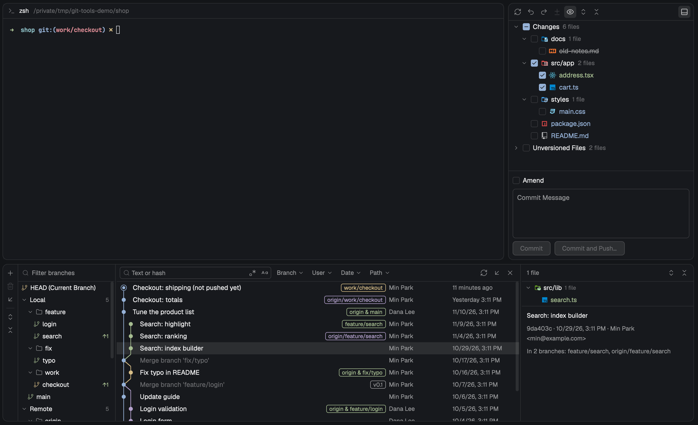

# herdr-git

**English** | [한국어](README.ko.md)

Git tools for the [Herdr](https://herdr.dev) desktop app: a Commit panel
behind the tab bar's Changes button, a Files panel behind its Files button and a Git Log
panel under the work area. Pick the files to commit, commit or amend, push with a
preview, roll files back and restore them, bring deleted branches back, browse your
files with their git status, and browse branches and history with a commit graph, search
and filters. Stash, merge, rebase, pull, cherry-pick, revert and reset from the same
screens, resolve conflicts side by side, fix up older commits, and compare branches and
revisions.



- **Commit panel** (Changes button, `cmd-k`): changed and unversioned files as a
  checkbox tree. Only the checked files are committed, whatever git has staged.
  Amend, Commit and Push…, Rollback…, Restore Rolled-Back Changes…, Show Diff. With
  Amend on, the files of the last commit show at the bottom. A **Stash** tab beside
  **Commit** lists your stashes while there are any. During a merge, rebase, cherry-pick or
  revert it shows what is in progress, the conflicted files with **Resolve**, and the
  commit button goes on with the operation.
- **Files panel** (Files button): the focused pane's folder as a tree, names colored by
  their git status, a dot beside folders with changes inside, a search box that finds
  files by part of their path, and a read-only preview of the file you press.
  Right-click a row for Show Diff, Copy Path, Copy Relative Path and Reveal in Finder.
- **Log panel** (the Git button beside Changes, `cmd-shift-g`): Branch tree (current
  branch, then favorites, then by name; checkout, new branch, merge, rebase, update,
  rename, compare, delete, deleted branches, fetch, favorites, My Branches), every commit
  with a graph, search by text or hash, Branch / User / Date / Path filters, graph and
  view options, Go to Hash/Branch/Tag, and the selected commit's files and message.
  Shift- and Cmd-click pick several commits. Right-click a commit or a file for the
  operations below.
- **VCS widget** (left of the Git button on macOS, left end of the Log panel's toolbar
  elsewhere): the current branch with the commits to pull (↓) and to push (↑), or the
  operation in progress with continue ≫ and abort ■. On macOS its block is as wide as
  the branch name. Click it for a popup right below it: Update Project, Commit, Push, New
  Branch, New Worktree, Checkout Tag or Revision, and every recent, local and remote
  branch (favorites first) and tag, each branch's menu opening beside its row inside
  the popup.
- **VCS Operations popup** (`cmd-shift-v`): the Git menu in one numbered popup: Commit,
  Push, Update Project, Pull, Fetch, Merge, Rebase, Branches, New Branch, New Tag, Reset
  HEAD, New Worktree, Show Git Log, Patch (Create Patch, Apply Patch, Apply Patch from
  Clipboard), Uncommitted Changes (Stash, Unstash, Rollback), Manage Remotes and Git
  Console. Press its number to run one.
- **Progress bar**: while git-tools runs a git write (a commit, a pull, a push, a fetch…)
  the bottom of the Commit panel and the Log panel names it over a sliding bar.
- **Diff tab**: one file's unified diff with line numbers, opened from any panel. A
  working file's tab follows the file as it changes.

### Git operations

- **Stash** with a message, keeping the index or including untracked files; apply, pop
  (restoring the index, or onto a new branch), drop and clear from the Stash tab.
- **Merge, Rebase, Pull, Update Project**: straight from a branch's menu, or from a
  dialog with options. Update Project fetches and merges or rebases your branch (or
  resets it to the remote branch), then an **Update Info** tab lists what came in. Update
  brings a branch you aren't on up to its remote branch without checking it out.
- **Cherry-Pick** and **Revert Commit** for one commit or several, or for some files of a
  commit (Cherry-Pick Selected Changes, Revert Selected Changes).
- **Reset Current Branch to Here…** (soft, mixed, hard, keep) and **Reset HEAD…**. A hard
  reset records your local changes first; Restore brings them back, staging included,
  even onto another commit.
- **Fix older commits**: Undo Commit, Edit Commit Message, Fixup, Squash Into, Drop
  Commits, Squash Commits, extract or drop some files of a commit, and Interactively Rebase
  from Here (reorder, pick, edit, reword, squash, fixup, drop in one dialog). Commits
  already pushed to `main` or `master` can't be edited.
- **Conflicts**: when an operation stops on conflicts, the Conflicts dialog opens. Accept
  yours or theirs per file, resolve every simple conflict at once, or open the
  three-pane Merge Revisions dialog and pick chunk by chunk.
- **Smart operation**: when local changes are in the way of a checkout, merge, pull,
  rebase, cherry-pick, revert or a history edit (all but Fixup and Squash Into, which
  commit your checked changes), see the files and let git-tools stash them, run it, and
  put them back. Force Checkout records your changes before it throws them away.
- **New Tag, Rename branch, Push All up to Here, Push Tag.**
- **Remotes**: Manage Remotes lists every remote with its URL; add, edit or remove one
  there (or edit and remove from a remote's folder in the Branch tree).
- **Patches**: Create Patch from commits (Log panel) or from the local changes you check
  (VCS Operations popup), to a file or the clipboard; Apply Patch from a file or the
  clipboard, picking which of its files to apply. A patch that doesn't fit is applied
  with a 3-way merge, and conflicts open the Conflicts dialog.
- **Compare and browse** in space tabs: two branches' own commits, the working tree
  against a branch or a commit, two commits, a file against its commit's parents, the
  repository at a revision, history up to a commit, Get from Revision or Branch. While
  one of these tabs has the focus, the panels show the repository it was opened on.
- **New Worktree** from a branch, opened as a new space.
- **Git console**: a tab with every git command git-tools ran and its output, with
  passwords and tokens in URLs shown as `***`. Every error strip has View in Console.

### Undo a rollback or a branch delete

- **Rollback** records the files it is about to throw away inside the repository first.
  Right after it, a row under the Commit panel says `Rolled back N files.` with
  **Restore…**; any time later, the toolbar's **Restore Rolled-Back Changes…** lists the
  last 50 rollbacks. Pick one, check the files (double-click one to see its diff), press
  Restore. A file you changed again since the rollback is never overwritten: it is
  skipped and the dialog says why. A new file still on disk as it was recorded (rolled
  back with `Delete local copies of added files` off) counts as restored. What was
  staged comes back too, so `git status` reads as it did before the rollback; a file
  you staged something else for since keeps that staging, and the dialog says so.
- **Deleting a branch** records it in the repository first, then shows a row under the
  Log panel, `Deleted branch 'x' (1a2b3c4).`, with **Restore**: the branch comes back at
  the same commit, tracking the same remote branch, without checking it out. Any time
  later, the Branch tree's **Deleted Branches…** button lists the branches deleted in
  this repository, newest first; check several and press Restore. git keeps them for
  about 30 days. A branch of that name made meanwhile is left alone. A branch checked
  out in another worktree isn't deleted, and the error names that worktree.

### User filter

Type a few letters: the repository's authors narrow as you type. Check several people
by clicking or with ↑ ↓ and Enter; the list keeps the commits of any of them. Enter with
no row selected adds what you typed as a part of a name or email to match.

### File icons

Files and folders in the changed-file trees, the Files panel and the Diff tab's header
show the
[Atom Material Icons](https://github.com/AtomMaterialUI/iconGenerator) icons (the light
or dark variant with Herdr's look). See "Icons and size" below for their license.

### Language

The screens are Korean when your computer's first preferred language is Korean, and
English otherwise. There is no switch in the mod. macOS reads the system's preferred
languages, Linux the `LC_ALL`, `LC_MESSAGES` and `LANG` variables, and Windows its
display language (not yet checked on a real Windows machine). A space on another machine still follows the computer the window is on. After
changing the system language, restart Herdr. git's own messages are shown as git writes
them.

It all lives in a layout called `main-git`, a copy of Herdr's `main`. Herdr's own
layout and its Changes and Files panels are left as they are.

## Before you add it

- **Programs**: the mod runs `git` in the repository of the focused pane (on the
  space's machine when the space is on another one), and `env` to pass
  `GIT_TERMINAL_PROMPT=0` to git. The Files panel lists folders with `sh` (PowerShell
  for a folder on a Windows computer) where the space runs, and Reveal in Finder runs
  `open -R`. To pick the language it runs, on your own computer,
  `defaults read -g AppleLanguages` (macOS), `sh -c 'printf …'` printing `LC_ALL`,
  `LC_MESSAGES` and `LANG` (Linux) or `powershell -NoProfile -Command
  "(Get-UICulture).Name"` (Windows). Saving a merge result in a space on another machine
  runs `sh` there (`mktemp`, `cp -p`, `mv`).
- **Network**: `git fetch` when you press Fetch, Pull, Update Project, Update or
  Checkout and Update, or save a remote with Fetch from the remote on; `git pull` for Pull
  and the branch menus' Pull into; `git push` when you press Push, Force Push or Push Tag.
  Nothing else goes out.
- **Your repositories**: git-tools writes only when you press a button or pick a menu
  item (commit, rollback, checkout, branches, stash, merge, rebase, pull, cherry-pick,
  revert, reset, history edits, tags, remotes, fetch, push and the rest above). It never
  runs a bare `--force`. It runs `reset --hard` only for Reset with Hard picked and Update
  Project's Reset to Remote Branch, and a forced checkout only for Force Checkout; each
  records your local changes first (Restore Rolled-Back Changes… lists them as Reset or
  Checkout) and doesn't run if it can't. History edits run `git rebase -i` with a todo
  list git-tools writes, and never touch commits already pushed to `main` or `master`.
  One write runs at a time per repository: while one runs, the buttons for the others are
  off on every git-tools screen showing that repository. Your git config is left as it
  is, except for git-tools' own keys in the repository's local config:
  `gittools.favorite` and `gittools.unfavorite` (favorite branches) and
  `gittools.smart-stash` (a Smart operation's stash while its operation is stopped).
- **Rollback records**: each Rollback adds a commit object under the private ref
  `refs/git-tools/rollback` (with its reflog) and leaves an emptied file
  `git-tools-rollback-index-<id>` in the git folder, one for each Commit panel id that
  rolled back or restored there (`<id>` is kept in the copy's storage, so copies opened
  with the same props share one; a copy that can't keep it leaves one more file each
  run; 65 bytes in a SHA-1 repository, 89 in a SHA-256 one). It isn't a branch or tag and is never pushed, but **the newest record
  shows as one commit in `git log --all`** and in tools that draw every ref (like
  `git stash`). A record the ref no longer points at goes 30 days later, when git's
  reflog expiry runs at `gc` (the default); the newest record stays as long as the ref
  points at it. git-tools deletes none itself. A record also holds what was staged, as a
  second commit that `git log --all` shows beside the newest record.
- **Deleted-branch records**: before each Delete, the branch is recorded in the reflog
  of the private ref `refs/git-tools/deleted-branches`, which rests on the first commit
  of HEAD's history, so `git log --all` shows no new commit (only that ref's name on the
  first commit). git drops a record about 30 days later, when its reflog expiry runs at
  `gc`; git-tools deletes none itself and changes no git config for it. Records stay in
  that clone: `push --all` and clone don't carry them. Restoring a deleted branch also
  writes back its `branch.<name>.remote` and `.merge` config.
- **Files in Herdr's app home** (`~/.config/herdr-app`, or `$HERDR_APP_HOME`):
  `install.sh` writes `mods/git-tools/` and `layouts/main-git.json`, and adds three keys to
  `keys.json`. The mod keeps five small values in `shared.json`: `git-tools.bus` (how its
  screens tell each other the repository changed), `git-tools.lock` (which
  repository a git-tools write is running on), `git-tools.lang` (the system language
  last read, `"en"` or `"ko"`), `git-tools.menus` (how many of its menus are open, so no
  tooltip covers them) and `git-tools.tabs` (its open tabs and the repository each was
  opened on). In a `git-tools` folder there it keeps `console.jsonl`
  (the Git console, at most 512 KiB) and `settings.json` (Update Project's method, the
  Pull dialog's branches, graph and view options, Branch tree settings, "don't ask
  again"), and briefly a `git-tools-result.*` file while a merge result is saved or a
  patch from the clipboard is applied. It writes to the clipboard only for Copy Revision
  Number, Copy Path, Copy Relative Path and Create Patch to the clipboard, and reads it
  only for Apply Patch from Clipboard.

How it's built and what to watch for: [RECIPE.md](RECIPE.md).

## Install

You need Herdr running, `node`, and `git` 2.37 or later on every machine your spaces
run on.

```sh
git clone https://github.com/ukkiee/herdr-git
cd herdr-git && ./install.sh
```

`install.sh` copies the mod (only the files that differ from what is installed), builds
`main-git` from your current `main` layout, switches to it and adds the keys. If your `main` layout isn't shaped the way it expects, it says
which part is missing and changes nothing.

### Keys

| key | does |
|---|---|
| `cmd-k` | opens the Commit panel |
| `cmd-shift-g` | shows or hides the Log panel |
| `cmd-shift-v` | opens the VCS Operations popup (while the Commit panel or the Log panel shows) |

All three work only in the `main-git` layout. A key you already use for something else is
left alone; `install.sh` says so, and you can bind the action to another key in
`keys.json`.

### After a Herdr update

`main-git` is a copy, so it doesn't pick up changes Herdr makes to `main`. **Run
`./install.sh` again after every Herdr update** (and after `git pull` here). It rebuilds
`main-git` from your current `main`. Changes you made by hand to `main-git.json` are lost
then.

### Back to `main`

Press `cmd-shift-l` (Herdr's layout switch). It moves to the next layout, so with more
than two layouts press it until `main` shows. Herdr's own Changes panel is there
unchanged. Press it until `main-git` shows, or run `./install.sh`, to come back.

### Remove it

Switch to `main` first, then delete `mods/git-tools/`, `git-tools/` and
`layouts/main-git.json` in the app home, and the `layout:main-git` section of
`keys.json`. Herdr may also have left `layouts/.state/main-git.json` and the
`git-tools.bus`, `git-tools.lock`, `git-tools.lang`, `git-tools.menus` and `git-tools.tabs`
keys in `shared.json`; all are safe
to delete. Rollback and deleted-branch records stay in each repository until git expires
them; `git update-ref -d refs/git-tools/rollback` and
`git update-ref -d refs/git-tools/deleted-branches` there drop them at once (they can't be
restored after that). `git config --remove-section gittools` drops the favorites (and
`gittools.scripted`).

## Force push

- Force Push sits under the ▾ next to Push in the Push dialog. It is always
  `--force-with-lease`: git refuses if someone pushed to the remote branch since your
  last fetch. A plain `--force` is never used.
- It is disabled on `main` and `master`, including a branch that pushes to a remote
  `main` or `master`.
- There is no place to type a password, passphrase or GPG PIN. A remote that asks for
  one doesn't hang: the push fails and the dialog shows git's error. Your commit is
  already made; set up a credential helper or SSH agent and press Push again.

## Icons and size

- The file and folder icons are **Atom Material Icons** by Elior "Mallowigi" Boukhobza,
  MIT License, taken from
  [`AtomMaterialUI/iconGenerator`](https://github.com/AtomMaterialUI/iconGenerator) at
  commit `90e051eecb393c6380be18a1941c3096170c15d6` (the rules and icons of Atom Material
  Icons 210.0.2): 1,797 file icons and 351 folder icons,
  closed and open. The license and the source are in
  [`mods/git-tools/icons/theme/LICENSE`](mods/git-tools/icons/theme/LICENSE) and
  [`NOTICE.md`](mods/git-tools/icons/theme/NOTICE.md). Icons that depict a product's logo
  or mark stay that owner's.
- They add **2,502 files, about 5.6 MB**, to the repository and to the installed mod
  folder.
- The button and menu icons are Atom Material Icons too, by the same author, MIT License,
  taken unchanged from
  [`AtomMaterialUI/a-file-icon-idea`](https://github.com/AtomMaterialUI/a-file-icon-idea)
  at commit `12c2ce7a0dd4c00f92437034417d44dfbc8f7976` (plugin 210.0.2): 61 files, about
  24 KB, with the license and the source in
  [`mods/git-tools/icons/ui/LICENSE`](mods/git-tools/icons/ui/LICENSE) and
  [`NOTICE.md`](mods/git-tools/icons/ui/NOTICE.md). Toolbar and menu actions and the
  branch rows (branch, current branch, tag, star) are drawn in the icons' own colors; tree
  arrows, folders, the search box's magnifier and menu check marks in the text color. A
  disabled button draws the same shape in one dim gray. They are drawn at 16px in 24px
  buttons; the 8 with a dark variant switch with the button's background.
- `node tools/gen-icon-theme.mjs <unpacked iconGenerator folder>` makes them again; the
  script's header says how to get that folder.

## Known limits

- One repository at a time, the focused pane's; submodules aren't shown on their own.
- No place to type a password, passphrase or GPG PIN. A remote that asks for one fails
  at once (push, fetch, pull, update, push tag) with git's words and a hint to set up a
  credential helper or SSH agent.
- No menu bar menu: the Git menu is the VCS Operations popup (`cmd-shift-v`), and it opens
  only while the Commit panel or the Log panel shows.
- A notification carries one button at most, so a rebase stopped to edit says where to go
  on (the VCS widget or the Commit panel) instead of offering Continue and Abort.
- F2 belongs to Herdr (renaming a tab) before the Branch tree sees it: rename a branch
  from its right-click menu.
- The Branch tree's and the Commit list's menus have no submenus: a current branch's
  Tracked Branch and a tag's Push Tag open a second menu. Only the VCS widget popup
  draws a branch's menu beside its row.
- The VCS widget popup's stars only show favorites; mark them in the Branch tree. The
  widget cuts a branch name that would make it wider than 360px.
- After editing the message at a stopped squash or fixup, when another squash follows
  right after it, the message you wrote also stands in for that next commit's message.
- At a rebase stopped for editing, when you made more commits on top and then edit the
  message and Continue, git's own Continue runs and the message you wrote isn't used.
- Apply Patch has no file picker (Herdr offers a folder picker only): type the patch's
  path, or pick its folder with 📁 in a space on this computer. A patch file over 1 MiB
  is refused. Create Patch and Apply Patch have no diff pane.
- Apply Patch applies a very long file list in parts (over 1,000 files, or a command line
  of about 60 KB). When git refuses a later part, the parts before it stay applied.
- The panels follow a git-tools tab's repository only once that tab has recorded itself
  (when it opens, or when it gets the focus); until then they follow the space's folder.
- The Merge Revisions dialog's middle pane is drawn, not an editor with colored lines: to
  type in the result, switch to Edit Result Directly (a plain editor without colors) and
  switch back.
- The Rebase dialog has no `--interactive` (use Interactively Rebase from Here), and its
  `--update-refs` needs git 2.38 or later.
- Compare with the working tree lists tracked files only. A patch of commits that aren't
  next to each other also holds the commits between them.
- A Smart operation's stash left by a stopped operation is put back by the Commit panel's
  next refresh after the operation ends; with the Commit panel closed it waits.
- Diffs are unified only: no side-by-side view, no syntax colors. In the Commit panel a
  renamed file lists as a deleted file and an added file, and the added file's diff is
  the whole file.
- The Files preview's syntax colors come from the Herdr editor's syntax set. Formats it
  lacks (TypeScript, TOML, Terraform, Kotlin, Swift and others) borrow the closest syntax,
  so keywords only that language has stay uncolored; formats with no close syntax (Vim
  script, Nix, Pug, Stylus, AsciiDoc, CSV and others) show without colors.
- Commit amends only the last commit and commits whole files, not lines.
- In a space on another machine nothing watches the files: a working file's Diff tab
  reads again every 10 seconds while it is on screen.
- The Git button is on macOS only. On Windows and Linux, show the Log panel with
  `cmd-shift-g` or the Commit panel's Git Log button; the VCS widget is at the left end of
  its toolbar.
- Commit details hides when the Log panel is narrower than about 930px.
- Commit details names at most 12 branches that contain the commit, then `and N more`.
- English and Korean only, picked from the system with no switch.
- Windows hasn't been checked on a real machine: picking the language, the Files
  panel's folder lists and search there, and the git operations' screens. Linux and an
  English macOS haven't been checked on a real machine either.
- Restore doesn't bring back the staging of a file you staged something else for since
  the rollback, or of a file that was in a conflict; the file itself comes back.
- Deleted branches are kept for about 30 days (git's default reflog expiry), the
  Deleted Branches list shows the newest 50, and the records stay in that clone.
- The Files panel reads its search list again at most every 10 s while you search: a
  file made meanwhile shows within about 20 s. Inside or outside a repository it
  searches the first 20,000 files, and submodules aren't in the results. Its tree shows
  at most 500 entries per folder and 5,000 in all.
- Rolling back a submodule takes back only its staged commit, not its checkout, so
  Restore skips it as changed since the rollback.
- Restore checks for changes when it starts. A file another program edits in the moment
  between that check and the write (tens of ms to about 100 ms for a few files) is
  overwritten; git's own checkout has the same gap.
- If Herdr's app home is copied to another computer or kept in sync between two, both
  apps can hold the same Commit panel id; if they roll back the same repository at the
  same moment, their records can get mixed up.
- With a `.mailmap`, the User filter, the Commit list, Commit details and the Push
  dialog show the mapped names. Checking `bob` matches `bob` alone while only
  names are checked. While a text is searched with Match Case off, or letters typed in
  the User popup are in force (and no text is searched with Match Case on), it also
  matches `Bob`: git has one case setting for the text and the authors.
