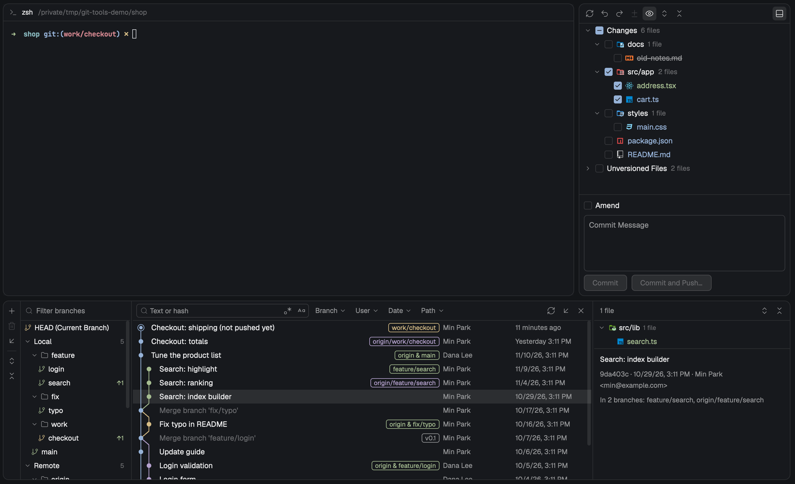

# git-tools

Git tools inside the Herdr desktop app, in a layout called `main-git`.
The tab bar's Changes button opens a **Commit panel**: the changed files as a checkbox
tree, a message box, Commit and Commit and Push…. Under the work area a **Log panel**
shows the branches, every commit with a colored graph, and the selected commit's files
and message. Diffs open as tabs; Push, Rollback, Restore and New Branch are dialogs;
right-click opens small popup menus. A rollback is recorded first and can be restored; a
deleted branch can be restored from a notice under the Log panel. Files and folders show
Atom Material Icons. The words are Korean when the computer's first preferred language
is Korean, English otherwise. Spaces on another machine run git there.

## What you see

Colors are the theme's names (`t.ansi4` is written `ansi4`). Text is 13px unless said.
Rows are 24px. Icons are 15px in 24px square buttons (5px corners) unless said.

The words quoted here are the English ones. On a computer whose first preferred language
is Korean every word the mod writes is Korean instead (see "Language" under How it
behaves; every sentence in both languages is in "Words" under Built from). Branch names,
paths, hashes, commit messages, author names and git's own output are never translated,
nor are `HEAD`, `Diff` and `Git`.

**File and folder icons** (the Icon theme): every file row and folder row of a changed-file
tree (Commit panel, Commit details, Push, Rollback and Restore dialogs) and the Diff tab's
header draws the Atom Material Icons icon its name picks, in the icon's own colors (an
`image`, not tinted). A file's icon is picked from its path, a folder's from its name (a
compact row `src/app` by `app`); an unfolded folder shows the open icon. 48 file icons
have a dark variant (`_dark`), used while Herdr's look is dark. A name no rule matches
gets the theme's plain `file` or `folder` icon. The status color stays on the name's
text. The Branch tree's folders, toolbars and buttons keep the Lucide icons.

### Commit panel

The right side panel, in place of Herdr's own Changes. A card: 10px corners, 1px
`border`, `background`. Top to bottom:

- **Toolbar**, 34px, line under it. Icon buttons, left to right: Refresh (`refresh`,
  spins while a read runs), Rollback… (`rollback`), Restore Rolled-Back Changes…
  (`restore`, a bent arrow pointing right; off only outside a repository), Show Diff
  (`diff`, only with a file selected), View Options (`eye`, lit while grouped by directory), Expand All
  (`expand-all`), Collapse All (`collapse-all`); then on the right Git Log
  (`panel-bottom`, lit while the Log panel shows; absent in a layout without it).
  Disabled buttons are `dim` at half opacity; a lit one has the `selected` background.
- **File list**, the rest of the height. Two groups, **Changes** and **Unversioned
  Files**, each a row with the name in semibold and `N files` at 12px `dim`. A group
  with no files is left out. Unversioned Files starts folded. Each row: a 14px fold
  arrow (`chevron-right` / `chevron-down`, `muted`; an empty 14px place on file rows so
  checkboxes line up), a 14px checkbox, then:
  - flat view: the file's Icon theme icon (14px), the file name in its status color (at
    most 70% of the row), then its folder at 12px `dim`.
  - grouped view: folders (the folder's Icon theme icon, 14px, open while unfolded) with
    `N files` at 12px `dim`; a
    folder whose only child is a folder is one row (`src/app`). Folders before files,
    both by name, case-insensitive first. Files show only their name.
  - Indent: 8px, plus 16px per level.
  - Status colors: modified `ansi4`, added `ansi2`, deleted `muted` struck through,
    unversioned `ansi1`, conflict `ansi9` (`ansi1` if the theme lacks it) in semibold.
  - The selected row has the `selected` background; others get `hover` under the
    pointer.
  - Checkbox: 14px, 3px corners. Off: 1px `input` border. On: `accent` fill with a
    `check` (all) or `minus` (some) at 11px in `accent_foreground`.
- **Commit form**, line above it, 8px padding, 6px gaps:
  - An **Amend** checkbox and the word `Amend` (`dim` and with a tooltip when it can't
    be used: `No commits to amend yet`, or why no write can start, as below).
  - Only while Amend is on and the last commit is on a remote: the line
    `The last commit is already pushed: after amending it, the next push needs Force Push.`
    at 12px `ansi3`, under the checkbox (not beside it).
  - Only while HEAD is detached: the line
    `HEAD is detached: a commit made here is on no branch. Create a branch to keep it.`
    at 12px `ansi3`, above the message box.
  - The message box: 4 rows, placeholder `Commit Message`, 6px corners, `input` border
    (`accent` while typing), `background`.
  - Two 28px buttons, 12.5px text, 6px corners: **Commit** (primary: `solid` fill,
    `solid_foreground` text) and **Commit and Push…** (plain: `raised` fill, `input`
    border). With Amend on the labels stay `Commit` and `Commit and Push…`. Disabled,
    both are `raised` with `dim` text and the tooltip says why: `Select files to commit`,
    `Specify a commit message`, or why no write can start (the panel's own running
    write's label, or `Another git operation is running: <label>`). Enabled, the
    tooltips are `Commit (⌘Enter)` and `Commit, then review and push`. The button that
    started a commit shows a 12px spinner.
  - Under the buttons, at 12px `muted`, while a write the buttons don't show runs: another
    screen's write on this repository, `Another git operation is running: Committing…`
    (the label is that write's: `Amending…`, `Pushing…`, `Force Pushing…`,
    `Rolling back…`, `Restoring…`, `Checking out…`, `Creating branch…`, `Deleting…`,
    `Fetching…`);
    this panel's own write on another repository,
    `Another git operation is running in another repository: Committing…` (and no
    spinner on the buttons); or this panel's own write that a dialog asked for, by its
    label alone (`Pushing…`, `Rolling back…`, `Restoring…`).
- **Rollback notice**, right after a rollback this panel ran, under the form and above
  the error strips: one row, line above it, `raised`, 10px by 5px padding, 12.5px text in
  `foreground` (not an error color): `Rolled back N files.` (`Rolled back 1 file.`), a
  plain **Restore…** button, and a 20px `x` (Dismiss).
- **Error strips**, when git fails: a commit's output right under the form; then the
  output of a write a dialog asked this panel to run (Push, Rollback); a read's output
  at the bottom. Each: line above, `raised`, 12px `ansi1` text, at most 120px tall and
  scrolling, an `x` (Dismiss) on the right. A write that ends after the panel has moved
  to another repository puts that repository's folder name in front:
  `slowhook: <git's output>`.
- **States** in place of the list, centered in `dim`: `Loading…` with a 14px spinner
  (first read of a folder), `No changes`, `<folder> is not in a git repository.` (then there is no
  form).

### Log panel

A block under the tab bar, the work area and the side panel, above the status bar, 8px
in from both sides and 8px above the status bar. 320px tall at first, hidden at first.
The same card as the Commit panel. Three columns with 5px drag handles between them
(a 1px `border` line, `accent` while dragged, `hover` under the pointer):

| column | width | min |
|---|---|---|
| Branch tree | 220px | 120px |
| Commit list | the rest | 360px |
| Commit details | 340px | 160px |

When the panel is too narrow Commit details goes first (below 930px with the default
widths), then the Branch tree (below 585px). Outside a repository the card holds a
toolbar (`Git` semibold, `Log` 12px `muted`, Refresh, Hide) and the notice.

**Branch tree** (12.5px text):

- A vertical toolbar on the left, 30px wide, line on its right: New Branch… (`plus`),
  Delete (`branch-delete`, tooltip `Delete '<name>'` or why not), Fetch (`fetch`, spins
  while fetching), a 16×1px line, Expand All, Collapse All.
- A 34px filter row (as tall as the Commit list's toolbar): `search` icon (13px, `dim`,
  `accent` while typing) and an input, placeholder `Filter branches`.
- The tree: `HEAD (Current Branch)` (or `HEAD (<7-char hash>)` when detached), then
  **Local** and **Remote** groups (semibold, count at 11px `dim`). A `/` in a name makes
  folders (`folder` icon 13px, count shown while folded). Indent 6px plus 12px per
  level. Branch rows: `branch-item` icon (13px) in `ansi3` for the current branch (whose
  name is semibold), `ansi2` for other local branches, `ansi5` for remote ones; then
  `↑N` (`ansi2`) and `↓N` (`ansi4`) at 11px against its upstream. Tooltip: the name, or
  `<name> → <upstream>`. The row the Commit list is limited to has the `selected`
  background; the keyboard's cursor row has `hover`. `origin/HEAD` is not listed.
- Filtering with no match: `No branches match`.

**Commit list** (the middle column):

- **Toolbar**, 34px, holding the **filter row** (below), then the name of the write that
  keeps writes from starting, at 12px `muted`, up to 320px and cut from the end with `…`
  (it gives way first: the filter row keeps at least 420px, or all but 100px of a
  narrower list). Any write on this repository shows its label alone, the panel's own
  (`Fetching…`, `Checking out…`, `Creating branch…`, `Deleting…`) or another screen's
  (`Committing…`, `Pushing…`); the panel's own write on another repository shows
  `Checking out… (another repository)`. Its tooltip is the full sentence: the label for
  the panel's own write here, `Another git operation is running: Committing…`, or
  `Another git operation is running in another repository: Checking out…`. Then
  Refresh, Fetch (`fetch`), and Hide (`x`).
- **Rows**: the graph, the subject (`dim` for a merge commit), the Ref labels, the
  author (120px, 12px `muted`) and the time (124px, 12px `muted`). Below 520px of list
  width the author goes; below 380px the time too.
  - Graph: lanes 14px apart from 5px in, as many lanes as the history has. Stroked
    lines 1.5px. A commit is an 8px dot; HEAD's commit is a 12px ring (1px border,
    `background` inside) around a 6px dot. Lane colors in order: `ansi4`, `ansi2`,
    `ansi3`, `ansi5`, `ansi6`, `ansi1`, `ansi12`, `ansi10`, `ansi13`, `ansi14`, then
    again. A lane keeps its color.
  - The graph part is as wide as the widest row in view needs, and at most half the
    list's width. When the rows in view need more, it scrolls sideways (see How it
    behaves) and a 3px strip sits at the bottom of the list under the graph part, 2px
    from its left: `border` with a `muted` thumb (at least 16px), 2px corners. The
    subject, labels, author and time never move sideways.
  - Ref label: 16px tall, 5px side padding, 4px corners, 1px border and 11px text in
    one color: the current branch `ansi3` semibold, local `ansi2`, remote `ansi5`, tag
    `muted`, a detached `HEAD` `ansi3`. A local branch and its remote twins are one
    label (`origin & main`). Labels longer than 28 characters lose their middle (`…`).
    4px between labels.
  - Which labels show: whole labels from the first, at most three, that fit in 45% of
    the row and leave the subject at least 40px (each label counted as 12px plus 6.5px
    per character); the rest become `+N` (11px `dim`). A first label too long on its
    own loses its middle to fit. A label is never cut at its left edge.
  - Time: `Moments ago`, `N minutes ago` within the hour, `Today 2:30 PM`,
    `Yesterday 11:06 PM`, else `11/9/26, 9:05 AM` (local time).
- **States**: `Loading…`, `No commits yet`, `No commits matching filters`.

**Filter row** (inside the Commit list's toolbar):

- Search box: 24px tall, 96 to 300px wide, 5px corners, `input` border (`accent` while
  typing), `search` icon, placeholder `Text or hash`, and two 20px toggles inside it:
  Regex (`regex`) and Match Case (`case-sensitive`), lit when on.
- Four filter buttons, 24px, 12px text: **Branch**, **User**, **Date**, **Path**. Unset:
  the name in `muted` and a `chevron-down`. Set: `selected` background, `Label:` in
  `muted` and the value (cut at 150px; below 760px of list width only the value, cut at
  84px), a tooltip with the whole value, and an 18px `x` beside it that clears it.
- `filter-x` (Clear all filters) at the end while any filter or the branch limit is set.
- Each button opens a popup under it: 260px wide, 5px padding, 8px corners, `border`,
  `popover`, a shadow, 12.5px text, 26px items with a 12px `check` on the one in force.
  - Branch: an input (`Search branches`), then every branch as 26px rows, 10 rows
    (260px) at a time with a 6px scroll thumb on the right: `HEAD` (hint: the current
    branch or `detached`), then `Local` and `Remote` headings at 11px `dim` over their
    branches. The row the arrow keys are on has the `hover` background.
  - User: an input (`Name or email`) on top, then a list of 26px rows, 10 rows (260px)
    at a time, drawn and scrolled like the Branch popup's: `me` (hint: the configured
    name or email, or `not set in git`; `dim` and off when git has neither), then each
    typed value in force (hint `contains`), then the repository's authors that match the
    input, by name. An author row's hint is its email, or the first email and `+N` when
    the name has several. Checked rows have the 12px `check`. While the authors are first
    read, a `Loading…` row (`dim`); a typed input that matches none, `No matching users`;
    a failed read, git's words at 12px `ansi1`. Last, at 11px `dim`:
    `Enter checks a row or adds the text`. The button's value is the one entry (`me`, a
    name or a typed value) or `N users` (`1 user`), and its tooltip
    `User: me, Ann, oan` names every one.
  - Date: `Last 24 hours`, `Last 7 days`, a line, `From: YYYY-MM-DD`, `To: YYYY-MM-DD`,
    and `Enter applies` or what is wrong (`Dates are written YYYY-MM-DD.`,
    `The start date is after the end date.`, `Type a start date, an end date or both.`)
    in `ansi1`. A typed range shows as `2026-11-01 – 2026-11-05`, `From 2026-11-01`,
    `Until 2026-11-05`, or the one day.
  - Path: an input (`Path from the repository root`), `A file or a folder. Enter applies`.

**Commit details** (12.5px text):

- Toolbar, 34px: `N files` (12px `muted`), Expand All, Collapse All.
- The changed files as a folder tree (compact folders as in the Commit panel), indent 6px
  plus 14px per level, Icon theme folder and file icons at 13px, status colors: modified and
  renamed `ansi4`, added `ansi2`, deleted `muted` struck through. A file's tooltip is its
  path (`<path> (renamed from <old>)` for a rename). The tree is as tall as its rows, up
  to half the column (whole rows), with a line under it. No files: `No changes`.
- The message area, 10px by 8px padding, the rest of the column, one list that scrolls
  as a whole with a scrollbar on its right: the subject in semibold, the whole body
  however long, then at 12px `muted`:
  `<7-char hash> · 11/9/26, 9:05 AM · Author <email>`, then
  `Committed by Name <email> · <date>` when the committer differs, then the branches:
  `Reading branches…` with a spinner, then `In N branches: a, b` (12 names, then
  `and N more`), `Not in any branch`, or `Branches could not be read.`.
- No selection: `Select commit to view changes`.

**Deleted-branch notice**, at the bottom of the card above its error strip, after a Delete
that removed a branch: the same row as the Commit panel's Rollback notice, with
`Deleted branch '<name>' (<7-char hash>).`, a plain **Restore** button (a spinner while
it restores; off with the running write as its tooltip while any write runs on the
repository) and the `x`.

### Diff tab

A tab in the shown space, titled with the file name, `background`:

- Header, 34px, line under it: the file's Icon theme icon (14px), the file name semibold (up to
  360px), its folder in `dim`, what is compared at 12px `muted` (`HEAD → Working Tree`,
  `9d3f6d7 → b7aabca`, or only the right side when there is no left one), then on the
  right `+N` in `ansi2` and `−N` in `ansi1` (12px) and Refresh.
- When cut short, a band under the header: `raised`, 12px `ansi3`,
  `This diff is too large to show in full: it stops after 5,000 lines.` (or
  `400,000 characters.`).
- Lines, 20px rows, 12px in the terminal font (`settings().font_family`, else JetBrains
  Mono): an old and a new line-number column (right-aligned `dim`; a side that has no
  lines at all gets no column), an 18px sign column (`+` `ansi2`, `-` `ansi1`), the text
  with tabs as 4 spaces. Added rows have `ansi2` at alpha `0x24` behind them, deleted
  rows `ansi1` at `0x24`. Hunk headers (`@@ … @@`) on `raised` in `dim`. Git's own
  `\ No newline at end of file` in `dim`. No syntax colors, no side-by-side view.
- States: `Loading…`, `Binary file`, `Contents are identical`, `Empty file`,
  `Can't show this diff.`, and git's words in an error strip.

### Push dialog

A modal dialog, 760×480, `popover`. Every dialog has a 40px title bar (title semibold,
`x` Close on the right, line under it) and a footer (10px padding, line above it, a note
at 12px `muted` on the left, buttons on the right). Title `Push Commits`.

- Left: a 28px line `<branch> → <remote> : <target>` (branch semibold, remote and target
  `accent`, arrows `dim`), a `New` tag (11px `ansi2`, 1px `ansi2` border, 4px corners)
  when the remote doesn't have that branch yet, and `N commits` (`1,000+ commits` past
  1,000) at 12px `dim` on the right. Clicking it selects all commits. Under it one row
  per commit, indented one level: a 7px `ansi4` dot, the subject, the author (up to
  96px, 12px `muted`), the time (12px `dim`). Or `No commits to push`, or git-tools'
  reason in `ansi1` (`This repository has no remote. Add one first: git remote add origin <url>`,
  `HEAD is detached: check out a branch to push.`).
- Right, 290px, line on its left: `N files` (12px `dim`) and the files of the selection
  (all commits, or one) as a folder tree; a folder row folds on click.
- Footer: the note `<branch> will track <remote>/<target>` when the branch has no
  upstream (`Pushing to <remote>…` while pushing; `Another git operation is running: <label>`
  while another screen writes to the repository), **Cancel**, and the **Push ▾** split
  button: 28px, 6px corners, `solid` when it can push; `Push` (tooltip
  `Push <branch> to <remote>/<target>`, or why it can't), a faint 1px line, and a 24px
  `chevron-down` (tooltip `More push options`; none while its menu is open). While
  pushing: a spinner and `Pushing…` or `Force Pushing…`.
- The ▾ opens a 250px menu with its top left where the ▾ was pressed, with one item,
  **Force Push**. On a Protected branch it is `dim` with the hint `Protected branch` and
  the tooltip `Force Push is not allowed on the protected branch "main"` (the target's
  name when that is Protected, else the branch's); otherwise its tooltip is
  `Overwrites the remote branch, unless someone pushed to it since your last fetch (--force-with-lease)`.
- An error strip above the footer: git's output from a failed push;
  `Nothing was pushed: the current branch is <branch> now. Check the commits shown and push again.`
  (or `it goes to <remote>/<target> now`, `the newest commit to push is a different one now`)
  when the plan changed since the dialog read it;
  `Nothing was started: the Commit panel that opened this dialog didn't respond. Try again.`;
  `The result didn't reach this dialog. The Commit panel shows how it ended.`; or
  `The result didn't reach this dialog. The Commit panel closed while git was running; check the repository before trying again.`

### Rollback dialog

Modal, 520×460, title `Rollback Changes`.

- A 32px row of icon buttons: Group By: Directory (`folder`, lit, on at first), Expand
  All, Collapse All.
- The Changes files in a box (12px side margin, 6px corners, `border`, `background`):
  one `Changes` row with a checkbox, then the files flat or as a tree, drawn like the
  Commit panel's.
- A 26px summary at 12px `muted`: `2 modified, 1 added` (also `deleted`,
  `conflicting`), `No files checked`, or `No changes to roll back`.
- A checkbox row `Delete local copies of added files` (`dim` and disabled when the list
  has no added file).
- Footer note `Rolled-back files can be brought back later with Restore Rolled-Back Changes…` (`Rolling back…` while it runs;
  `Another git operation is running: <label>` while another screen writes to the
  repository), **Close**, **Rollback** (primary, disabled with nothing checked).
- When git fails, its words in an error strip above the footer. Paths left alone are
  listed there one per line under `Not rolled back, to keep what is there now:`, as
  `<path>: a folder is there now`, `<path>: a file git doesn't track is there`,
  `<path>: a file git doesn't track is there at <folder>`,
  `<path>: a file git tracks is there at <folder>` (`<folder>` is the folder above the
  path that is a file or link now), `<path>: something else is there on disk`,
  `<path>: git failed before it could check it` or
  `<path>: git is told not to watch this file (assume-unchanged or skip-worktree); clear
  that flag to roll it back`. A reason ends `; its index could not be put back as it was`
  when the path's staging couldn't be put back, and those paths are also listed under
  `The index could not be put back as it was for:`.

### Restore dialog

Modal, 760×480, title `Restore Rolled-Back Changes`.

- Left, 250px: the repository's Rollback snapshots, newest first, one 24px row each: a
  14px `rollback` icon in `muted`, when it was made (the Commit list's time format:
  `Moments ago`, `Today 2:30 PM`, …) and `N files` at 12px `dim` on the right. The
  selected row has the `selected` background.
- Right, line on its left: a 28px row with a checkbox for all the files and `N files`
  (`No files checked` when none is checked) at 12px `dim`, then the selected snapshot's
  files as a folder tree (compact folders, Icon theme icons, a fold arrow on folders,
  a checkbox on every row), names in status colors: modified `ansi4`, added `ansi2`,
  deleted `muted` struck through. Folder rows end with `N files` at 12px `dim`.
- In place of both: `Loading…` with a spinner, `Nothing has been rolled back in this
  repository.` (no snapshot), or git's words in `ansi1`.
- After a Restore, a row above the footer (line above, `raised`, scrolling past 108px):
  `Restored N files.`, or
  `Restored N files. Not restored, to keep what is there now:` and one
  `<path>: <reason>` line per path left alone: `it was changed after the rollback`,
  `HEAD has another version of it now`, `git tracks a file at this path now`,
  `something is there on disk now`, `it isn't in this rollback`, or
  `git is told not to watch this file (assume-unchanged or skip-worktree); clear that flag to restore it`.
  Any other failure shows in an error strip.
- Footer note `Files changed since the rollback are left as they are.` (`Restoring…`
  while it runs; `Another git operation is running: <label>` while another screen writes
  to the repository), **Close**, **Restore** (primary; off with no snapshot or nothing
  checked; a spinner while it runs).

### Icon sheet

A tab for checking the Icon theme, opened only by a command (nothing on screen opens
it). Toolbar: `Icon sheet` semibold, a 12px `muted` line of lookup timings
(`Lookup: timing…` while it measures, with `<done>/<total>` now and then, then
`Lookup (performance.now, 16 per step): file rules built … ms, …`), and a
`Background: Herdr (dark)` button that cycles Herdr's background, `Light`
(`#ffffff`) and `Dark` (`#1e1f22`). Below, under headings with their counts:
`File icons (1714)`, `File icons with a dark variant (base on light, _dark on dark) (48)`,
`Folder icons, closed (347)`, `Folder icons, open (346)`: each cell 170px wide in 32px
rows, the icon at 14px and at 24px (the dark-variant cells: the base icon on a `#ffffff`
chip and the `_dark` one on a `#1e1f22` chip, both 14px) and its name at 12px, its file
path as the tooltip. Only the rows in view are drawn. Its words are English only.

### New Branch and Delete Branch dialogs

- **New Branch**, modal 420×214, title `Create Branch from <HEAD | branch | 7-char hash>`:
  a 30px input (`New branch name`; `accent` border, `ansi1` when refused), a 32px line
  for the reason in 12px `ansi1` (`Branch 'x' already exists.`,
  `'x' is not a valid branch name.`, `Enter a branch name.`,
  `Another git operation is running: <label>`, git's words), a **Checkout branch**
  checkbox (on at first), **Cancel** and **Create** (primary, disabled until git has
  accepted exactly the typed name; a spinner while the Log panel creates it).
- **Delete Branch**, modal 420×190: `N unmerged commits on '<name>' will be lost.`, then
  `No other branch or tag has them.` (`has it` for one) at 12px `muted`, then git's words
  in `ansi1` if it fails, or `Another git operation is running: <label>` in `muted`,
  **Cancel** and **Delete** (primary, a spinner while the Log panel deletes).

### Popup menus

A popup at the pointer (the Push dialog's ▾ menu: where the ▾ was pressed), `popover`,
5px padding, 12.8px text. While a menu is open, the row or button that opened it shows
no new tooltip (one already showing before the press stays until the pointer moves). Items 28px, 8px side
padding, 6px corners; the keyboard's item has `selected`, others `hover`; a disabled
item is `dim` (its tooltip says why); a hint at 11px `dim` on the right; a 1px `border`
line can sit above an item. Width 220px unless said.

| where | items |
|---|---|
| Commit panel, a row | `Show Diff` (files only), `Rollback…` (rows in Changes only) |
| Commit panel, View Options | `Group By: Directory` (hint `✓` while on) |
| Branch tree, a branch or HEAD (300px) | `Checkout`, `New Branch from '<name>'…`, line, `Delete` |
| Commit list, a commit (260px) | `Copy Revision Number` (hint: 7-char hash), line, `Checkout Revision`, `New Branch…` |
| Commit details, a file | `Show Diff` |
| Push dialog, ▾ (250px) | `Force Push` |

## How it behaves

Agent statuses aren't shown anywhere. Nothing moves on its own except spinners.

### Where git runs

Both panels follow the focused pane's folder, else the space's folder. A space on
another machine runs every git command on that machine. A panel opened with
`props.folder` (and `props.on`) stays on that folder instead.

### Language

- The words follow the computer the window is on, also for a space on another machine:
  Korean when its first preferred language starts with `ko` (`ko`, `ko-KR`,
  `ko_KR.UTF-8`), English for anything else, an empty list or an answer that can't be
  read. macOS: the system's preferred languages. Linux: the first set of `LC_ALL`,
  `LC_MESSAGES`, `LANG`. Windows: always English. There is no switch in the mod.
- The language last read is kept in Herdr's shared state, so a screen opened later
  starts in it at once. A screen starts in that (English the very first time), reads
  the system's again, and changes over when it differs. After changing the system
  language, open screens follow it at the next start of Herdr.
- A dialog or popup menu opens in the language of the screen that opened it, from its
  first frame. A screen opened with `props.lang` (`"en"` or `"ko"`) stays in that
  language (a way to see the English screens on a Korean computer).
- Times and dates follow it too: `방금 전`, `25분 전`, `오늘 오후 2:30`,
  `어제 오후 11:06`, `26. 11. 9. 오전 9:05` (English as in the Commit list).
- git's own words (hooks, `fatal: …`, refusals) show as git wrote them.

### Keys and buttons

- **Changes** button (Herdr's tab bar): shows and hides the Commit panel.
- **`cmd-k`**: opens the Commit panel when the side panel is hidden or shows Files.
  Pressing it again leaves it open.
- **`cmd-shift-g`**, the Commit panel's Git Log button and the Log panel's Hide: show and
  hide the Log panel. Drag its top edge to resize it (120 to 900px); Herdr keeps the
  height.
- Both keys work only while the `main-git` layout shows.

### Commit panel

- **Reads**: when the folder changes on disk (this computer only), every 10 s, on
  Refresh, when the focused folder changes, and when another screen reports a change to
  this repository. A read asked for during a read, or while any screen writes to this
  repository, runs once that ends (when the write lets go of the repository, without
  waiting for its report). A failed read keeps the list and shows git's words.
- **Moving to another repository** (the focused pane's folder changes) shows that
  repository at once, also while this panel's own write still runs on the one before:
  the write goes on there, and the write error strip of the repository before goes away.
- **Coming back to a folder** shown before: its files, checks, folding and place in the
  list show at once as they were left, without `Loading…`, and the read that follows
  puts them right (files gone since then leave the checks). A commit that succeeds
  while the panel shows another repository clears the checks kept for its own. The
  panel keeps this for the last 8 folders; a folder not among them starts with
  `Loading…` and nothing checked.
- **A detached HEAD** shows its warning line for as long as it lasts; Commit stays one
  press (no second confirmation).
- **Click** a row: selects it. **Double-click**: a file opens its Diff tab, a group or
  folder folds. The arrow folds; the checkbox checks.
- **Checkboxes** start off. A group or folder checks all its files, or unchecks all when
  every one is checked; it shows all / some / none. Checked files stay checked across
  reads while they are still listed.
- **Keys** (after a click in the list): ↑ ↓ move, ← folds (or goes to the parent), →
  unfolds (or goes to the first child), Space checks, Enter opens the Diff tab or folds.
- **Right-click** a row: selects it and opens its menu.
- **View Options**: the menu toggles Group By: Directory. The choice is kept.
- **Expand All / Collapse All**: both groups and every folder.
- **Rollback…**: opens the Rollback dialog with the selected file, or every file under
  the selected folder, checked; with nothing in Changes selected, every file. Disabled
  when Changes is empty or a write runs.
- **Rollback notice**: shows when a rollback this panel ran recorded a snapshot. `N` is
  the files sent to roll back less the ones skipped. **Restore…** opens the Restore
  dialog with that snapshot selected. The notice goes on `x`, when this panel starts its
  next write, when any copy's write on that repository ends (its `changed`; the
  rollback's own doesn't count), when events went unseen (the bus's `changed` without a
  root), and when the panel moves to another folder; it isn't drawn while the panel
  shows another repository.
- **Restore Rolled-Back Changes…**: opens the Restore dialog with the newest snapshot
  selected. It is on even when nothing was ever rolled back (the dialog says so), so the
  panel doesn't ask git about snapshots on every read.
- **Show Diff**: the selected file's Diff tab.
- **Commit** (or `cmd-enter` in the message box): commits exactly the checked files as
  they are on disk now, whatever git has staged; everything else staged stays staged.
  Unversioned files are committed too. Hooks run. While it runs the panel reads
  nothing on that repository and starts no other write anywhere. Success: the message
  and checks clear and the list reads again. Failure: the message and checks stay, git's
  output shows under the form. When the panel has moved to another repository by the
  time the commit ends, what it shows there (checks, selection, message, Amend) stays
  as it is: a success clears the kept message of the repository committed to, and a
  failure shows in the error strip with that repository's folder name in front.
- **Amend**: off while the repository has no commit. Turning it on fills an empty
  message box with the last commit's message and, if any remote branch has that commit,
  shows the force-push warning. With Amend on, Commit works with nothing checked (only
  the message changes).
- **Commit and Push…**: commits; only if that worked, opens the Push dialog (also when the
  panel has moved to another repository meanwhile: the dialog names the branch and where
  it goes).
- **Dialogs' writes**: the Push and Rollback dialogs this panel opened ask it to run
  their push or rollback; it runs them as its own writes (see "One git write at a time").
- The message is kept per repository: moving to another repository puts it away and
  brings back that one's.

### Log panel

- **Reads**: on Refresh and when the folder changes; after that only when a branch, tag
  or HEAD moved: the panel watches the repository's git folder (this computer) and checks
  every 10 s (one `for-each-ref`). While the panel is hidden it doesn't check; it catches
  up when it shows again. After a commit, checkout, branch, delete, fetch or push it reads
  again without Refresh. While any screen writes to the repository it doesn't check; it
  catches up once the write lets go.
- **Failed reads**: when finding the repository or reading the branches, commits or
  Commit details fails, what was shown stays, git's words show in the error strip, and
  the next 10 s check reads again without Refresh (Refresh does too); the strip goes once
  a read works.
- **Moving to another repository** shows it at once, with a commit selected or while
  this panel's own write still runs on the one before (that write goes on there).
- **Column widths**: drag the handles. The Commit list never goes below 360px. Widths
  are kept.
- **Branch tree**:
  - Click a branch (or HEAD): the Commit list shows only what it reaches; click it again
    to show everything. HEAD means the current branch (HEAD itself when detached). The
    Branch filter shows the same value, and setting the Branch filter marks that branch
    in the tree.
  - Click a group or folder: folds it. Typing in the filter shows matching names
    (anywhere in the name, any case) with everything unfolded.
  - Keys (after a click): ↑ ↓ PageUp PageDown Home End move the cursor, ← folds or goes up,
    → unfolds, Enter does what a click does.
  - Right-click: Checkout (disabled on the current branch), New Branch from '…'…, Delete
    (local, not current).
  - **Checkout**: a local branch switches. A remote branch `origin/x` switches to local
    `x` if it exists, else creates `x` tracking it. When local changes are in the way,
    git's refusal shows in the error strip; nothing is forced.
  - **New Branch…** (toolbar): starts at HEAD. From a row's menu: at that branch, even
    when a tag or a local branch has the same short name. If that branch is gone by the
    time Create runs, nothing is made and the error says so.
  - **Delete** (toolbar: the cursor row; menu: that row): a branch whose commits are all
    on another branch, a remote branch, a tag or HEAD is deleted at once (a pushed branch
    too). Otherwise the Delete Branch dialog says how many commits would be lost and
    deletes only on Delete. Remote branches and the current branch can't be deleted.
  - **Deleted-branch notice**: every Delete that removes a branch (toolbar, menu, or the
    Delete Branch dialog) shows it, merged branches too, replacing the one before; only
    the last one is kept. Cancel in the dialog, a Delete git refuses, and the first try
    on an unmerged branch (which opens the dialog) leave the notice as it was.
    **Restore** makes the branch again under the same name at the same commit, with the
    upstream it tracked (`branch.<name>.remote` and `.merge`), without checking it out;
    the notice then goes, every screen reads again and the branch is back in the tree.
    When a branch of that name exists by then, nothing changes and git's words
    (`reference already exists`) show in the error strip; the notice stays. The notice
    goes on `x` and when the panel moves to another repository (another folder of the
    same repository keeps it).
  - **Fetch** (here or in the Commit list's toolbar): all remotes, pruning remote
    branches that are gone. The button spins; then every screen reads again.
- **Commit list**:
  - All branches, remote branches, tags and HEAD, by commit date. 1,000 commits are read
    at first; scrolling near the end reads the next 1,000, and the graph carries on.
  - The first look at a repository, a branch or a filter is read twice at once: without
    tags (no tag labels, no commits that only a tag reaches), which shows as soon as it
    answers, and in full, which replaces it when it lands (a preview that answers
    after the full read is dropped). The Refresh button spins until then, and the next
    1,000 are read only after the full read. When the full read replaces a preview
    that was scrolled, the commit on top stays on top if it is among the commits the
    full read brought (1,000, or as many as the list held before), else the list stays
    at the same row number; a list at its top stays at the top; a selected commit that
    is not among them is no longer selected. A list already
    on screen is read in full only.
    When that read fails, the rows read stay, git's words go in the error strip, and the
    next poll or the next scroll down reads that batch again (at the last row too, where
    the list can't move: each wheel step down is one more try, never two at once). A
    hash search that needs those commits reads it as well. Once it reads, by any of
    these, its error leaves the strip; another action's error stays.
  - Click a row: selects it and shows it in Commit details. Keys: ↑ ↓ PageUp PageDown
    Home End. Right-click: selects it and opens the commit menu. After a menu closes,
    the keys work again without another click.
  - **Sideways**: a sideways swipe, or Shift with the wheel, over the rows moves the
    graph part of every row together, as far as the widest row in view needs; the strip
    under it follows. Up and down scrolling into narrower history pulls it back within
    what those rows need. There is no key or drag for it.
  - **Copy Revision Number**: the full hash on the clipboard. **Checkout Revision**: a
    detached HEAD at that commit (the HEAD row then reads `HEAD (<hash>)`). **New
    Branch…**: the New Branch dialog starting at that commit.
- **Search and filters** (git does the filtering, so commits not read yet are filtered
  too):
  - The search applies on **Enter**; emptying the box removes it at once. Text matches
    commit messages, as typed or as a regular expression (git's extended syntax), any
    case unless Match Case is on.
  - 7 to 40 hex digits on Enter jump to that commit (reading on until it is in the list)
    and select it. If there is none: `Commit <text> not found.`; if it is filtered out:
    `Commit <text> doesn't match the filters in use.`; if no branch or tag has it:
    `Commit <text> is not on any branch or tag.` (in the error strip). A newer search,
    filter change, click or repository drops a jump still running, so a slow one never
    changes the selection afterwards.
  - Branch: a click picks; ↑ ↓ move over the branches (the list follows), Enter picks
    the row they are on, or the first match when they are on none. The wheel scrolls
    the list to its last branch. Opened with a branch in force, that row is in view.
  - User: several people at once; a commit by any of them stays. Opening the popup reads
    the authors of every branch, remote branch and HEAD (not commits only a tag
    reaches), one row per name (after `.mailmap`) with all its emails, sorted by name
    ignoring case (code-unit order: `Óscar` and `김철수` come after `Z`). The input stays
    usable while they are read; the list read last for this repository (the last 8
    repositories are kept) shows at once and is replaced when the new read lands. Typing
    narrows the authors to those whose name or email holds the text, any case. A click,
    or ↑ ↓ then Enter, checks or unchecks a row and the Commit list reads again at once;
    the popup stays open. A checked author matches that exact name only (`Ann` doesn't
    match `Joann`; for case, see the User filter under Watch out). Enter with the arrows on no row adds the typed text as a value that
    matches part of a name or email, literally (a `contains` row; clicking it removes
    it), and empties the input; the popup stays open with the input focused. Typing
    takes the arrows off their row. `me` matches the configured email (`<email>`), else
    name, as part of the author. The button's `x` clears every one.
  - Date: the two presets, or typed days (a day means the
    whole day). Path: one file or folder from the repository root, literally (no
    wildcards).
  - The `x` beside a filter clears it; Clear all filters clears every one and the
    branch limit. Moving to another repository clears them all.
  - With a search, User, Date or Path filter in force the graph shows dots only (the
    commits in between are missing). A branch limit alone keeps the lines.
- **Commit details**: shows the selected commit at once from what the list knows; the
  files and full message follow, the containing branches last. Selecting fast through the
  list only ever shows the last one. Double-click or Enter on a file opens the Diff tab of
  that commit's change; a folder folds. Keys: ↑ ↓ ← → Enter. Right-click a file: Show Diff.
  The message area scrolls with the wheel to the end of the message, however long, and
  a newly selected commit starts at its top.

### Diff tab

- A working file is compared with HEAD; an unversioned file shows all added, a deleted
  one all removed. A commit's file is compared with the commit's first parent; a first
  commit shows all added.
- Keys (after a click): ↑ ↓ one line, PageUp PageDown (and Space, Shift-Space) a page,
  Home End, ← → 8 columns sideways. Mouse wheel scrolls; a sideways swipe or
  shift-wheel scrolls sideways.
- A working file's tab reads again when another screen reports a change to its
  repository, and on Refresh. It doesn't watch the file.

### Push dialog

- Lists the commits on HEAD that no branch of the target remote has (as of the last
  fetch or push), newest first, at most 1,000. Click a commit to see only its files;
  click the branch line to see all. Keys: ↑ ↓, Esc closes.
- Target: the branch's upstream; without one, `origin` and the same name, and the push
  sets the upstream.
- **Push** pushes exactly what the dialog shows, or nothing. The Commit panel that
  opened the dialog runs it: right before `git push` it reads the plan again, and when
  the branch, remote, target or newest commit differ from what the dialog shows, nothing
  is pushed, the dialog says what changed and shows the new plan. While it runs both
  buttons, × and Cancel do nothing. Success: every screen reads again and the dialog
  closes. Failure: git's output stays in the dialog and in the Commit panel's error
  strip, the commit is already made, Push can be pressed again.
- Esc closes the dialog even while it pushes (Herdr does that; the mod can't stop it).
  The push goes on in the Commit panel: every screen reads again when it ends, and a
  failure shows in the Commit panel's error strip.
- When the Commit panel doesn't take the request within 3 s (it closed), nothing is
  pushed and Push can be pressed again.
- **Force Push** is `--force-with-lease`: git refuses when someone pushed to the remote
  branch since your last fetch. Disabled when the branch or its target is `main` or
  `master`, and when there is nothing to push.
- A remote that asks for a user name, password or passphrase fails with git's message
  (for example `terminal prompts disabled`) instead of waiting.

### Rollback dialog

- **First a Rollback snapshot.** Before writing anything, Rollback records the files it
  is about to roll back, as they are on disk, in the repository (see "Rollback snapshots"
  under Built from). Paths it skips beforehand (flagged, something in the way) are not
  recorded. When the snapshot can't be made, nothing is rolled back and the error strip
  says `Nothing was rolled back: the rollback couldn't be recorded first.` and git's
  words. When every checked path is skipped, no snapshot is made.
- Only the checked files, only on Rollback. Modified and deleted files go back to HEAD,
  in the index and on disk. An added file that HEAD doesn't have is untracked, and its
  file deleted only with `Delete local copies of added files` on (git deletes it, so a
  file git doesn't track is never removed). Unversioned files are never touched.
- A deleted file comes back only where nothing is in its way. Whatever is at its path or
  at a folder above it (a folder, even an empty one, a file git doesn't track, a link, a
  file that isn't checked) stays as it is, under any spelling the disk takes as the same
  name (on macOS `A` and `a`, `Σ` and `ς`, `é` composed and decomposed). The path is named
  in the error strip and its staging is as before; the other checked files are still
  rolled back. A reason names what git has under the same spelling
  (`f: a folder is there now`, `a/b: a file git doesn't track is there at a`), and says
  `something else is there on disk` for the rest (`Σ/x: something else is there on disk`
  with a file `ς`).
- A checked file git is told not to watch (flagged `assume-unchanged` or `skip-worktree`
  in the index) is not rolled back, whatever its state, added files included: its staging
  and its flag stay as they are, and so does its file unless another checked name the
  disk takes as the same name is rolled back (`F` and `f` on macOS). The error strip
  says `f: git is told not to watch this file (assume-unchanged or skip-worktree); clear
  that flag to roll it back`. The other checked files are still rolled back. In a
  repository with `core.ignoreStat` on, git puts `assume-unchanged` on every file it
  stages, so most changed files there are skipped this way. If git can't say which files
  are flagged, nothing is rolled back and git's words show.
- A deleted file git can't confirm was written as HEAD has it (content, kind and
  executable bit) is skipped the same way, `git failed before it could check it` when a
  git call failed on the way. If its staging can't be put back either, its reason ends
  `; its index could not be put back as it was` and the error strip says so after git's
  words.
- The Commit panel that opened the dialog runs the rollback, as for Push: Esc closes
  the dialog even while it runs, the rollback goes on, and a failure also shows in the
  Commit panel's error strip. Not taken within 3 s: nothing is rolled back.
- Click selects, double-click folds, the arrow folds, the checkbox checks. Keys: ↑ ↓ ← →,
  Space. Esc, × and Close close it (not Close and × while it runs).
- Success: every screen reads again and the dialog closes. Failure: git's words stay,
  the files already rolled back stay rolled back, and the list reads again to show what
  is left.
- The footer names the way back: the files' working-tree content comes back with
  Restore Rolled-Back Changes…; what was staged does not.

### Restore dialog

- Opens with the snapshot asked for (the Rollback notice's) or the newest selected, and
  all its files checked. Selecting another snapshot checks all of its files and drops the
  last result. ↑ ↓ move between snapshots; Esc, × and Close close it (not Close and ×
  while it runs). A click on a file selects it, a double-click opens that file's change
  in the snapshot in a Diff tab (`<parent> → <snapshot>`, as a commit's file); a
  double-click or the arrow folds a folder; the checkboxes check.
- **Restore** brings back the checked files as they were right before the rollback, in
  the working tree only: a modified file gets that content, a deleted one is deleted
  again, an added one comes back as an untracked file. The index is not touched. A path
  is restored only when nothing changed it since: HEAD has the same version of it as
  when the rollback ran, the working tree matches HEAD there (for an added file: nothing
  at all is at the path, under any spelling the disk takes as the same name), and it
  isn't flagged `assume-unchanged` or `skip-worktree`. Others are left as they are and
  listed with their reason. An added file that is still there under that very name,
  with the content and mode git would record for it (after line-ending conversion and
  filters), counts as restored and is left untouched: what a rollback with
  `Delete local copies of added files` off leaves behind.
- What "changed since" sees is the disk when Restore starts. Another program that edits
  a file between that check and the write (tens of ms to about 100 ms for a few files)
  has its edit overwritten; see Watch out.
- The Commit panel that opened the dialog runs it, as for Push and Rollback, under the
  name `Restoring…`; a skipped path or a failure also shows in that panel's error strip.
  Afterwards every screen reads again and the dialog stays open with the result.
- The snapshot stays after a Restore and can be used again; a Restore makes no snapshot.
- The list shows the 50 newest snapshots. A new rollback while the dialog is open adds
  one on top; the selection stays.

### New Branch and Delete Branch dialogs

- Each name typed is checked with git; Create waits for the answer for exactly that
  text. Enter in the input creates; Esc closes. The new branch tracks nothing. With
  Checkout branch on it is switched to; if switching is refused, no branch is left
  behind and git's words show.
- Delete Branch: Enter deletes, Esc cancels.
- The Log panel that opened them creates or deletes the branch, as for Push: while it
  runs Cancel and × do nothing, Esc still closes the dialog and the branch is still
  made or deleted, and a failure also shows in the Log panel's error strip. Not taken
  within 3 s: nothing happens.
- Both close after success and every screen reads again.

### Popup menus

↑ ↓ move (skipping disabled items), Enter picks, a click picks, Esc or a click beside
the menu closes it with nothing picked.

### Errors and limits on screen

- git's words go in the error strip of the panel or dialog where it happened, and what
  was read before stays. A machine that can't be reached shows the same way; the next
  poll tries again.

### One git write at a time

- **Per repository**: while any screen runs a git write on a repository (Commit, Amend,
  Push, Force Push, Rollback, Restore, Checkout, Checkout Revision, New Branch, Delete,
  a deleted branch's Restore, Fetch),
  no other write starts there, from any screen: a Commit panel tab, the side panel,
  the Log panel, a dialog. Every screen showing that repository turns its write
  buttons and menu items off (Commit, Commit and Push…, Amend, Rollback…, Push ▾,
  Rollback, Create, Delete, Fetch, New Branch…, Checkout, Checkout Revision) and says
  `Another git operation is running: <label>`: under the Commit panel's buttons, in a
  dialog's footer or reason line, in the tooltips. The Log panel's toolbar shows
  `<label>` alone, with that sentence as its tooltip. The screen
  running the write shows its own spinner instead. A screen on another repository is
  not held up.
- When the write ends, every screen turns its buttons back on without a click, and reads
  again.
- **Per panel**: a panel runs one write at a time. When it has moved to another
  repository while its write still runs, its write buttons there stay off with
  `Another git operation is running in another repository: <label>` until that write
  ends. The Log panel's toolbar shows it as `<label> (another repository)`, with that
  sentence as its tooltip.

## Built from

### Layout: `layouts/main-git.json`

`install.sh` builds it from the person's current `layouts/main.json` with `layout.mjs`.
`toMainGit(main)` is pure and returns `{ ok: true, layout }` or `{ ok: false, error }`.
Two changes, nothing else:

- `panel-body` (stack) > `changes`: same id (the tab bar's Changes button opens it by
  id), content `{ "mod": "git-tools", "props": { "view": "commit" } }`.
- `work` (column, `resizable: false`): its child `work-body` is replaced by a column
  `git-work` = `[work-body, git-log]`, so `work` = `[tabs, git-work, status]`. `git-log`:
  `{ "id": "git-log", "type": "block", "hidden": true, "size": { "px": 320 }, "min": 120, "max": 900, "padding": [0, 8], "content": { "mod": "git-tools", "props": { "view": "log" } } }`.
  The Log panel's own view adds 8px at its bottom; `work-body` pads the top.

It refuses, writing nothing and naming the node, unless `work` is a column holding
`work-body`, which holds the stack `panel-body`, which holds the block `changes`. On its
own output it finds `work-body` inside `git-work` and rebuilds the same thing.
`node layout.mjs <main.json>` only checks; `node layout.mjs <main.json> <out.json>`
writes, keeping `cloned_from` of an existing file. It writes with
`writeWhole(fs, path, text)`: the whole text goes to a temporary file in the same folder,
which is then renamed over the target, so a write that fails halfway leaves the old file
as it was.

### Install: `install.sh`

In order, stopping with `Nothing was changed.` at any of the first four:

1. `node` exists.
2. `layouts/main.json` exists in the app home (`$HERDR_APP_HOME`, else
   `~/.config/herdr-app`).
3. `node layout.mjs main.json` accepts it.
4. `herdr-app status` answers (Herdr is running).
5. Copies `mods/git-tools/` into the app home and runs `herdr-app check` on it.
6. The first time only: `herdr-app do layout.clone '{"name":"main","as":"main-git"}'`
   (so the person's clicks and theme pick come along).
7. Writes `layouts/main-git.json` with `layout.mjs`, runs
   `herdr-app do layout.switch '{"name":"main-git"}'`, and stops if Herdr wrote
   `layouts/main-git.error`.
8. Adds the keys of `keys.json` to the app home's `keys.json` with `node`: a key already
   bound in the same section, `global` or `terminal` is left alone and reported. When it
   adds any, it writes `keys.json.<pid>.tmp` next to it and renames that over
   `keys.json`. Without an app-home `keys.json` it says to add the keys by hand.

`layouts/main.json` is never written.

### Keys: `keys.json`

Section `layout:main-git`: `cmd-k` → `mod.open:git-tools`, `cmd-shift-g` →
`layout.toggle:git-log`.

### Mod: `mods/git-tools/`

`mod.json`: `{ "place": "none", "title": "Git", "overlay": { "kind": "popup", "width": 1, "height": 1 } }`.
The overlay entry exists only for `mod.open:git-tools` (`cmd-k`).

One mod, many screens. `main.js` owns the one `View`. In `init` it makes the copy's
side of the bus (`subscribe()`, set on the screen as `screen.bus`) and of the write locks
(`lockSide(bus.id)`, set as `screen.locks`), both before the screen's `init`; routes on
`props().view`; gives the screen its language (below) before the screen's `init`; runs
the `nextCommand()` loop and the event loop (a `request` event goes
to the screen's `serve`, and is answered `This screen can't run that git operation.`
when it returns false); beats the locks every 5 s (`cx.timer.every(LOCK_BEAT, …)`);
calls `bus.pump(cx)` in every render; and in `close` stops the bus and releases the
copy's locks (`locks.releaseAll()`) before the screen's own `close`:

| `view` | file | opened as |
|---|---|---|
| `commit` | `view-commit.js` (+ `commit-form.js`) | layout block `changes` |
| `log` | `view-log.js` (+ `log-branches.js`, `log-filters.js`, `log-list.js`, `log-details.js`) | layout block `git-log` |
| `diff` | `view-diff.js` | `tab.new { name, mod, props }` |
| `push` | `view-push.js` | modal dialog 760×480 |
| `rollback` | `view-rollback.js` | modal dialog 520×460 |
| `restore` | `view-restore.js` | modal dialog 760×480 |
| `branch-new` | `view-branch-new.js` (`mode: "delete"`: Delete Branch) | modal dialog 420×214 (delete 420×190) |
| `menu` | `view-menu.js` | popup at the pointer |
| `icon-sheet` | `view-icon-sheet.js` | `tab.new { name, mod, props }` only (a check screen) |
| none, with `overlay` | `OpenCommitPanel` in `main.js` | `mod.open`: runs `layout.select {stack: "panel-body", child: "changes"}` and `layout.show {id: "panel"}`, closes itself in `init` |

A screen is a plain class: `init(props, cx)`, `render(cx)`, and optionally
`command(name, cx)`, `event(e, cx)`, `close(cx)`, and `serve(e, cx)` (a dialog's request
`{ key, action, args }` for this copy to run; true when it took it). A part a panel embeds
is a class with `init(host, cx)` and `render(cx)`.

Props: every screen takes `view` and `lang` (`"en" | "ko"`: fixes its language).
`commit` and `log` take `folder` and `on` (stay on that
folder); `log` takes `filters` (`{ text, regex, matchCase, branch, user, users, date, path }`;
`user` may be `"me"` or a part of a name or email; `users` is a list of `"me"`, a part
of a name or email, `{ name }` (exactly that author) or `{ text }` (a part), added to
`user`; `date` a preset label (`"Last 24 hours"`, `"Last 7 days"`, English whatever the
language) or `{ since, until }`) and `filterOpen`
(`"branch" | "user" | "date" | "path"`). `diff`: `root, on, path, commit, status`.
`push`: `root, on, owner`. `rollback`: `root, on, files, checked, owner`. `restore`:
`root, on, owner, select, chosen` (`select`: a snapshot's hash to select first).
`branch-new`: `root, on, from, label, name, chosen, owner` or
`mode: "delete", root, on, name, unmerged, chosen, owner`. `menu`: `key, items`.
`icon-sheet`: `look` (`"light" | "dark"`: a fixed background).
`owner` is the opening panel copy's bus id (`bus.id`): that copy runs the dialog's
write. `chosen` is true when a Log tab opened with `props.folder` opened the dialog.

Screen openers: `openDiff({ root, on, path, commit, status })`,
`openRollback({ root, on, files, checked, owner, lang })`,
`openPush({ root, on, owner, lang })`,
`openRestore({ root, on, owner, select, chosen, lang })`,
`openBranchNew({ root, on, from, label, name, chosen, owner, lang })`,
`openBranchDelete({ root, on, name, unmerged, chosen, owner, lang })` (every caller
passes `lang: this.lang`, or `host.lang` in a part), and in `log-details.js`
`openCommitMenu(host, commit, cx)`, `copyRevision(commit, cx)`,
`checkoutCommit(host, commit, cx)`, `newBranchAt(host, commit)`.

Dialog writes, run by the panel copy named in `owner` from its `serve`:
`servePush(panel, e, cx)` (`view-push.js`, action `push`, args
`{ root, on, force, shown }`: `shown` is the plan on screen, `{ ok, err, branch, remote,
target, top }`), `serveRollback(panel, e, cx)` (`view-rollback.js`, action `rollback`,
args `{ root, on, files, deleteAdded }`; when a snapshot was made it calls
`panel.rolledBack(repo, { snapshot, n })` before the lock is let go, which sets the
Rollback notice), `serveRestore(panel, e, cx)` (`view-restore.js`, action `restore`, args
`{ root, on, snapshot, paths }`), `serveBranch(panel, e, cx)`
(`view-branch-new.js`, actions `branch-create` `{ root, on, name, from, checkout }` and
`branch-delete` `{ root, on, name }`; a delete that removed a branch calls the Log
panel's `noteDeleted(repo, deleted)`). The Commit panel serves `push`, `rollback` and
`restore`, the Log panel the two branch actions. A result whose words hold other
sentences (Rollback's and Restore's lists of skipped paths, Push's "the plan moved") is
worded again by the panel in its language before it goes back (`wordRollback`,
`wordRestore`).

**Hosts.** The Commit panel gives `commit-form.js`: `repo` (`{ git, root, on, folder }`
or null), `hasHead`, `included()`, `busy`, `held` (the repository `busy` runs on, which
may no longer be `repo`), `setBusy(work, cx)` (work: `{ key, args? }`, a message key
naming the write) → false when the lock can't be taken,
`writeBlock()`, `bus`, `committed(cx, repo)` (clears Included and reads again only while
the panel still shows `repo`), `refresh(cx)`. For
`serveRequest` the Commit panel also has `setBusy(work, cx, repo)` and
`writeFailed(text, cx)`. The Log panel gives its parts: `repo`, `branch` (the one ref
the Commit list is limited to, shared by the Branch tree and the Branch filter),
`setBranch(ref, cx)`, `filterArgs`, `setFilterArgs(args, cx)`, `selected`,
`select(hash, cx)`, `pick(hash, cx)` (the person's own pick: drops a running hash jump),
`beginJump()`, `jumpLive(turn)`, `goTo(hash, cx, turn?)` → `true | false | null` (null:
the jump was dropped), `reload(cx)`, `busy`, `setBusy(work, cx, repo?)` → bool,
`writeBlock()`, `writingHere()` (`busy` while it runs on the shown repository, else null;
its `key` says which button spins), `spoke()` (the language changed),
`shows(repo)`, `failedOn(repo, text, cx)` (a write's failure in the strip, with the
folder name in front when the panel has moved on), `writeFailed(text, cx)`,
`fail(text, cx)`, `error`, `fetch(cx)`,
`listWidth`, `fixed`, `bus`, and `list`, `branches`, `details` (the parts). Parts:
`LogBranches` (`reload`, `command`), `LogFilters`, `LogList` (`reload`, `find`, `goTo`,
`command`, `handle`), `LogDetails` (`show(commit, cx)`, `retry(cx)`, `command`).
Filters are made before the list. Both hosts also give `t` and `lang` (the copy's), and
the Log panel `noteDeleted(repo, deleted)`; parts word everything with `host.t` at draw
time and never keep `t` in a variable.

**Language.** `main.js` gives each screen `this.t` (`t(key, args)`) and `this.lang`
before its `init`: `props.lang` when set (fixed), else the shared `git-tools.lang`, else
English. An unfixed copy then reads the system's language in a `cx.spawn` of its `init`
(`readSystemLang`), writes `git-tools.lang` when it differs, and when it differs from
its own it swaps `t` and `lang` and redraws. `main.js` runs the screen's `init`,
`render`, `command`, `event`, `serve` and `close` inside `speakAs(this.t, …)`, so the
shared parts in `ui.js` speak the copy's language while one of those calls runs; in a
click handler or after an `await` they take the screen (`askOwner`, `serveRequest`,
`writeBlock`, `writeName` use `screen.t`) or an optional `tr` argument (`runningText`,
`elsewhereText`, `notRepository`), else English. `openDialog` and `openMenu` put the
language in the props: the caller's `lang`, else the running screen call's, else the
shared one, else English. `openTab` puts none (a tab's props are saved, and a saved
language would outlive a change of the system's), so a tab reads its own.

**`ui.js`** (shared parts): `MOD`, `ROW` (24), `icon(name)`; the language:
`speakAs(t, fn)`, `fixedLang(props)`, `rememberedLang()`, `rememberLang(lang)`,
`readSystemLang()` → Promise of `"ko" | "en"`, or null when the command couldn't start,
`sentence(t, msg, text)` (from `i18n.js`); the Icon theme: `darkLook(color?)`
(whether `color`, default `theme().background`, is dark; read once per render),
`darkColor(color)` (true, false, or null when it can't read it), `fileGlyph(path, { dark, size })` and
`folderGlyph(name, { open, size })` (an `image` of the icon, 14px unless said);
`noteBar(id, text, t, { action: { label, onClick, busy, disabled, title }, onDismiss })`
(the notice row; the screen keeps whether it shows); `location()` →
`{ folder, on, space }`; `LOG_NODE`, `logPanelShown()` (true, false, or null without the
node), `toggleLogPanel()`, `openCommitPanel()`; `subscribe()` (a new copy side of the
bus each call), `broadcast(event)`; the write locks: `lockSide(owner)`, `LOCK_BEAT`
(5000), `runningText(label)` (`Another git operation is running: <label>`),
`elsewhereText(label)` (`Another git operation is running in another repository: <label>`),
`writingOn(screen, repo)` (the screen's own write runs on `repo`: only then its spinner
shows), `writeBlock(screen, repo)` (why a write can't start on `repo`: the screen's own
`busy` there, its own write elsewhere as `elsewhereText`, or another copy's lock as
`runningText`; null when it can), `writeName(screen, repo)` (the Log panel toolbar's
short form of the same: the label, or `<label> (another repository)` for the screen's own
write elsewhere; null when a write can start), `readBlocked(screen, repo)` (a write, the screen's or
any copy's, runs on `repo`), `fromRepo(screen, repo, text)` (a failure as the screen
shows it: with `<folder name>: ` in front when the screen no longer shows `repo`),
`workName(work, tr)` (a work `{ key, args? }` worded in tr's language),
`takeWrite(screen, repo, work)` → bool (takes the lock with the work and its words, sets
`screen.busy` to the work and `screen.held`), `releaseWrite(screen)`,
`copyId(key)` (the copy's id for its scratch index: lower-case hex kept in
`localStorage` under `key`, or made for the run without storage);
dialog requests: `ASK_WITHIN` (3000), `askOwner(screen, action, args, who, cx, done)`
(from a dialog; `done(r, cx)` gets `{ ok, err, moved? }`, or `{ ok: false, err,
unheard: true }` when the owner didn't take it in time),
`serveRequest(screen, e, label, work, cx)` (from a panel's `serve`: `label` is a work
`{ key, args? }`; takes the lock on the request's repository with
`setBusy(label, cx, repo)`, runs `work(repo)`, releases,
broadcasts `changed` when the write succeeded or `changed: true`, hands the failure to
`writeFailed` (through `fromRepo` when the panel shows another repository by then; a
success there leaves its strip alone), answers the dialog with git's words cut at 4,000
characters); `scriptedRepo(git, root)` → Promise of
true when `git config --local --type=bool --get gittools.scripted` says `true`;
`openDialog(view, props, { width, height })`, `openTab(view, props, name)`;
`openMenu(bus, items, { width, at, lang })` → Promise of the picked `value` or null (`bus`: the
opening copy's, `this.bus` on a screen, `host.bus` in a Log panel part; `at`: `{ x, y }`
in window coordinates, a mouse event's `position`, passed to `openOverlay` as its `at`),
`answerMenu(bus, key, value)`,
`menuMetrics`; `panelFrame`, `toolbar`, `spacer`, `row`, `iconButton`, `checkbox`,
`button`, `notice`, `notRepository`, `errorStrip`, `scrollText`, `dialogFrame`, `close`, `textBox`,
`strokePath`, and `WindowedList` (draws only the rows in view, its own wheel handling
and a 6px thumb; `render`, `reveal`, `scrollBy`, `scrollTo`, `nearEnd`, and an
`onWheel(rows, cx)` hook told of every wheel step, moved or not: the Commit list reads a
failed next batch again on it).

**Screens talking to each other.** One small value in Herdr's shared state, key
`git-tools.bus`: `{ seq, era, events: [{ seq, ...event }] }`, the last 8 events. `era` is
made with the first event after the value was empty, so a copy tells numbers that started
over even once they reach or pass the one it handled. `bus.js`
(no herdr) has the pure `KEEP`, `latest`, `era`, `append`, `take`, plus `post(io, event)` and
`makeCopy(io, { id, now })`, where `io` is `{ read, write }` on the shared-state slot
(`ui.js` passes `shared`/`setShared`). `makeCopy` holds everything one copy owns: its
`id`, the number it has handled, its queue, the waiting `next()`, whether it stopped,
whether a pump is scheduled, the menus and requests it waits for and the keys it
answered. Its methods: `next`, `stop`, `pump`, `wait(key)`, `answer(key, value)`,
`request(to, action, args, within)` → `{ key, reply }`, `acked(key)`, `drop(key)`.
`broadcast(event)` and `answerMenu` set the value. Setting it re-renders every shown
copy; each copy's render calls its `bus.pump(cx)`, which on a number it hasn't handled
schedules `cx.timer.after(0, …)` in that copy and hands the new events to its screen's
`event`. A menu answer resolves `openMenu`'s promise only in the copy that opened the
menu, in that copy's own timer. `stop(unanswered)` (from `close`) ends only that copy,
and answers each request it took and hasn't answered with `unanswered`. A copy that
was away for more than 8 events gets `{ type: "changed" }` without a root (read
everything again), and each menu or request it waits for since before the last lost
event ends with null; one it began waiting for after that stays open (each wait keeps
the newest number at the time it began).
Events: `{ type: "changed", root, by? }` after every git write (`by`: the request's key
when a panel ran the write for a dialog; a Rollback notice on `root` ends on any
`changed` there but its own Rollback's, and on one without a root); `{ type: "menu", key, value }`
(a menu's pick, or the answer to a request); `{ type: "request", to, key, until, action,
args }` (only copy `to` takes it, only until `until`, and posts
`{ type: "ack", key }` at once).

**The write lock.** A second value in Herdr's shared state, key `git-tools.lock`:
`{ [lockKey]: { owner, label, work, beat } }`, one record per repository being written to.
`work` is the write as a message key and its values (`{ key: "commit.committing", args: {} }`):
each copy words it in its own language. `label` is the same in the holder's language,
for a copy that reads only the label; a record without `work` (written by such a copy)
is shown by its label. `lock.js` (no herdr) has `BEAT` (5000), `STALE` (15000),
`lockKey({ on, root })` (the JSON of `[on, root]`) and `makeLocks(io, owner, now)` →
`take(repo, label, work?)` → `{ ok } | { ok: false, label, work? }`,
`holder(repo)` → `{ label, work?, mine } | null`,
`release(repo)`, `releaseAll()`, `beat()`. `take` reads and writes in one synchronous
call and refuses while any live record holds the repository, the copy's own included.
The holding copy rewrites its records' `beat` every 5 s while it holds any (most writes
end sooner and never beat); a record not beaten for 15 s is dead and ignored. Only the
holder can release a record. A record that isn't well formed counts as none. Every
screen that writes keeps `busy` (its own write's work; which button spins is told by its
key, never by its words) and `held` (the repository it
holds) and goes through `takeWrite`/`releaseWrite` from its `setBusy`; panels skip their
polls while `holder(repo)` is set and read once it is gone (the Log panel's Refresh,
filter and branch changes and next batch run anyway).

**The language value.** A third value in Herdr's shared state, key `git-tools.lang`:
`"en"` or `"ko"`, the system language a copy last read. Written only when it changes
(every write redraws every copy).

**A dialog's write.** Push, Rollback, Restore, New Branch and Delete Branch never run a git write
themselves. The dialog calls `askOwner`, which posts a `request` to `props.owner` and
waits for the answer. The owner copy takes it in its own timer, acks it, and runs it with
`serveRequest` as its own write under the lock. When no ack has come 3.25 s after asking
(`ASK_WITHIN` plus 250 ms), the dialog drops the request and says
`Nothing was started: the <Commit panel | Log panel> that opened this dialog didn't respond. Try again.`;
the owner never runs a request after its `until`. An answer that never arrives says
`The result didn't reach this dialog. The <who> shows how it ended.`. An owner copy that
closes while it runs a request answers it in `close` (synchronously, `bus.stop(UNKNOWN)`),
and the dialog says
`The result didn't reach this dialog. The <who> closed while git was running; check the repository before trying again.`
and turns its buttons back on; it never says nothing started and never runs it again.
Push carries the
plan on screen (`shown`), and `servePush` reads the plan again and pushes nothing when
it moved (the answer then has `moved: true`).

**Git and pure modules** (no herdr import, so node tests each with its `*.test.mjs`;
the git ones run against real temporary repositories):

| file | exports |
|---|---|
| `git.js` | `READ`, `makeGit(exec, on)` → `git(cwd, args, { timeout, env })` → `{ ok, code, out, err }` and `git.read`, `repoRoot(git, folder)` |
| `git-status.js` | `readStatus` |
| `git-commit.js` | `commit`, `lastMessage`, `headIsPushed` |
| `git-rollback.js` | `rollback` (→ `{ ok, code, out, err, msg?, snapshot, skipped: [{ path, reason, msg }] }`; `snapshot`: the Rollback snapshot's hash or null), `wordRollback(t, r)` (`r.msg` with its list of reasons worded again in `t`'s language) |
| `git-snapshot.js` | `SNAPSHOTS` (`"refs/git-tools/rollback"`), `LIST_LIMIT` (50), `record(git, root, paths)` → `{ ok, code, out, err, snapshot }` (only Rollback calls it), `listSnapshots(git, root)` → `{ ok, code, err, snapshots: [{ hash, time, files: [{ path, status }] }] }` (newest first, `status` `modified` / `added` / `deleted`), `restore(git, root, { snapshot, paths })` → `{ ok, code, out, err, msg?, restored: [path], skipped: [{ path, reason, msg }], changed }` (`changed`: anything on disk changed, also when git failed partway), `reasonList(skipped, word?)`, `wordRestore(t, r)` (r.msg with the skipped reasons and a worded cause in t's language) |
| `git-diff.js` | `MAX_ROWS` (5000), `MAX_CHARS` (400000), `parseDiff`, `readDiff` |
| `git-push.js` | `PROTECTED` (`["main", "master"]`), `readPushPlan`, `readPushFiles`, `push` |
| `git-log.js` | `readLog`, `readRefsState`, `readGitDir`, `refsChanged`, `resolveCommit`, `shortenMiddle`, `labelRefs`, `formatCommitTime` |
| `git-branch.js` | `readBranches`, `checkout`, `checkoutRevision`, `checkBranchName`, `createBranch`, `fetchAll`, `deleteBranch` (a branch it removed comes back as `deleted: { name, hash, upstream }`, `upstream` `{ remote, merge }` or null, read before `branch -D`), `restoreBranch(git, root, { name, hash, upstream })` |
| `git-log-filter.js` | `DATE_PRESETS` (`{ label, key, since }`: `label` is the saved English name, `key` the words), `datePreset(label)`, `dateText(t, { dateLabel, since, until })`, `isDate`, `filterArgs` (`users: [{ name } \| { text }]` besides `user`), `isHash`, `readMe`, `userOf`, `readAuthors(git, root)` → `{ ok, err, authors: [{ name, emails }] }`, `matchAuthors(authors, query)`, `readBranchNames` |
| `i18n.js` | `LANGS` (`["en", "ko"]`), `pickLang(tags)`, `readAppleLanguages(stdout)`, `readLocaleEnv(stdout)`, `TABLES`, `translator(lang, tables?)` → `t(key, args)` (`t.lang`), `sentence(t, msg, text)`, `formatTime(seconds, lang, now?)`, `formatDateTime(seconds, lang)` |
| `messages-<area>.js` | `en` and `ko`, one per area: `ui`, `commit`, `log`, `filters`, `branches`, `dialogs`, `restore` (see "Words") |
| `icon-theme.js` | `THEME_ROOT` (`"mods/git-tools/icons/theme"`), `DEFAULT_FILE_ICON` (`"file"`), `DEFAULT_FOLDER_ICON` (`"folder"`), `DEFAULT_DISABLED_PACKS` (`["ANGULAR"]`), `makeIconTheme({ fileRules, folderRules, disabledPacks, exclude, root })` → `{ fileIcon, folderIcon, warm, stats }`, and the shared `fileIcon(path, { dark })`, `folderIcon(name, { open })` → the icon's path, `warmIcons()` (compiles the shared rules; `main.js` init) |
| `icon-theme-data.js` | generated: `SOURCE`, `FILE_RULES`, `FOLDER_RULES` (`{ name, pattern, priority, icon, pack? }`, in source order), `DARK_FILE_ICONS`, `CLOSED_ONLY_FOLDER_ICONS`, `SKIPPED_RULES` |
| `git-show.js` | `readCommit`, `readContaining` |
| `graph.js` | `layoutGraph(commits, carry)`, `graphWindow({ widest, listWidth, left })` → `{ room, left, max }`, `indexSegments(segments)`, `segmentsIn(index, from, to)`, `fitLabels(labels, room, { char, pad, gap, most })` → `{ shown, rest }` |
| `tree.js` | `buildRows(items, { grouped, collapsed, compact })`, `folderKeys`, `parentIndex`, `checkState`, `toggleIncluded`, `keepIncluded` |
| `bus.js` | `KEEP`, `latest`, `era`, `append`, `take`, `post`, `makeCopy` |
| `lock.js` | `BEAT`, `STALE`, `lockKey`, `sameRepo(a, b)` (same machine and root; false when either has no root), `repoName(root)` (the root's last folder name), `makeLocks` |

`log-list.js` works out each row's graph once when its commits arrive (`indexSegments`
of its lines, its width `5 + 5 + 14 × cols` px). On each render it takes the widest row in
view for `graphWindow` (the graph part's room, at most half the list, and how far it may
scroll), draws only the lines `segmentsIn` the visible range, and fits each row's labels
with `fitLabels` (kept until the room changes). Commit details draws the message with
`gpui-kit`'s `list` (one item per line, only the items in view) and a
`Scrollbar.vertical` over it.

Every git module function takes `git` and the repository root and returns a result
instead of throwing. Each file's top comment has the details.

**Commands** (`git-tools.<name>`, for keys and scripts; they reach shown copies only).
A command that changes a repository runs only where it can't reach the person's own
work: in a copy opened with `props.folder` (a dialog: opened from one, `chosen`), or for
a repository with `git config --local gittools.scripted true` (`scriptedRepo`, asked
when the command arrives). Elsewhere it does nothing. Commands that only move, fold,
filter or read run everywhere.

- `refresh`: Commit panel, Log panel, Diff tab, Push dialog. `focus`: Commit panel,
  Rollback dialog, Diff tab, Log panel (Herdr sends it only to a mod whose `mod.json`
  has `"focusable": true`, which this one doesn't).
- Commit panel: `commit-group-by-directory`, `commit-expand-all`, `commit-collapse-all`,
  `commit-up`, `commit-down`, `commit-left`, `commit-right`, `commit-toggle`,
  `commit-show-diff`, `commit-rollback` (opens the dialog), `commit-restore` (opens the
  Restore dialog; every shown Commit panel does). Only in a copy opened with
  `props.folder`: `commit`, `commit-and-push`, `commit-amend`, `commit-message`.
- Restore dialog: `restore-next`, `restore-prev` (the snapshot), `restore-toggle-all`,
  `restore-cancel`, and `restore-run` only for a repository with
  `git config --local gittools.scripted true` or in a dialog a Commit panel tab opened
  with `props.folder` opened.
- Rollback dialog: `rollback-up`, `rollback-down`, `rollback-left`, `rollback-right`,
  `rollback-toggle`, `rollback-delete-added`, `rollback-group-by-directory`,
  `rollback-expand-all`, `rollback-collapse-all`. No command runs the rollback.
- Diff tab: `diff-up`, `diff-down`, `diff-page-up`, `diff-page-down`, `diff-top`,
  `diff-end`, `diff-left`, `diff-right`.
- Push dialog, only for a repository with `git config --local gittools.scripted true`:
  `push-run`, `push-force`, `push-menu`, `push-next`, `push-prev`, `push-all`,
  `push-cancel`.
- Commit list: `log-next`, `log-prev`, `log-top`, `log-end`, `log-page-down`,
  `log-page-up`, `log-focus`, `log-fetch`, `log-restore-branch` (the deleted-branch
  notice's Restore; with the guard above, like `log-fetch`).
- Branch tree: `branches-next`, `branches-prev`, `branches-page-down`,
  `branches-page-up`, `branches-top`, `branches-end`, `branches-left`, `branches-right`,
  `branches-toggle`, `branches-menu`, `branches-checkout`, `branches-new-from`,
  `branches-new`, `branches-delete`, `branches-fetch`, `branches-expand-all`,
  `branches-collapse-all`, `branches-focus`, `branches-filter-focus`,
  `branches-filter:<text>`. `branches-checkout` and `branches-delete` need the guard
  above, and so does `details-checkout-revision`.
- Commit details: `details-next`, `details-prev`, `details-left`, `details-right`,
  `details-open`, `details-menu`, `details-expand-all`, `details-collapse-all`,
  `details-focus`, `details-commit-menu`, `details-copy-revision`,
  `details-checkout-revision`, `details-new-branch`.
- New Branch and Delete Branch dialogs: `branch-new-toggle-checkout` and
  `branch-dialog-cancel` anywhere; `branch-new-create`, `branch-new-name:<text>` and
  `branch-delete-confirm` with the guard above.

**Herdr and UI functions used.** `herdr`: `exec`, `run` (`layout.toggle`,
`layout.select`, `layout.show`, `tab.new`), `props`, `nextCommand`, `theme`, `settings`,
`layout`, `spaces`, `panes`, `focused`, `watchFolder`, `openOverlay` (with `at` for the
Push dialog's ▾ menu), `closeOverlay`, `shared`, `setShared` (keys `git-tools.bus`,
`git-tools.lock` and `git-tools.lang`), `window` (its `platform`, for reading the system
language) and `settings().dark` (Herdr's look, for the dark icon variants only when the
theme's color can't be read). Also
`localStorage` (keys `commit.grouped`, `commit.copy`, `log.branches`,
`log.details`), `cx.timer.after`, `cx.timer.every` and `cx.write_to_clipboard`.
`gpui-kit`: `View`, `div`, `svg`, `image` (the Icon theme), `list`, `PathBuilder`
(`PathBuilder.stroke`), `window.paint_path`. `gpui-base`: `h_flex`, `v_flex`, `Textarea`,
`TextareaState`, `Input`, `InputState`, `Popover`, `Scrollbar`. No shipped mod is used.

**Art.** `mods/git-tools/icons/`, Lucide style (24px viewBox, `currentColor` strokes):
`branch-delete`, `branch-item`, `case-sensitive`, `check`, `chevron-down`,
`chevron-right`, `collapse-all`, `diff`, `expand-all`, `eye`, `fetch`, `file`,
`filter-x`, `folder`, `minus`, `panel-bottom`, `plus`, `refresh`, `regex`, `restore`,
`rollback`, `search`, `spinner`, `x`. `folder` is the Branch tree's folder; `file` is
drawn by no screen.

The Icon theme in `mods/git-tools/icons/theme/`: Atom Material Icons by Elior
"Mallowigi" Boukhobza, MIT License, from `AtomMaterialUI/iconGenerator` at commit
`90e051eecb393c6380be18a1941c3096170c15d6` (the rules and icons of
Atom Material Icons 210.0.2). `files/` (1,797 SVGs, 48 of them the `_dark` variants),
`folders/` (351) and `foldersOpen/` (351), the source's `LICENSE`
verbatim and a `NOTICE.md` (source, commit, plugin version, what was changed), plus the
rules in `icon-theme-data.js`: 1,779 file rules and 346 folder rules, with their lookup
hints. 2,502 files, about 5.6 MB. The SVGs are the source's with their XML comments (the license header repeated
in each) removed. Individual icons depict third-party logos and marks, which stay with
their owners.

### Rollback snapshots

A Rollback snapshot is a commit object kept under the private ref
`refs/git-tools/rollback` with its reflog; it is no branch or tag, so no Commit list
read, Branch tree, branch list, tag list or push reaches it. `git-rollback.js`
`rollback` calls `git-snapshot.js` `record` after sorting out the paths it will skip and
before its first write, under the Rollback's write lock:

1. `rev-parse --absolute-git-dir`; the temporary index is
   `<git dir>/git-tools-rollback-index-<copy>`. `<copy>` is the id of the Commit panel copy
   that runs the Rollback (or Restore): 20 random lower-case hex digits made once and kept
   in that copy's `localStorage` (`commit.copy`), or made for the run when there is no
   storage. Copies of another Herdr app have other ids, so none of them writes this file;
   copies of one app that share the storage take turns under the write lock. `record`
   and `restore` take the id as an argument and refuse anything but lower-case hex, and
   a missing id, before any git call:
   `This copy of git-tools has no id to name its scratch index with.` The file without an
   id (`git-tools-rollback-index`) is never read or written.
2. With `GIT_INDEX_FILE` set to it: `read-tree HEAD` (`read-tree --empty` without a
   commit), `update-index --add --remove -- <paths>` (the working tree's content, a
   link, or nothing), `write-tree`.
3. Outside the recorded paths the tree must be HEAD (`diff-tree -r --name-only`, or
   `ls-tree -r --name-only` without a commit). Otherwise nothing is recorded or rolled
   back:
   `The recorded files changed while they were being recorded (<path>); another rollback may be running on this repository. Try again.`
4. `commit-tree --no-gpg-sign <tree> -p HEAD -m "Rollback: N files" -m "After <hash>" -m "Copy <copy>"`
   (`<hash>`: the snapshot the ref points at, none for the first; no parent without a
   commit), then `update-ref --create-reflog -m … refs/git-tools/rollback <commit>`. The
   body makes a rollback of the same state in the same second another commit (one after
   another in a copy, or two apps' copies that read the same snapshot before theirs), so
   the reflog gains an entry for each. Both with
   `-c user.name=git-tools -c user.email=git-tools@localhost`, so a repository with no
   user set still rolls back; no config is written.
5. The temporary index is emptied (`read-tree --empty`: 65 bytes in a SHA-1 repository,
   89 in a SHA-256 one), also after a failure.

So a snapshot's diff against its parent is what the rollback threw away. The list is
`log -g --max-count=50 --format=%x01%H %ct --name-status --no-renames --root -z refs/git-tools/rollback --`
(one call; when it fails, `rev-parse -q --verify` tells a missing ref, an empty list,
from git failing). It is read word by word between NULs: a status is always followed by
its path, so a path holding `\x01`, a tab or a line break is one path. A type change
counts as `modified`.

`restore` decides per path, the first reason that applies:

| condition | reason |
|---|---|
| the snapshot and its parent have the same entry | `it isn't in this rollback` |
| the index flags it `assume-unchanged` or `skip-worktree` | `git is told not to watch this file (assume-unchanged or skip-worktree); clear that flag to restore it` |
| HEAD's entry now differs from the snapshot's parent's | `HEAD has another version of it now` |
| an added file the index has now | `git tracks a file at this path now` |
| a modified or deleted file whose working tree differs from HEAD | `it was changed after the rollback` |
| an added file git refused to write | `something is there on disk now` |
| a modified or deleted file git left neither as HEAD nor as the snapshot has it when it failed partway | `git failed while writing it: it is neither as HEAD has it nor as it was before the rollback` |

Modified and deleted files are written with
`--literal-pathspecs restore -q --worktree --source=<snapshot> -- <paths>` (the index
untouched). When that call fails, its paths are read again (`diff --name-only <snapshot>`
and against HEAD): those the disk holds as the snapshot has them count as restored, the
ones git left half-way are listed with their reason, and the result says the repository
changed. Added files are written one path per call with `checkout-index -- <path>`
from the temporary index holding only those paths (`update-index --add --cacheinfo`),
never `--force`, so git refuses whatever is at the path or a folder above it, under any
spelling the disk takes as the same name. For each refused path,
`ls-files -o -z -- ':(literal,icase)<path>'…` (the real index) lists the untracked files
there under the names the disk holds, its folders included; only a path listed exactly as
asked has that name (`dir/new.txt` on disk is not `Dir/new.txt`). A plain pathspec would
lend its own spelling to the folders it names. For those, `update-index -q --refresh` then `diff-files
--name-only -z -- <paths>`, both on the temporary index, say whether git would record the
file as the snapshot has it: content after the repository's line-ending conversion and
filters, and the executable bit as `core.fileMode` counts it. A file that matches counts
as restored and is not written; anything else (another content or mode, a folder, a
link, a failed call) stays skipped. The temporary index is emptied afterwards. Each file
written counts as restored, and once one is written the result says the repository
changed even when a git call after it fails; so does a write that ends without a result
(`checkout-index` timed out, code -1), which may have written the file. A failure after skipped paths comes with its own key
(`restore.failedNotAll`: git's words, then the list). Whether the
working tree matches HEAD is `diff --name-only HEAD` with `-c diff.autoRefreshIndex=true`
(not a read: it may rewrite the index's timestamps, never its entries). The snapshot
argument must be 40 or 64 hex digits, or git is not called (`No rollback to restore from.`).

Retention is git's reflog expiry. A snapshot the ref no longer points at goes 30 days
later, when `gc` runs (the default of `gc.reflogExpireUnreachable`). The newest snapshot
stays as long as the ref points at it. The mod deletes none and has no setting for it.

### Icon theme

`icon-theme.js` (no herdr) picks icons the way the plugin does: among the rules whose
pattern matches the **whole** name (`^(?:pattern)$`), the one with the highest
priority; on a tie the one first in the source. A pattern holding `/` is matched against
the repository-relative path with a `/` in front (76 file rules, e.g. tests folders).
Rules of the `ANGULAR` pack are left out (the plugin's default). Examples: `package.json`
is NPM (100) over JSON (1), `a.test.ts` Test TypeScript over TypeScript. Each rule in
`icon-theme-data.js` carries hints the generator read from its pattern: `names` (every whole
name it can match), `exts` (every last extension, when each match ends in `.` and an
extension holding no `.` or `/`), `sure` (`.*\.ext$`: the extension alone decides),
`needles` (runs of plain characters one of which any match holds), `path` and `rank` (its
place in rank order). The mod never reads a pattern: once, on the first lookup or
`warmIcons()`, it files each rule in rank order under its names and extensions, and a rule
with neither (81 file rules, 3 folder rules, and any rule written by hand) is tried for
every name, after the needles check. A lookup tries, in rank order, only the rules filed
under the name and its last extension plus those, each with its own `^(?:pattern)$`, made
the first time it is needed. Over the source's example names a first lookup runs 0.9 regular expressions on
average, 7 at most. Every path (file) and name (folder) is remembered, so only the first
draw of a name runs the rules. `dark` and `open` pick from the remembered
icon: `<icon>_dark.svg` where the theme has one, `foldersOpen/<icon>.svg` (closed for
`plastic`, which has no open one). `makeIconTheme({ exclude })` makes a copy without the
named rules, the place for an icon that draws wrong.

`tools/gen-icon-theme.mjs <iconGenerator folder> [mod folder]` (node, no dependencies,
never downloads) builds `icons/theme/` and `icon-theme-data.js` from the source unpacked
at the pinned commit (`git archive` or GitHub's tarball; its head comment has both
commands). It refuses another version (the two rule files' SHA-256 are pinned), leaves out
the four `<type>` rules (IDE file types, not names) and rules whose icon is missing
(`Groovyfile`), adds each rule's lookup hints and rank, and writes the same bytes for the
same input (hint lists sorted by code point).
`ICON_THEME_SOURCE=<folder> node tools/gen-icon-theme.test.mjs` regenerates into a
temporary folder and compares every byte; without the variable it prints `skip: …`
and `ok`.

### Words

Every word on screen comes from `t(key, args)`. The tables are `messages-<area>.js`, each
exporting `en` and `ko` with the same keys, keys starting `<area>.`, placeholders
`{name}` the same in both. An English value that changes with a count is
`{ one, other }` (`one` when `args.n === 1`); Korean has one form. `t` of a missing key
returns the key itself, so a missing word shows. A git module that writes its own sentence
keeps its English `err` (or a skipped path's `reason`) and adds
`msg: { key, args }` with a literal key; screens show `sentence(this.t, r.msg, r.err)`,
and git's own words have no `msg`. `i18n.test.mjs` finds every table, checks keys,
placeholders and empty values, and checks that every literal key in the mod's source
(`msg: { key: "…"`, `t("…")`) is in a table.

The Korean uses the terms Korean developer tools use (커밋, 푸시, 롤백, 복원, 브랜치, 리비전, 페치,
체크아웃); the rest is worded in the same voice. In the tables, `one / other` are the two
English forms and ⏎ is a line break.

`messages-ui.js`

| key | English | Korean |
|---|---|---|
| `ui.notRepository` | `{folder} is not in a git repository.` | `{folder}은(는) git 저장소 안에 있지 않습니다.` |
| `ui.thisFolder` | `This folder` | `이 폴더` |
| `ui.loading` | `Loading…` | `로드 중…` |
| `ui.running` | `Another git operation is running: {label}` | `다른 git 작업이 실행 중입니다: {label}` |
| `ui.runningElsewhere` | `Another git operation is running in another repository: {label}` | `다른 저장소에서 git 작업이 실행 중입니다: {label}` |
| `ui.anotherRepository` | `{label} (another repository)` | `{label} (다른 저장소)` |
| `ui.commitPanel` | `Commit panel` | `커밋 패널` |
| `ui.logPanel` | `Log panel` | `로그 패널` |
| `ui.notTaken` | `Nothing was started: the {who} that opened this dialog didn't respond. Try again.` | `아무것도 시작하지 않았습니다. 이 창을 연 {who}이(가) 응답하지 않았습니다. 다시 시도하세요.` |
| `ui.lostWhileRunning` | `The result didn't reach this dialog. The {who} closed while git was running; check the repository before trying again.` | `결과가 이 창에 도착하지 않았습니다. git이 실행되는 동안 {who}이(가) 닫혔습니다. 다시 시도하기 전에 저장소를 확인하세요.` |
| `ui.lostShownThere` | `The result didn't reach this dialog. The {who} shows how it ended.` | `결과가 이 창에 도착하지 않았습니다. 어떻게 끝났는지는 {who}에 표시됩니다.` |
| `ui.noRepository` | `No repository to work in.` | `작업할 저장소가 없습니다.` |
| `ui.gitFailed` | `git failed.` | `git이 실패했습니다.` |
| `ui.cantServe` | `This screen can't run that git operation.` | `이 화면은 그 git 작업을 실행할 수 없습니다.` |
| `ui.noScreen` | `git-tools has no screen called "{view}".` | `git-tools에 "{view}" 화면이 없습니다.` |
| `ui.dismiss` | `Dismiss` | `닫기` |
| `ui.close` | `Close` | `닫기` |

`messages-commit.js`

| key | English | Korean |
|---|---|---|
| `commit.changes` | `Changes` | `변경` |
| `commit.unversioned` | `Unversioned Files` | `버전이 없는 파일` |
| `commit.files` | `1 file / {n} files` | `{n}개 파일` |
| `commit.noChanges` | `No changes` | `변경 사항 없음` |
| `commit.refresh` | `Refresh` | `새로고침` |
| `commit.rollback` | `Rollback…` | `롤백…` |
| `commit.showDiff` | `Show Diff` | `Diff 표시` |
| `commit.viewOptions` | `View Options` | `보기 옵션` |
| `commit.groupByDirectory` | `Group By: Directory` | `그룹화 기준: 디렉터리` |
| `commit.expandAll` | `Expand All` | `모두 펼치기` |
| `commit.collapseAll` | `Collapse All` | `모두 접기` |
| `commit.gitLog` | `Git Log` | `Git 로그` |
| `commit.amend` | `Amend` | `수정` |
| `commit.messagePlaceholder` | `Commit Message` | `커밋 메시지` |
| `commit.commit` | `Commit` | `커밋` |
| `commit.commitTitle` | `Commit (⌘Enter)` | `커밋(⌘Enter)` |
| `commit.commitAndPush` | `Commit and Push…` | `커밋 및 푸시…` |
| `commit.commitAndPushTitle` | `Commit, then review and push` | `커밋한 뒤 검토하고 푸시` |
| `commit.committing` | `Committing…` | `커밋 중…` |
| `commit.amending` | `Amending…` | `수정 중…` |
| `commit.notRepository` | `Not in a git repository` | `git 저장소 안에 있지 않습니다` |
| `commit.selectFiles` | `Select files to commit` | `커밋할 파일을 선택하세요` |
| `commit.specifyMessage` | `Specify a commit message` | `커밋 메시지를 입력하세요` |
| `commit.noCommitsToAmend` | `No commits to amend yet` | `아직 수정할 커밋이 없습니다` |
| `commit.amendWarning` | `The last commit is already pushed: after amending it, the next push needs Force Push.` | `마지막 커밋이 이미 푸시되었습니다. 수정한 뒤의 다음 푸시에는 푸시 강제 실행이 필요합니다.` |
| `commit.detachedWarning` | `HEAD is detached: a commit made here is on no branch. Create a branch to keep it.` | `HEAD가 분리되어 있습니다. 여기서 만든 커밋은 어느 브랜치에도 없습니다. 보존하려면 브랜치를 만드세요.` |
| `commit.commitFailed` | `git commit failed.` | `git commit이 실패했습니다.` |
| `commit.noMessage` | `Specify a commit message.` | `커밋 메시지를 입력하세요.` |
| `commit.noFiles` | `No files to commit.` | `커밋할 파일이 없습니다.` |
| `commit.stillRegistered` | `These files are still registered for commit (git rm --cached failed: {reason}): {files}` | `이 파일들은 아직 커밋 대상으로 등록되어 있습니다(git rm --cached 실패: {reason}): {files}` |
| `commit.stillRegisteredAfter` | `{output}⏎⏎These files are still registered for commit (git rm --cached failed: {reason}): {files}` | `{output}⏎⏎이 파일들은 아직 커밋 대상으로 등록되어 있습니다(git rm --cached 실패: {reason}): {files}` |
| `commit.noCommitsYet` | `No commits yet.` | `아직 커밋이 없습니다.` |
| `commit.forEachRefFailed` | `git for-each-ref failed` | `git for-each-ref가 실패했습니다` |
| `commit.statusFailed` | `git status failed` | `git status가 실패했습니다` |

`messages-log.js`

| key | English | Korean |
|---|---|---|
| `log.noCommit` | `No commit {text}` | `커밋 {text}이(가) 없습니다` |
| `log.noUser` | `git has no user.name or user.email set.` | `git에 user.name 또는 user.email이 설정되어 있지 않습니다.` |
| `log.notRemoteBranch` | `'{name}' is not a remote branch.` | `'{name}'은(는) 원격 브랜치가 아닙니다.` |
| `log.notLocalBranch` | `'{name}' is not a local branch.` | `'{name}'은(는) 로컬 브랜치가 아닙니다.` |
| `log.enterBranchName` | `Enter a branch name.` | `브랜치 이름을 입력하세요.` |
| `log.invalidBranchName` | `'{name}' is not a valid branch name.` | `'{name}'은(는) 올바른 브랜치 이름이 아닙니다.` |
| `log.branchExists` | `Branch '{name}' already exists.` | `브랜치 '{name}'이(가) 이미 있습니다.` |
| `log.branchUnder` | `'{name}' is taken: branch '{existing}' exists under it.` | `'{name}'은(는) 사용할 수 없습니다: 그 아래에 브랜치 '{existing}'이(가) 있습니다.` |
| `log.branchAbove` | `Branch '{existing}' exists, so nothing can be named '{existing}/…'.` | `브랜치 '{existing}'이(가) 있으므로 '{existing}/…' 이름은 쓸 수 없습니다.` |
| `log.notBranchOrCommit` | `'{from}' is not a branch or a commit.` | `'{from}'은(는) 브랜치나 커밋이 아닙니다.` |
| `log.notFullRef` | `'{from}' is not a full ref name or commit hash.` | `'{from}'은(는) 전체 ref 이름이나 커밋 해시가 아닙니다.` |
| `log.onlyLocalDelete` | `'{name}' is not a local branch. Only local branches can be deleted.` | `'{name}'은(는) 로컬 브랜치가 아닙니다. 로컬 브랜치만 삭제할 수 있습니다.` |
| `log.deleteCurrent` | `Cannot delete the current branch '{name}'.` | `현재 브랜치 '{name}'은(는) 삭제할 수 없습니다.` |
| `log.unmerged` | `Branch '{name}' has {n} unmerged commit that would be lost. / Branch '{name}' has {n} unmerged commits that would be lost.` | `브랜치 '{name}'에 병합되지 않은 커밋 {n}개가 있어 삭제하면 잃게 됩니다.` |
| `log.configFailed` | `git config {key} failed.` | `git config {key}이(가) 실패했습니다.` |
| `log.last24Hours` | `Last 24 hours` | `지난 24시간` |
| `log.last7Days` | `Last 7 days` | `지난 7일` |
| `log.dateFrom` | `From {since}` | `{since}부터` |
| `log.dateUntil` | `Until {until}` | `{until}까지` |
| `log.dateRange` | `{since} – {until}` | `{since} – {until}` |
| `log.checkingOut` | `Checking out…` | `체크아웃 중…` |
| `log.deleting` | `Deleting…` | `삭제 중…` |
| `log.fetching` | `Fetching…` | `페치 중…` |
| `log.restoring` | `Restoring…` | `복원 중…` |
| `log.local` | `Local` | `로컬` |
| `log.remote` | `Remote` | `원격` |
| `log.headCurrent` | `HEAD (Current Branch)` | `HEAD(현재 브랜치)` |
| `log.filterBranches` | `Filter branches` | `브랜치 필터` |
| `log.selectLocalToDelete` | `Select a local branch to delete` | `삭제할 로컬 브랜치 선택` |
| `log.remoteNoDelete` | `Remote branches can't be deleted here` | `여기서는 원격 브랜치를 삭제할 수 없습니다` |
| `log.currentNoDelete` | `The current branch can't be deleted` | `현재 브랜치는 삭제할 수 없습니다` |
| `log.checkout` | `Checkout` | `체크아웃` |
| `log.alreadyCheckedOut` | `Already checked out` | `이미 체크아웃되어 있습니다` |
| `log.newBranchFrom` | `New Branch from '{name}'…` | `'{name}'에서 새 브랜치…` |
| `log.delete` | `Delete` | `삭제` |
| `log.newBranch` | `New Branch…` | `새 브랜치…` |
| `log.deleteBranch` | `Delete '{name}'` | `'{name}' 삭제` |
| `log.fetch` | `Fetch` | `페치` |
| `log.expandAll` | `Expand All` | `모두 펼치기` |
| `log.collapseAll` | `Collapse All` | `모두 접기` |
| `log.noBranchesMatch` | `No branches match` | `일치하는 브랜치 없음` |
| `log.noCommits` | `No commits yet` | `아직 커밋이 없습니다` |
| `log.noMatchingCommits` | `No commits matching filters` | `필터와 일치하는 커밋 없음` |
| `log.textOrHash` | `Text or hash` | `텍스트 또는 해시` |
| `log.regex` | `Regex` | `정규식` |
| `log.matchCase` | `Match Case` | `대/소문자 구분` |
| `log.branch` | `Branch` | `브랜치` |
| `log.date` | `Date` | `날짜` |
| `log.path` | `Path` | `경로` |
| `log.clearFilter` | `Clear the {label} filter` | `{label} 필터 지우기` |
| `log.clearAllFilters` | `Clear all filters` | `모든 필터 지우기` |
| `log.commitNotFound` | `Commit {text} not found.` | `커밋 {text}을(를) 찾을 수 없습니다.` |
| `log.commitFiltered` | `Commit {text} doesn't match the filters in use.` | `커밋 {text}이(가) 사용 중인 필터와 일치하지 않습니다.` |
| `log.commitNowhere` | `Commit {text} is not on any branch or tag.` | `커밋 {text}이(가) 어느 브랜치나 태그에도 없습니다.` |
| `log.searchBranches` | `Search branches` | `브랜치 검색` |
| `log.detached` | `detached` | `분리됨` |
| `log.noMatchingBranches` | `No matching branches` | `일치하는 브랜치 없음` |
| `log.fromDate` | `From: YYYY-MM-DD` | `시작: YYYY-MM-DD` |
| `log.toDate` | `To: YYYY-MM-DD` | `끝: YYYY-MM-DD` |
| `log.enterApplies` | `Enter applies` | `Enter로 적용` |
| `log.dateNeeded` | `Type a start date, an end date or both.` | `시작 날짜나 종료 날짜, 또는 둘 다 입력하세요.` |
| `log.dateFormat` | `Dates are written YYYY-MM-DD.` | `날짜는 YYYY-MM-DD 형식으로 입력합니다.` |
| `log.dateOrder` | `The start date is after the end date.` | `시작 날짜가 종료 날짜보다 뒤입니다.` |
| `log.pathFromRoot` | `Path from the repository root` | `저장소 루트부터의 경로` |
| `log.pathHint` | `A file or a folder. Enter applies` | `파일 또는 폴더. Enter로 적용` |
| `log.selectCommit` | `Select commit to view changes` | `변경 사항을 확인할 커밋 선택` |
| `log.files` | `{n} file / {n} files` | `{n}개 파일` |
| `log.noChanges` | `No changes` | `변경 사항 없음` |
| `log.renamedFrom` | `{path} (renamed from {from})` | `{path} ({from}에서 이름 변경됨)` |
| `log.committedBy` | `Committed by {who} · {date}` | `커밋한 사람: {who} · {date}` |
| `log.readingBranches` | `Reading branches…` | `브랜치 읽는 중…` |
| `log.branchesUnread` | `Branches could not be read.` | `브랜치를 읽을 수 없습니다.` |
| `log.inNoBranch` | `Not in any branch` | `어느 브랜치에도 없음` |
| `log.inBranches` | `In {n} branch: {list} / In {n} branches: {list}` | `브랜치 {n}개에 포함: {list}` |
| `log.listAndMore` | `{list} and {more} more` | `{list} 외 {more}개` |
| `log.showDiff` | `Show Diff` | `Diff 표시` |
| `log.copyRevision` | `Copy Revision Number` | `리비전 번호 복사` |
| `log.checkoutRevision` | `Checkout Revision` | `리비전 체크아웃` |
| `log.title` | `Log` | `로그` |
| `log.refresh` | `Refresh` | `새로고침` |
| `log.hide` | `Hide` | `숨기기` |

`messages-filters.js`

| key | English | Korean |
|---|---|---|
| `filters.user` | `User` | `사용자` |
| `filters.me` | `me` | `나` |
| `filters.meNotSet` | `not set in git` | `git에 설정되지 않음` |
| `filters.userPlaceholder` | `Name or email` | `이름 또는 이메일` |
| `filters.loading` | `Loading…` | `로드 중…` |
| `filters.noUsers` | `No matching users` | `일치하는 사용자 없음` |
| `filters.typed` | `contains` | `포함` |
| `filters.userHint` | `Enter checks a row or adds the text` | `Enter로 줄을 체크하거나 글자를 추가` |
| `filters.users` | `{n} user / {n} users` | `사용자 {n}명` |

`messages-branches.js`

| key | English | Korean |
|---|---|---|
| `branches.deleted` | `Deleted branch '{name}' ({hash}).` | `삭제된 브랜치: '{name}' ({hash})` |
| `branches.restore` | `Restore` | `복원` |
| `branches.unknownCommit` | `Branch '{name}' can't be restored: its commit isn't known.` | `브랜치 '{name}'을(를) 복원할 수 없습니다: 커밋을 알 수 없습니다.` |

`messages-dialogs.js`

| key | English | Korean |
|---|---|---|
| `dialogs.gitCommandFailed` | `{command} failed` | `{command}이(가) 실패했습니다` |
| `dialogs.cancel` | `Cancel` | `취소` |
| `dialogs.files` | `1 file / {n} files` | `{n}개 파일` |
| `dialogs.push.title` | `Push Commits` | `커밋 푸시` |
| `dialogs.push.push` | `Push` | `푸시` |
| `dialogs.push.pushing` | `Pushing…` | `푸시 중…` |
| `dialogs.push.forcePushing` | `Force Pushing…` | `푸시 강제 실행 중…` |
| `dialogs.push.force` | `Force Push` | `푸시 강제 실행` |
| `dialogs.push.forceHelp` | `Overwrites the remote branch, unless someone pushed to it since your last fetch (--force-with-lease)` | `마지막 페치 뒤에 다른 사람이 푸시하지 않았다면 원격 브랜치를 덮어씁니다(--force-with-lease)` |
| `dialogs.push.protectedHint` | `Protected branch` | `보호된 브랜치` |
| `dialogs.push.forceProtected` | `Force Push is not allowed on the protected branch "{name}"` | `보호된 브랜치 "{name}"에는 푸시 강제 실행을 할 수 없습니다` |
| `dialogs.push.more` | `More push options` | `추가 푸시 옵션` |
| `dialogs.push.pushTo` | `Push {branch} to {remote}/{target}` | `{branch}을(를) {remote}/{target}(으)로 푸시` |
| `dialogs.push.pushingTo` | `Pushing to {remote}…` | `{remote}(으)로 푸시 중…` |
| `dialogs.push.pushingToRemote` | `Pushing to the remote…` | `원격으로 푸시 중…` |
| `dialogs.push.willTrack` | `{branch} will track {remote}/{target}` | `{branch}이(가) {remote}/{target}을(를) 추적합니다` |
| `dialogs.push.new` | `New` | `신규` |
| `dialogs.push.commits` | `1 commit / {n} commits` | `{n}개 커밋` |
| `dialogs.push.manyCommits` | `{n}+ commits` | `{n}+개 커밋` |
| `dialogs.push.noRepository` | `No repository to push` | `푸시할 저장소 없음` |
| `dialogs.push.noRepositoryDot` | `No repository to push.` | `푸시할 저장소가 없습니다.` |
| `dialogs.push.noCommits` | `No commits to push` | `푸시할 커밋 없음` |
| `dialogs.push.noFiles` | `No files changed` | `변경된 파일 없음` |
| `dialogs.push.failed` | `git push failed.` | `git push가 실패했습니다.` |
| `dialogs.push.moved` | `Nothing was pushed: {why}. Check the commits shown and push again.` | `아무것도 푸시하지 않았습니다: {why}. 표시된 커밋을 확인하고 다시 푸시하세요.` |
| `dialogs.push.movedUnread` | `the plan could not be read` | `푸시 계획을 읽을 수 없습니다` |
| `dialogs.push.movedSomething` | `there is something to push now` | `이제 푸시할 것이 있습니다` |
| `dialogs.push.movedBranch` | `the current branch is {branch} now` | `현재 브랜치가 이제 {branch}입니다` |
| `dialogs.push.movedDetached` | `the current branch is a detached HEAD now` | `현재 브랜치가 이제 분리된 HEAD입니다` |
| `dialogs.push.movedTarget` | `it goes to {remote}/{target} now` | `이제 {remote}/{target}(으)로 푸시됩니다` |
| `dialogs.push.movedTop` | `the newest commit to push is a different one now` | `푸시할 최신 커밋이 이제 다른 커밋입니다` |
| `dialogs.push.detached` | `HEAD is detached: check out a branch to push.` | `HEAD가 분리되어 있습니다. 푸시하려면 브랜치를 체크아웃하세요.` |
| `dialogs.push.noHead` | `git could not read HEAD.` | `git이 HEAD를 읽지 못했습니다.` |
| `dialogs.push.noRemoteList` | `git could not list the remotes.` | `git이 원격 목록을 읽지 못했습니다.` |
| `dialogs.push.noRemote` | `This repository has no remote. Add one first: git remote add origin <url>` | `이 저장소에는 원격이 없습니다. 먼저 원격을 추가하세요: git remote add origin <url>` |
| `dialogs.push.upstreamUndefined` | `The upstream remote "{remote}" of {branch} is not defined.` | `{branch}의 업스트림 원격 "{remote}"이(가) 정의되어 있지 않습니다.` |
| `dialogs.push.noOrigin` | `{branch} has no upstream branch and there is no remote named "origin".` | `{branch}에 업스트림 브랜치가 없고 "origin"이라는 원격도 없습니다.` |
| `dialogs.push.protected` | `Force Push is not allowed on the protected branch "{name}".` | `보호된 브랜치 "{name}"에는 푸시 강제 실행을 할 수 없습니다.` |
| `dialogs.branch.newTitle` | `Create Branch from {label}` | `{label}에서 브랜치 생성` |
| `dialogs.branch.namePlaceholder` | `New branch name` | `새 브랜치 이름` |
| `dialogs.branch.checkout` | `Checkout branch` | `브랜치 체크아웃` |
| `dialogs.branch.create` | `Create` | `생성` |
| `dialogs.branch.creating` | `Creating branch…` | `브랜치 생성 중…` |
| `dialogs.branch.deleteTitle` | `Delete Branch` | `브랜치 삭제` |
| `dialogs.branch.delete` | `Delete` | `삭제` |
| `dialogs.branch.unmergedLost` | `1 unmerged commit on '{name}' will be lost. / {n} unmerged commits on '{name}' will be lost.` | `'{name}'에서 병합되지 않은 커밋 {n}개가 사라집니다.` |
| `dialogs.branch.noOtherHas` | `No other branch or tag has it. / No other branch or tag has them.` | `다른 브랜치나 태그에는 없는 커밋입니다.` |
| `dialogs.diff.noFile` | `No file to show.` | `표시할 파일이 없습니다.` |
| `dialogs.diff.unreadable` | `git could not read the diff.` | `git이 Diff를 읽지 못했습니다.` |
| `dialogs.diff.noFileTab` | `This tab has no file to show.` | `이 탭에는 표시할 파일이 없습니다.` |
| `dialogs.diff.workingTree` | `Working Tree` | `작업 트리` |
| `dialogs.diff.refresh` | `Refresh` | `새로고침` |
| `dialogs.diff.cantShow` | `Can't show this diff.` | `이 Diff를 표시할 수 없습니다.` |
| `dialogs.diff.binary` | `Binary file` | `바이너리 파일` |
| `dialogs.diff.identical` | `Contents are identical` | `내용이 동일합니다` |
| `dialogs.diff.empty` | `Empty file` | `빈 파일` |
| `dialogs.diff.cutLines` | `This diff is too large to show in full: it stops after {n} lines.` | `Diff가 너무 커서 전부 표시할 수 없습니다. {n}줄까지만 표시합니다.` |
| `dialogs.diff.cutChars` | `This diff is too large to show in full: it stops after {n} characters.` | `Diff가 너무 커서 전부 표시할 수 없습니다. {n}자까지만 표시합니다.` |
| `dialogs.rollback.title` | `Rollback Changes` | `변경 내용 롤백` |
| `dialogs.rollback.run` | `Rollback` | `롤백` |
| `dialogs.rollback.running` | `Rolling back…` | `롤백 중…` |
| `dialogs.rollback.restoreLater` | `Rolled-back files can be brought back later with Restore Rolled-Back Changes…` | `롤백한 파일은 나중에 롤백된 변경 내용 복원…으로 되살릴 수 있습니다.` |
| `dialogs.rollback.changes` | `Changes` | `변경` |
| `dialogs.rollback.groupByDirectory` | `Group By: Directory` | `그룹화 기준: 디렉터리` |
| `dialogs.rollback.expandAll` | `Expand All` | `모두 펼치기` |
| `dialogs.rollback.collapseAll` | `Collapse All` | `모두 접기` |
| `dialogs.rollback.deleteAdded` | `Delete local copies of added files` | `추가된 파일의 로컬 복사본 삭제` |
| `dialogs.rollback.noChanges` | `No changes to roll back` | `롤백할 변경 사항 없음` |
| `dialogs.rollback.noFilesChecked` | `No files checked` | `선택한 파일 없음` |
| `dialogs.rollback.noRepository` | `No repository to roll back in.` | `롤백할 저장소가 없습니다.` |
| `dialogs.rollback.noFiles` | `No files to roll back.` | `롤백할 파일이 없습니다.` |
| `dialogs.rollback.countModified` | `{n} modified` | `{n}개 수정됨` |
| `dialogs.rollback.countAdded` | `{n} added` | `{n}개 추가됨` |
| `dialogs.rollback.countDeleted` | `{n} deleted` | `{n}개 삭제됨` |
| `dialogs.rollback.countConflict` | `{n} conflicting` | `{n}개 충돌` |
| `dialogs.rollback.skipOnDisk` | `something else is there on disk` | `디스크의 그 자리에 다른 것이 있습니다` |
| `dialogs.rollback.skipOnDiskNotPutBack` | `something else is there on disk; its index could not be put back as it was` | `디스크의 그 자리에 다른 것이 있습니다. 인덱스를 원래대로 되돌리지 못했습니다` |
| `dialogs.rollback.skipUnchecked` | `git failed before it could check it` | `git이 확인하기 전에 실패했습니다` |
| `dialogs.rollback.skipUncheckedNotPutBack` | `git failed before it could check it; its index could not be put back as it was` | `git이 확인하기 전에 실패했습니다. 인덱스를 원래대로 되돌리지 못했습니다` |
| `dialogs.rollback.skipFlagged` | `git is told not to watch this file (assume-unchanged or skip-worktree); clear that flag to roll it back` | `git이 이 파일을 보지 않도록 설정되어 있습니다(assume-unchanged 또는 skip-worktree). 롤백하려면 그 설정을 해제하세요` |
| `dialogs.rollback.skipFolder` | `a folder is there now` | `지금 그 자리에 폴더가 있습니다` |
| `dialogs.rollback.skipUntracked` | `a file git doesn't track is there` | `지금 그 자리에 git이 추적하지 않는 파일이 있습니다` |
| `dialogs.rollback.skipUntrackedAt` | `a file git doesn't track is there at {at}` | `지금 {at}에 git이 추적하지 않는 파일이 있습니다` |
| `dialogs.rollback.skipTrackedAt` | `a file git tracks is there at {at}` | `지금 {at}에 git이 추적하는 파일이 있습니다` |
| `dialogs.rollback.notRolledBack` | `Not rolled back, to keep what is there now:⏎{list}` | `지금 있는 것을 지키려고 롤백하지 않은 파일:⏎{list}` |
| `dialogs.rollback.failedNotRolledBack` | `{err}⏎Not rolled back, to keep what is there now:⏎{list}` | `{err}⏎지금 있는 것을 지키려고 롤백하지 않은 파일:⏎{list}` |
| `dialogs.rollback.indexLost` | `The index could not be put back as it was for:⏎{paths}⏎{err}` | `다음 파일의 인덱스를 원래대로 되돌리지 못했습니다:⏎{paths}⏎{err}` |
| `dialogs.rollback.failedIndexLost` | `{gitErr}⏎The index could not be put back as it was for:⏎{paths}⏎{err}` | `{gitErr}⏎다음 파일의 인덱스를 원래대로 되돌리지 못했습니다:⏎{paths}⏎{err}` |

`messages-restore.js`

| key | English | Korean |
|---|---|---|
| `restore.button` | `Restore Rolled-Back Changes…` | `롤백된 변경 내용 복원…` |
| `restore.title` | `Restore Rolled-Back Changes` | `롤백된 변경 내용 복원` |
| `restore.none` | `Nothing has been rolled back in this repository.` | `이 저장소에서 롤백한 적이 없습니다.` |
| `restore.files` | `1 file / {n} files` | `{n}개 파일` |
| `restore.close` | `Close` | `닫기` |
| `restore.run` | `Restore` | `복원` |
| `restore.running` | `Restoring…` | `복원 중…` |
| `restore.hint` | `Files changed since the rollback are left as they are.` | `롤백한 뒤에 바뀐 파일은 그대로 둡니다.` |
| `restore.noFiles` | `No files checked` | `선택한 파일 없음` |
| `restore.restored` | `Restored 1 file. / Restored {n} files.` | `{n}개 파일을 복원했습니다.` |
| `restore.notAll` | `Restored 1 file. Not restored, to keep what is there now:⏎{list} / Restored {n} files. Not restored, to keep what is there now:⏎{list}` | `{n}개 파일을 복원했습니다. 지금 있는 것을 지키려고 복원하지 않은 파일:⏎{list}` |
| `restore.rolledBack` | `Rolled back 1 file. / Rolled back {n} files.` | `{n}개 파일을 롤백했습니다.` |
| `restore.open` | `Restore…` | `복원…` |
| `restore.noSnapshot` | `No rollback to restore from.` | `복원할 롤백 기록이 없습니다.` |
| `restore.notRecorded` | `Nothing was rolled back: the rollback couldn't be recorded first.⏎{err}` | `롤백을 먼저 기록하지 못해 아무것도 롤백하지 않았습니다.⏎{err}` |
| `restore.recordChanged` | `The recorded files changed while they were being recorded ({path}); another rollback may be running on this repository. Try again.` | `기록하는 동안 기록할 파일이 바뀌었습니다({path}). 이 저장소에서 다른 롤백이 실행 중일 수 있습니다. 다시 시도하세요.` |
| `restore.noCopy` | `This copy of git-tools has no id to name its scratch index with.` | `이 git-tools 사본에는 임시 인덱스의 이름에 쓸 식별자가 없습니다.` |
| `restore.skipNotIn` | `it isn't in this rollback` | `이 롤백에 없는 파일입니다` |
| `restore.skipFlagged` | `git is told not to watch this file (assume-unchanged or skip-worktree); clear that flag to restore it` | `git이 이 파일을 보지 않도록 설정되어 있습니다(assume-unchanged 또는 skip-worktree). 복원하려면 그 설정을 해제하세요` |
| `restore.skipHeadMoved` | `HEAD has another version of it now` | `지금 HEAD에 다른 버전이 있습니다` |
| `restore.skipChanged` | `it was changed after the rollback` | `롤백한 뒤에 변경되었습니다` |
| `restore.skipTracked` | `git tracks a file at this path now` | `지금 git이 이 경로의 파일을 추적합니다` |
| `restore.skipTaken` | `something is there on disk now` | `지금 디스크의 그 자리에 다른 것이 있습니다` |
| `restore.skipBroken` | `git failed while writing it: it is neither as HEAD has it nor as it was before the rollback` | `쓰는 도중 git이 실패했습니다. 지금은 HEAD의 내용도, 롤백하기 전의 내용도 아닙니다` |
| `restore.failedNotAll` | `{err}⏎Not restored, to keep what is there now:⏎{list}` | `{err}⏎지금 있는 것을 지키려고 복원하지 않은 파일:⏎{list}` |
| `restore.notRestored` | `Not restored, to keep what is there now:⏎{list}` | `지금 있는 것을 지키려고 복원하지 않은 파일:⏎{list}` |

### Programs, network and files outside the mod folder

- **Programs the mod runs**, through `exec`, on the space's machine when it has one:
  `git`, and `env` when a call sets a variable (`env GIT_TERMINAL_PROMPT=0 git …` for
  push and fetch). git subcommands: `rev-parse`, `status`, `add --intent-to-add`,
  `commit`, `rm`, `log`, `for-each-ref`, `checkout`, `restore --staged`,
  `checkout-index` (never `--force`), `update-index` (`--force-remove`, `--cacheinfo`,
  `--unresolve`), `diff-files`, `hash-object` (without `-w`),
  `ls-tree`, `ls-files`, `diff` (also `--no-index` against `/dev/null`), `diff-tree`,
  `rev-list`, `show`, `show-ref`, `symbolic-ref`, `config --get` (reads only; also
  `config --local --type=bool --get gittools.scripted`), `remote`, `check-ref-format`,
  `branch`, `fetch`, `push`; for Rollback snapshots and Restore also `read-tree`,
  `update-index --add --remove`, `--add --cacheinfo` and `-q --refresh`, `write-tree`,
  `checkout-index` and `diff-files` (these five only on the temporary index
  `GIT_INDEX_FILE`), `ls-files -o`,
  `commit-tree --no-gpg-sign`, `update-ref --create-reflog refs/git-tools/rollback`,
  `restore -q --worktree --source=<snapshot>`, `log -g`, `rev-list --parents`; for a
  deleted branch's Restore `update-ref refs/heads/<name> <hash> ""` and
  `config -- branch.<name>.remote|merge <value>`; for the User popup
  `log --use-mailmap --format=%aN%x00%aE`. Every read carries `--no-optional-locks -c core.fsmonitor=false -c diff.autoRefreshIndex=false`;
  the snapshot's commit and reflog carry `-c user.name=git-tools -c user.email=git-tools@localhost`,
  and Restore's one comparison with HEAD `-c diff.autoRefreshIndex=true`.
- **To read the system language**, on the computer the window is on (never a space's
  machine): `defaults read -g AppleLanguages` on macOS, and on Linux
  `sh -c 'printf "%s\n%s\n%s\n" "$LC_ALL" "$LC_MESSAGES" "$LANG"'`. Once per screen when
  it opens, 5 s timeout. Nothing on Windows.
  Branch and remote names go after `--end-of-options` (or as full `refs/heads/…` names),
  so a branch called `-f` or a remote called `--force` stays a name.
- **git 2.37 or later** (`--since-as-filter` for the Date filter; `--end-of-options`
  needs 2.24). With an older git on a space's machine, the Date filter fails with git's
  error and branch and push actions fail too.
- **Network**: `git fetch --all --prune` (every remote; Fetch buttons and
  `log-fetch`/`branches-fetch`) and `git push` (Push and Force Push,
  `--force-with-lease=refs/heads/<target>:<last seen hash>` for Force Push,
  `--set-upstream` when the branch has none). Both run with `GIT_TERMINAL_PROMPT=0`.
  Nothing else reaches the network; a bare `--force`, `-f` or `+refspec` is never passed.
- **Writes to repositories**: only through the buttons above (commit, rollback, restore,
  checkout, branch create, delete and restore, fetch, push). Each Rollback adds a
  snapshot commit and a reflog entry under `refs/git-tools/rollback`, and leaves the
  emptied file `<git dir>/git-tools-rollback-index-<copy>` (65 bytes in a SHA-1
  repository, 89 in a SHA-256 one) in the git folder, one for each Commit panel copy that
  rolled back or restored there. Restore
  writes working-tree files only. git config is written only by a deleted branch's
  Restore, putting back that branch's `branch.<name>.remote` and `.merge`.
- **Outside the mod folder**: the clipboard (Copy Revision Number), three keys of the app
  home's `shared.json` (through `setShared`): `git-tools.bus` (the last 8 events),
  `git-tools.lock` (`{}` when nothing writes) and `git-tools.lang` (`"en"` or `"ko"`), and
  `localStorage`.
  The mod reads no file directly; `watchFolder` watches the repository root and its git
  folder.
- **`install.sh`** runs `node`, `herdr-app status`, `herdr-app check`,
  `herdr-app do layout.clone` (first time) and `herdr-app do layout.switch`, and writes in
  the app home: `mods/git-tools/`, `layouts/main-git.json`, and `keys.json` (only added
  to). The last two are written whole to a temporary file next to them and renamed over
  them.

## Watch out

**Scrolling and long lists**

- `overflow_y_scrollbar()` wraps its element. Given only `max_h(...)`, the area inside
  the wrapper grows with its content, the wrapper clips it, and the wheel finds nothing
  to scroll (no bar shows either). This cut the Branch popup off at 280px and git's
  errors at 108px. A list gets a height in px (the Branch popup: rows × 26, at most
  260) and a text that should grow up to a limit uses `scrollText` in `ui.js`: a plain
  `max_h(...).overflow_y_scroll()` with `Scrollbar.vertical(id)` laid over it.
- The Branch popup draws only the rows in view (`WindowedList`): a repository can have
  thousands of branches, and every render would build them all.
- A preview stands in only until its own full read lands: `LogList.awaited` holds that
  turn and the full read clears it. The `loading` flag can't say this, since reading
  the next batch sets it again, and a late preview would then replace the full rows
  under a batch counted from them. No node test covers the order of answers (the list
  is a screen): change `preview`, `fetch` and `reload` together.
- The preview read of the Commit list (`readLog` with `tags: false`) is only for the
  first look. It lacks the commits that only tags reach, so nothing is counted or read on
  from it (`--skip` on the full list would land elsewhere), and an empty preview shows
  nothing: the full read decides between `No commits yet` and commits that hang on tags.
  Measured on a repository with 29,686 tags: 1,078 ms in full, 142 ms without tags.
- git writes `# branch.head (detached)` for a detached HEAD and for a branch someone
  named `(detached)`: on that one branch the warning shows too.

**Copies and who owns the work**

- Every place the mod shows (panel, dialog, popup, tab) is a separate copy with its own
  `View` instance. Whether copies share the mod's modules depends on the Herdr build:
  0.1.15's app home `AGENTS.md` says module code runs once and is shared by copies
  (observed: a Commit panel and a Log panel reported the same module), while 0.1.13
  gave each copy its own modules (a `Map` at module level in `ui.js` was empty in the
  popup). So module level holds only constants and pure functions, and anything a copy
  owns lives on its instance: one copy's state at module level is either missing in
  the other copies (separate modules) or trampled by them (shared). Nothing is handed
  between copies through module variables or `globalThis`.
- Never hand a promise or callback to another copy. Whatever the receiving code starts
  then (an `exec`, `cx.spawn`, a timer) belongs to the copy whose call it runs in, and
  when that copy closes the work is dropped, neither resolved nor rejected. A dialog
  that told a panel "changed" and closed left the panel's read hanging with its
  `loading` flag on, and every read after it blocked; a popup menu's pick never ran.
  Hence the `shared` bus: each copy takes events in its own render, in its own timer.
  `{ owner: <another view> }` is refused by the platform.
- The bus's per-copy bookkeeping (handled number, queue, waiting `next()`, stopped,
  scheduled pump, open menus, answered keys) is `bus.js` `makeCopy`, made once per copy
  in `main.js` `init`. With it at module level and modules shared, the 1×1 popup that
  `cmd-k` opens closing itself stopped every copy's pump, and a menu's answer could
  settle in whichever copy pumped first. `openMenu` therefore takes the opening copy's
  `bus`, and a pick settles in that copy's own timer.
- Every event costs one write of `shared.json` and one re-render of the whole window,
  so events go out only after git writes and carry nothing large.
- `close(cx)` gets 250 ms, and isn't called when a copy crashes or is killed. `main.js`
  releases the copy's locks first, synchronously, before the screen's own `close`.
- Herdr closes a dialog on Esc whatever the mod does (`on_key_down` can't stop it; Cancel
  and × can be ignored, Esc can't). git goes on, but nothing after the closed copy's
  current `await` runs: no `changed`, no error shown, no lock released. Hence a dialog
  only asks (`askOwner`) and the panel copy that opened it runs the write. A panel copy
  lives long, so its locks rarely go without being released.

**The write lock**

- It only keeps git-tools from *starting* a second write on a repository. It isn't git's
  own lock: git (`index.lock`) still refuses on its own, and a terminal's `git` in the
  same repository isn't held up. git's refusal then shows as git's words in the error
  strip.
- A copy that goes without `close` (a crash) leaves its record. It stops beating, and 15 s
  after the last beat the record counts as dead and anyone may write. The buttons come
  back on at the next redraw after that (a 10 s check, a click), not exactly at 15 s.
  Between those, git's own lock is what stops a clash.
- A copy that was stalled for longer than 15 s has lost its record: `beat()` doesn't
  revive a dead one.
- A record whose beat lies more than 15 s in the future (the clock was set back) counts
  as dead too, so it can't hold a repository for that long. The holder's own next beat
  writes the time again however far ahead its record lies, so a live holder keeps the
  repository. Between the clock going back by more than 15 s and that beat (up to 5 s),
  another screen can start a write there; git's own lock still refuses one that
  overlaps.
- Every take, release and beat writes `shared.json` and redraws every copy. Beats happen
  only while a write runs longer than 5 s, so a quiet window writes nothing.
- Records are keyed by machine and root as JSON (`[on, root]`): the same folder on two
  machines is two repositories.

**Rendering**

- Inside `render`, `cx.notify()` throws and `cx.spawn` runs its function's first part
  during the render. Anything a render starts goes through `cx.timer.after`.
- A field with the same name as a method hides the method (the Commit panel's checked
  set is `picked` because `included()` is what the form calls).
- `herdr-app check` renders the mod with no props: it loads the files and draws the
  "no screen" fallback. A screen's own render errors only show in `herdr-app status` once
  it is on screen.
- `herdr-app check` writes `gpui-kit.d.ts` and `jsconfig.json` into the folder it checks;
  `.gitignore` leaves them out.
- `herdr-app shot` returns the last frame drawn. With the screen locked or the display
  asleep it is an old picture. Compare two shots before trusting one.
- `v_virtual_list` can't hold handlers inside a row, so every list of rows is a
  `WindowedList`. The commit message is the exception: its lines wrap, so their heights
  are known only once drawn, and it is `gpui-kit`'s `list` (no handlers needed). Its
  scroll position belongs to its id, so the id carries the commit's hash and the item
  count.
- The app runtime's `toLocaleString` doesn't group digits; the Diff tab and the Push
  dialog write `5,000` and `1,000+` themselves.
- A `WindowedList` thumb drag ends at a release inside the list or at the next press
  anywhere: a move event doesn't say whether the button is still down, and a release
  outside the list never arrives.
- The graph part's width is the widest row *in view*, so it changes while scrolling up
  and down; the sideways position is kept and clamped to what the rows in view need.
  There is no text measuring in a mod: label widths are estimated at 6.5px a character
  (above the font's average), so a label counted as fitting does fit.
- An `agent-desktop` sideways wheel (line steps) doesn't reach Herdr as a sideways
  scroll (the Diff tab's doesn't either); pixel scroll events do.

**Commands and scripts**

- A `git-tools.<command>` reaches every shown copy at once and can't say which one it
  means. So: the commit commands only act in a copy opened with `props.folder` (never the
  side panel that follows the person's work), the push commands only for a repository
  with `gittools.scripted` set to true, and no command runs a rollback. The Branch tree,
  Commit details and branch dialog commands that change the repository
  (`branches-checkout`, `branches-delete`, `details-checkout-revision`, `log-fetch`,
  `branches-fetch`, `branch-new-create`, `branch-new-name:`, `branch-delete-confirm`)
  act in a Log tab
  opened with `props.folder` (and the dialogs it opened) or for a repository with
  `gittools.scripted`. The Log panel asks `scriptedRepo` when the command arrives, since
  it may have moved to another repository since its last read.
- Write commands also respect the write lock: a scripted `branches-checkout` while a
  commit runs does nothing, like the button.
- A hidden copy gets no commands. `cmd-k` therefore can't be a mod command: no single
  app command selects a stack child and shows its hidden parent
  (`layout.show {id: "changes"}` answers ok and changes nothing while `panel` is hidden),
  so the key runs `mod.open:git-tools`, a 1×1 popup that does `layout.select` +
  `layout.show` and closes in `init`.
- In a command name the text after `:` arrives as typed (`branches-filter:<text>`).
- `overlay.close` closes the topmost overlay, toasts included. Saving any file of the mod
  (and so every `install.sh`) restarts every copy: open dialogs close and what screens
  held (checks, a typed message, filters) starts over.
- `herdr-app status` lists overlays by mod name only.

**Git**

- Paths always go with `--literal-pathspecs` or `:(literal)`: `app/[id]/page.tsx`, `*.ts`
  or `:x` must never match other files.
- `exec` has no stdin, so paths are arguments. Rollback splits them into calls of at
  most 1,000 paths and 60,000 bytes; Commit passes all checked paths in one call, so
  checking a very large number of files can hit the system's argument-length limit.
- `exec` has no env option: variables go through `env`. It stops a command after 30 s
  unless told: commit and push wait up to 10 min (hooks, network), fetch 5 min, each
  rollback call 2 min. Its output is capped at 8 MiB.
- Reads must not write under `.git` (`git.js` `READ`), or the folder watch wakes the next
  read and the panel reads forever.
- A commit refused by git (a hook, a merge in progress) takes back the
  `add --intent-to-add` of the paths this commit added to the index (it checks the index
  with `ls-files --cached` first), never entries someone else staged meanwhile; after a
  timeout or a lost machine it doesn't, because the commit may have gone through.
- Names that look like options: `git checkout -f` would throw changes away. A ref or
  remote name never sits where git reads options: `--end-of-options`, full
  `refs/heads/…` names, or a hash checked with `rev-parse --verify`.
- The current branch is read as the full `refs/heads/…` name and cut there:
  `symbolic-ref --short` answers `heads/main` when a tag `main` also exists, which
  would push the wrong ref and miss that `main` is Protected.
- `git status` runs with `--no-renames`, so a staged rename lists as a delete and an add.
  Commit details uses rename detection; a renamed file's diff (which asks about one path
  with `--no-renames`) shows the whole file as added.
- Rollback decides untrack-or-restore from HEAD at the time of the rollback (`ls-tree`),
  not from the list the dialog was opened with.
- `checkout HEAD -- f` removes a folder `f` (its files staged or not), overwrites an
  untracked `f`, and for `a/b` replaces whatever is at `a`, all without asking. Rollback
  uses it only for a file git finds on disk three ways: in the index, not `D` in
  `diff-files --raw` (`D` also covers a folder at the path or a link above it), and not
  in `ls-files --deleted` (which takes a folder or another spelling at the path for the
  file). Any one of them calling a path missing makes it a deleted file. A deleted file
  first gets HEAD's index entry (`restore --staged --source=HEAD`, the disk untouched),
  then is written by `checkout-index` without `--force`, which refuses when anything is at
  the path or a folder above it isn't a folder, under whatever spelling the disk folds to
  it. Which names are one place is the disk's to say (case, `Σ`/`ς`, `ſ`/`S`, `ß`/`ẞ`,
  NFC/NFD, other systems' rules) and git can't be asked it without reading the disk, so
  names are never folded: no `icase`, no lowering, no normalizing.
- `diff-files` passes over without a look an entry flagged assume-unchanged
  (`update-index --assume-unchanged`, or any entry staged while `core.ignoreStat` is on)
  or skip-worktree, so the disk under such an entry can't be checked. Before any write,
  `ls-files -v` names the flagged ones (a lower-case tag, or `S`), and those paths are
  skipped: no `restore`, `checkout`, `checkout-index`, `update-index` or `rm` names them.
  If that call fails, nothing is written. Flagged is what `ls-files -v` says then: a
  tracked file a sparse checkout left out, made again on disk, shows `H` (git clears its
  `skip-worktree` when it finds the file there), so Rollback takes it back to HEAD like
  any modified file and the index keeps it without the flag.
- Where `checkout-index` refuses, the path's index goes back as it was:
  `update-index --force-remove` for a staged deletion, `update-index --cacheinfo` for a
  staged change, `update-index --unresolve` for a conflict (git keeps its sides when
  `restore --staged` resolves it; checked with git 2.54.0, Apple Git-157). With
  `core.ignoreStat` on, `update-index --cacheinfo` puts `assume-unchanged` on the entry it
  writes, so a staged change whose flag was cleared by hand comes back flagged.
  `checkout-index`'s exit says neither which path failed nor how far it got:
  `cannot create directory` stops the whole call, `already exists` goes on. So
  after a failure the paths still counted as missing are tried again, halved when a call
  wrote nothing; a path no longer missing counts as written only if `hash-object` gives
  HEAD's object and the mode `diff-files --raw` sees on disk is HEAD's, so the kind and
  the executable bit match too (two of the call's names the disk folds into one place:
  the second finds the first one's file). A link or a submodule there is taken by its
  mode alone. With `core.fileMode=false`, `diff-files` doesn't report the executable bit,
  so two deleted names the disk folds into one place, with the same content in HEAD and
  only the executable bit apart, are both counted as rolled back after one file is
  written: the other's staging becomes HEAD's and its executable bit isn't on disk.
  Nothing on disk is removed or overwritten by it.
- A deleted file whose writing git didn't confirm, because a git call failed on the way
  (`hash-object` through a failing clean filter, say), is skipped like one refused
  (`git failed before it could check it`) and its index goes back as it was. Where
  putting an index back fails, the other paths are still put back, that path's reason
  ends `; its index could not be put back as it was`, and err lists those paths under
  `The index could not be put back as it was for:` after the first failure's words.
- Checking and writing are separate git calls. If another program changes a path between
  them (a file there turns into a folder of files, say), the `checkout HEAD` for a path
  found on disk can overwrite or remove what is there now. git offers no call that checks
  and writes at once without `--force`, so this stays.
- Before any of that git is asked about the same spelling (`ls-files --cached` and
  `--others`, ignored files included, at the path and at each folder above it, one depth
  per call: `ls-files -- ':(literal)a' ':(exclude,literal)a/'` names only an entry called
  exactly `a`). A folder of files at `f`, or a file or link at `a` for `a/b`, skips the
  path with a reason that names it. This also keeps `restore --staged` from dropping a
  staged file `a`, or the staged files of a folder `f`, from the index.
- A file git sees at the path is that file. With the deletion not staged, an untracked
  `f.txt` where the index has `F.txt`, on a disk that folds case, is `F.txt` modified to
  git and the Commit panel, and Rollback overwrites it. Two tracked names the disk takes
  as one (`F` and `f`, from a repository made where case counts) are one file on disk:
  rolling back `f` writes HEAD's `f` there, even with `F` flagged and skipped. Paths are
  taken as git lists them (`git status`); a name HEAD doesn't list exactly goes to
  `checkout`, which refuses it.
- New Branch from a row passes the full ref (`refs/heads/…`, `refs/remotes/…`) or, for
  a detached HEAD or a commit, the full hash, never the short name: a tag or a local
  branch may share it. `createBranch` takes only those. A ref must exist under exactly
  that name (`show-ref --verify`): `rev-parse` would read a gone `refs/heads/x` as a
  branch called `refs/heads/x` and take `refs/heads/x~1`. A hash must come back whole
  from `rev-parse --verify`: in a SHA-256 repository 40 characters are only a prefix.
- A Diff tab opened as unversioned checks whether git tracks the file now; if it does,
  it compares with HEAD.
- "Unmerged" for Delete is git-tools' own count (commits no other branch, remote branch,
  tag or HEAD reaches), so a pushed branch goes without a question; `git branch -D`
  then deletes it.
- Protected applies to the branch name and the target's name: a local `work` that tracks
  `origin/main` can't be force pushed either.
- Search and User share one pattern syntax and one case switch in git (`--grep`,
  `--author`): both are extended regular expressions, plain text is escaped. The regex is
  git's, not Java's.
- `--until=<day>` means that day at the current time; a bare day gets `23:59:59` (and
  the start `00:00:00`).
- The start date is `--since-as-filter` (git 2.37), not `--since`: `--since` stops the
  walk at the first commit older than the date, and misses later-dated commits behind it
  when dates go backwards in history. `--since-as-filter` walks the whole history, so a
  Date filter on a very large repository is slower.
- Since git 2.48 a fetch can create `origin/HEAD`. It's a pointer, not a branch: every
  list leaves out a symbolic ref or a remote name ending in `/HEAD`.
- Credentials and GPG: the mod has no place to type a password, passphrase or GPG PIN.
  Push and fetch run with `GIT_TERMINAL_PROMPT=0`, so a remote that asks fails with
  git's words instead of waiting. Commit sets nothing of the kind: what a signing
  setup does there depends on its own pinentry.

**Panels**

- A column drag that ends outside the Log panel doesn't end; the next press inside it
  does.
- The Log panel skips its 10 s check while hidden (Herdr keeps a hidden copy's timers
  running) and catches up when shown.
- A panel moving to another repository is noticed in `render`, which can't start
  anything: the move happens in a `cx.timer.after(0, …)` of that copy. Starting the
  read from render throws at its `cx.notify()` and leaves the Log panel on `Loading…`.
- After a popup menu over the Log panel closes, the panel focuses its Commit list itself
  (the `"focus"` command never comes without `"focusable": true`).
- Commit details hides below 930px of panel width with the default columns. In a
  1024px-wide window with the sidebar open the Log panel is about 735px, so it isn't
  shown.
- The Diff tab doesn't watch its file: it reads again on a `changed` event, on
  `git-tools.refresh` and on Refresh.
- `localStorage` is per copy and kept across restarts; copies of the same mod with the
  same props share it.
- `watchFolder` only works on this computer: spaces on other machines rely on the 10 s
  timers.

**Setup**

- `main-git` is a copy of Herdr's `main`: it doesn't follow Herdr updates. Run
  `install.sh` again after one. Edits made by hand to `main-git.json` are lost then.
- `main-git.json` keeps the `cloned_from` of the first install.
- `layout.clone` copies clicks (an open side panel, sizes) into `main-git`.
- The key section is `layout:main-git`, not `global`: in other layouts these node ids
  don't exist. `cmd-shift-l` (Herdr's `layout.switch`) moves to the next layout; with
  more than two layouts, press it until `main` shows. Herdr's own Changes is unchanged
  there.
- `install.sh` writes `layouts/main-git.json` and `keys.json` to a temporary file and
  renames it over the old one. Herdr reads the renamed `main-git.json` as it reads an
  edited one (the install switches to it right after).
- `layouts/.state/<name>.json` disappears when nothing differs from the layout file; that
  is not an error.

**Rollback snapshots and Restore**

- The newest snapshot shows as one commit (`Rollback: N files`, author `git-tools`) in
  commands that look at every ref, like `git log --all` or a GUI's full graph, the way
  `git stash` does. The Commit list, Branch tree and Push never show it. Snapshots live
  in this clone only: they are not pushed or fetched.
- The temporary index file is emptied, not deleted: git has no command that deletes a
  file and the mod runs only `git` in repositories (`update-ref -d` on it is refused as a
  broken ref). Each Commit panel copy has its own, `<git dir>/git-tools-rollback-index-<copy>`
  (its id from `localStorage`, `commit.copy`), reused by every snapshot and Restore it
  runs there: a repository keeps one small file per id that rolled back or restored in
  it. Copies with the same props share their storage and so one id and one file; a copy
  without storage makes a new id each run, so it leaves one more file per run.
- The file is per copy because the write lock is per Herdr app (shared state): two apps
  on different machines rolling back the same repository at the same moment would
  otherwise write one file between each other's steps and record the wrong tree. With
  their own files they don't meet; copies of one app share an id only when they share
  storage, and then the lock makes them take turns. Two apps can still hold the same id
  when Herdr's app home is copied to another computer or kept in sync between two: if such apps roll back the same repository at the same
  moment, their snapshots can get mixed up. The tree is still checked outside
  the recorded paths (it must be HEAD), and a mismatch stops the Rollback with
  `The recorded files changed while they were being recorded (<path>); another rollback may be running on this repository. Try again.`
- What the snapshot can't see: a file changed by another program between the snapshot
  and the rollback's own writes (the same short gap Rollback has between its check
  and its write).
- Without `--create-reflog` git keeps no reflog for a ref outside `refs/heads` and HEAD,
  and the list would hold one snapshot.
- `exec` has no stdin, so `mktree` can't be fed; the snapshot's tree comes from the
  temporary index.
- Reading "does the working tree match HEAD" with the read flags
  (`diff.autoRefreshIndex=false`) reported files the Rollback had just written (only
  their timestamps differ) as changed. Restore's comparison refreshes the index, which can
  rewrite its timestamps; entries, modes and stages stay.
- Two paths a snapshot records can still end up as they were: a deleted file the disk
  refuses while Rollback writes it (another spelling is there), and an added file rolled
  back with `Delete local copies of added files` off (untracked, its file stays). Restore
  skips the first as changed. The second counts as restored while git would record it
  as the snapshot has it; once edited, it is skipped. Nothing is overwritten.
- Restore's "changed since" is the disk when it starts. A file another program edits
  between the check and the write (tens of ms to about 100 ms for a few files) is
  overwritten. No single git call checks and writes together: git's own checkout has
  the same gap. Rollback has the same kind of gap.
- Restoring many added files on another machine is one `checkout-index` call per file:
  one call with several paths stops at the first refusal.
- The Rollback notice's `N` is the files sent less the ones skipped; when git fails
  halfway it can be larger than what was rolled back.
- The Rollback dialog's footer says files can be brought back with Restore
  Rolled-Back Changes…: their working-tree content comes back, their staging doesn't.

**Deleted branch**

- The branch comes back with `update-ref refs/heads/<name> <hash> ""` (the empty old
  value means "only if it doesn't exist"), not `git branch`: `git branch` refuses a name
  like `-f`, which Delete can delete. The upstream is read before `branch -D`, which
  drops the branch's config section.
- If setting the upstream fails after the branch was made, the branch stays and git's
  words show; it isn't deleted again.
- Only the last deleted branch is kept, and only on that Log panel copy.

**User filter**

- Names are as `.mailmap` maps them, because git's `--author` matches the mapped name
  (checked with git 2.54: `^Raw <` stops matching once mapped), and the filter passes
  `--use-mailmap` so a repository with `log.mailmap` off matches the same way. The Commit
  list and Commit details show the mapped names too (`%aN %aE`, and `%cN %cE` for the
  committer), and so does the Push dialog's commit list (`%aN`), so the popup and the
  lists name people alike.
- In the app, Enter in the User popup's input (checking the row under the arrows, or
  adding typed letters) also made the `Popover` ask to close, while a click on a row
  didn't; which part asks isn't known. The popup refuses a close that comes within
  500 ms of an Enter unless Escape or a press outside the popup (its button included)
  came after the Enter, and reopens when the close was reported before the Enter's
  `submit`; either way the input gets the keyboard back.
- A checked name is `--author=^<name with regex characters escaped> <`. git has one case
  switch (`--regexp-ignore-case`) for `--grep` and `--author`. With only names checked
  (no text searched, nothing typed in the popup) it is off, so checking `bob` matches
  `bob` alone. It is on while a text is searched with Match Case off, or letters typed in
  the popup are in force with no Match Case text, and then checking `bob` also matches
  `Bob`. The text and the typed letters match as without a checked name, letters outside
  ASCII in any case too where git runs in a UTF-8 locale.
- An author with an empty name is left out of the list (it can't be picked by name); a
  typed email still matches.
- The last list per repository is kept on the Log panel copy's instance (`authorsSeen`,
  8 repositories), never at module level.

**Language**

- Screens word everything at draw time with `this.t(key, args)` and never keep `t` in a
  variable; text made ahead (Branch tree rows, the Commit list's times, Commit details'
  meta line) is kept with its language and made again when the language changes.
- `InputState` and `TextareaState` take their placeholder only when made. When a copy's
  language changes, the inputs (`log-filters.js`, `log-branches.js`) and the message box
  (`commit-form.js`) are made again outside render, in a timer, carrying the typed text
  over; the old state isn't released (a handler may still hold it).
- `speakAs` only holds during a screen call from `main.js`. A click handler or the code
  after an `await` is outside it: pass `screen.t` or `tr`, or the shared parts speak
  English. A dialog or menu opened there needs `lang: this.lang`, or it opens in the
  system's language (it differs only in a copy opened with `props.lang`).
- Values that are saved or passed in props stay English whatever the language (the date
  presets `"Last 24 hours"`, `"Last 7 days"`); the button's words come from `dateText`.
- The write lock carries the running write as a message key (`work`), and each copy
  words it in its own language: a Korean copy's commit reads `Committing…` in a copy
  opened with `props.lang: "en"`. A screen turns its own spinner on by the key
  (`writingHere()?.key === "log.deleting"`), never by the words. The lock's `label` (the
  holder's words) is only for a copy that reads no key, which shows it as it is.
- Commit details' text is made again when the language changes in the screen's
  `spoke(cx)`, which `main.js` calls right after replacing `t`; the Icon theme's rules
  are compiled in `main.js` init (`warmIcons`), not in the first row's render.
- The system language is read on the window's computer only. English on Windows; Linux
  and an English macOS were not checked on a real machine (the Korean macOS was).
- No `Intl` in the app's runtime and `toLocale*` ignore the language: `formatTime` and
  `formatDateTime` write both forms by hand.

**Icon theme**

- Herdr runs mods in QuickJS, whose regular expressions refuse more than 255 capture
  groups (`too many captures`) and run a long alternation slowly: each rule has its own
  expression, and a lookup runs only the few the name could match. The Icon sheet's
  toolbar shows the lookup's speed in QuickJS (node: filing the rules about 2 ms,
  3,000 new paths about 12 ms, again under 1 ms).
- Reading the rules' patterns at a mod's start (a small regex reader, to file them by name
  and extension) is too slow in QuickJS: on an Intel Mac it goes past Herdr's limit for one
  call (`interrupted` in `init`). So the generator reads them and ships the result; the mod
  only files what it is given.
- Herdr stops a script call that runs too long (`git-tools did not load: interrupted`):
  3,000 first lookups in one call did, in the Icon sheet's `init`. The sheet times them
  in steps on `cx.timer.after(0, …)`, each at most 16 lookups and none started after
  4 ms. Filing the rules is one step that can't be cut (the same work every copy does
  once in `main.js`). A screen that looks up names itself asks only for the rows in view.
- The theme adds 2,502 files, about 5.6 MB, to the mod folder; `install.sh` copies the
  folder whole. The source SVGs are not minified, and no minifier is used (it would be a
  dependency).
- Rules match the whole name, and a rule with `/` sees the repository-relative path, not
  an absolute one: a rule never matches on a folder outside the repository.
- Changed-file folders use the theme's folder icons; the Branch tree's folders stay plain
  outlines.
- The dark variants follow the color the rows are painted on, not Herdr's look setting:
  `darkLook(color)` is the color's relative luminance under about 0.179, where white and
  black ink have the same contrast with it (the `_dark` icons are light ink, the base
  ones dark ink), so a mid grey such as `#a0a0a0` keeps the base icons
  (`theme().background` unless a color is given; the Push and Restore dialogs give
  `theme().popover`, the color their lists sit on; the Rollback dialog's list is painted
  with `theme().background`, so it gives that). Judged from
  `settings().dark`, panels drawn light with `appearance` set to `light` showed the
  `_dark` icons (light grey), which disappeared. Only a color it can't read (not `#hex`
  or `rgb()`) falls back to `settings().dark`.
- An icon that draws wrong goes back to the plain icon by naming its rule in
  `makeIconTheme({ exclude })`; the generated files are never edited by hand.

## Done when

Each line is one check: do what it says, see what follows.

**Offline**

1. Run `node layout.test.mjs` at the root, `node <file>` for every `*.test.mjs` in
   `mods/git-tools` (17 files) and `node tools/gen-icon-theme.test.mjs`: each prints
   `ok` (the last one after `skip: …` unless `ICON_THEME_SOURCE` is set).
2. Run `herdr-app check mods/git-tools`: it passes.

`node tools/check.mjs` runs both steps and prints one line per test file.

**Install**

3. Run `./install.sh` with Herdr open: it ends with `Layout main-git is shown.`, the
   window shows `main-git`, `layouts/main.json` is byte for byte as before, and the app
   home's `keys.json` has `cmd-k` and `cmd-shift-g` under `layout:main-git` (or a line
   saying which key was already taken).
4. Run `./install.sh` again: `layouts/main-git.json` and `keys.json` are byte for byte as
   after the first run.
5. Point `HERDR_APP_HOME` at a copy whose `layouts/main.json` lacks `panel-body`, run
   `./install.sh`: it names the missing node, prints `Nothing was changed.` and writes
   nothing.

**Local flow** (a practice repository with a remote, in a local space)

6. Change two files and add a new one: within about 2 s the Commit panel lists them,
   modified in `ansi4` under Changes, the new one in `ansi1` under Unversioned Files.
7. Check one modified file and the new file: the group checkboxes show "some".
8. Select a file, press Show Diff: a tab named after the file opens with
   `HEAD → Working Tree`, red and green rows and line numbers.
9. Type a message, press Commit: `git show --stat HEAD` lists exactly the two checked
   files; the other modified file is still modified; the message and checks clear.
10. The Log panel (`cmd-shift-g`) shows the new commit on top with a ring on its dot,
    without Refresh.
11. Click the commit: Commit details shows its two files, message,
    `<hash> · <date> · <author> <email>`, then `In 1 branch: main` (or the branches).
12. Double-click a file there: a Diff tab opens comparing `<parent> → <hash>`.
13. Turn Amend on with the box empty: it fills with the last message; edit it, Commit:
    the commit count is the same, the hash and message changed.
14. Check a file, type a message, Commit and Push…: the commit is made, then the Push
    dialog lists it with its files.
15. Press Push: the dialog closes, the branch's `↑N` in the Branch tree goes away, and the
    remote has the commit.

**Rollback, push, failure**

16. Modify two files, select one, press Rollback…: the dialog opens with only that file
    checked; Rollback restores it, the other stays modified, the dialog closes and the
    Commit panel drops the file.
17. On a branch other than `main`, amend a pushed commit (the warning line shows), open
    Push: Push fails with git's words and the dialog stays; ▾ → Force Push succeeds.
18. On `main`, open the ▾: Force Push is `dim` with `Protected branch`.
19. Set the remote's URL to an unreachable or password-protected one, Push: the dialog
    shows git's error (no prompt, no hang) and stays open; the commit is still there.

**Branches and filters**

20. Click a branch in the Branch tree: the Commit list shows only its commits and the
    Branch button reads `Branch: <name>`. Click it again: both clear.
21. Pick a branch in the Branch filter: the same branch row is highlighted in the tree.
22. Right-click a remote branch → Checkout: a local branch tracking it is current, and the
    Branch tree, Commit list and Commit panel all show the new state without Refresh.
23. New Branch… from the toolbar with a new name: the dialog closes, the branch is current
    in the tree and labeled in the list.
24. Fetch: the button spins, then remote branches pushed elsewhere appear.
25. Delete a branch with an unpushed commit: the Delete Branch dialog says
    `1 unmerged commit on '<name>' will be lost.`; Delete removes it from the tree.
26. Type part of a commit message and Enter: only matching commits remain. Type a 7-char
    hash and Enter: that commit is selected and in view.
27. Set User `me`, Date `Last 7 days`, Path to a folder: each button shows its value and
    the list narrows to commits matching all; Clear all filters restores the full list.
28. Right-click a commit: the menu has Copy Revision Number (the clipboard then holds the
    full hash), Checkout Revision (HEAD row reads `HEAD (<hash>)`), New Branch… (dialog
    titled `Create Branch from <hash>`).
29. Right-click a file in Commit details → Show Diff: its Diff tab opens.

**Elsewhere**

30. In a space on another machine, steps 6 to 16 work against that machine's repository,
    and a change made there shows in the Commit panel within 10 s.
31. In a repository with more than 1,000 commits, scroll to the bottom of the Commit list:
    more commits load and the graph continues without breaks.
32. In a folder outside a repository both panels say `<folder> is not in a git repository.`
33. In a repository without commits: the Commit panel lists the files, Amend is off with
    `No commits to amend yet`, the Commit list says `No commits yet`.
34. In a clean repository the Commit panel says `No changes`.
35. After Checkout Revision, the Branch tree's top row reads `HEAD (<hash>)`; a Commit and
    Push… there opens the Push dialog with `HEAD is detached: check out a branch to push.`
36. With the side panel at its 280px minimum, the Commit panel's toolbar, Amend line and
    both buttons don't overlap.
37. With the keyboard only: `cmd-k` opens the Commit panel; in its list ↑ ↓ ← → Space
    Enter work; `cmd-enter` in the message commits; Esc closes the Rollback and Push
    dialogs; ↑ ↓ Enter work in a popup menu and in the Branch tree.
38. Press `cmd-shift-l` until `main` shows (it moves to the next layout each time):
    Herdr's own Changes shows under the Changes button and there is no Log panel.

**Push and Rollback edge cases**

39. Press the ▾ next to Push: the menu opens at the ▾ (its right side may reach past the
    dialog).
40. Open the Push dialog on branch `a`, run `git checkout b` in a terminal, press Push:
    the remote is unchanged, and the dialog shows
    `Nothing was pushed: the current branch is b now. Check the commits shown and push again.`
    in the strip under `b`'s commits, above the buttons.
41. In a repository with a tag `main` as well as the branch `main`, open Push on `main`:
    the line reads `main → origin : main`, and ▾ → Force Push is `dim` with
    `Protected branch`.
42. Commit a file `f`, delete it, create a folder `f` holding `f/x`, then Rollback… with
    `f` checked and press Rollback: `f/x` is still there, and the dialog's and the
    Commit panel's error strips say `Not rolled back, to keep what is there now:` and
    `f: a folder is there now`. Then delete a committed file `g`, create an empty folder
    `g` and roll `g` back: `g` is still an empty folder and the strip says
    `g: something else is there on disk`.
43. Run `git rm f` on a committed file `f`, write a new file `f`, then roll `f` back: the
    new file's content is unchanged and the strip says
    `f: a file git doesn't track is there`.
    Then commit `a/b`, delete the folder `a` and `git add -u`, write a new file `a`, and
    roll `a/b` back: the file `a` is unchanged, `a/b` stays deleted, and the strip says
    `a/b: a file git doesn't track is there at a`. On macOS do the same with `Σ/x` and a
    new file `ς`: `ς` is unchanged and the strip says
    `Σ/x: something else is there on disk`.

**Wide graph and long message**

44. In a repository with 25 branches open at once (26 lanes), open the Log panel: the
    graph part stops at half the Commit list's width and a 3px strip shows under it.
45. Swipe sideways (or Shift and the wheel) over the rows: the lanes past the 16th come
    into view with their dots, lines stay joined from row to row, the strip's thumb
    moves, and the subject, labels, author and time stay where they are.
46. Narrow the Log panel until a row's Ref labels don't fit: whole labels show, then
    `+N`; no label is cut at its left edge.
47. Select a commit whose message has 500 lines and scroll the message area: it reaches
    the 500th line, then the hash line and the containing branches.

**One write at a time** (a practice repository whose hooks sleep: pre-commit 60 s,
pre-push 20 s, reference-transaction 12 s, each made to fail when a check says so)

48. Commit there: until it ends, the Log panel's toolbar says `Committing…` (not cut
    with the Commit list 668px wide), its tooltip says
    `Another git operation is running: Committing…`, Fetch, `+` and Delete are off, and
    a branch's right-click menu has Checkout, New Branch… and Delete off.
49. Commit from a Commit panel tab (opened with `props.folder`) on that repository, then
    go back to a terminal tab on it: the side panel's Amend, Commit and Commit and Push…
    are off and `Another git operation is running: Committing…` shows under the buttons.
50. While a commit runs past 15 s, the `git-tools.lock` record in the app home's
    `shared.json` has a `beat` no older than 5 s, and the buttons are still off.
51. When the commit ends: the buttons and menu items come back on without a click, the
    new commit tops the Commit list, and `git-tools.lock` is `{}`.
52. While a commit runs, open a tab on another repository: its Log panel's buttons are
    on and its toolbar shows no `Committing…`.
53. Press Push (pre-push sleeping 20 s), then Esc: the dialog closes, the Log panel's
    toolbar says `Pushing…`, the Commit panel shows `Pushing…` under
    its buttons, and 20 s later the remote has the commit, the label reads
    `origin & main` and the buttons come back on.
54. The same with a pre-push hook that fails: after Esc, the Commit panel's error strip
    shows the hook's words and `error: failed to push some refs …`; the remote is
    unchanged.
55. New Branch… → Create (reference-transaction sleeping 12 s), then Esc: the Log panel's
    toolbar says `Creating branch…`; 12 s later the new branch is current in the tree and
    labeled in the list. With the hook failing: the Log panel's error strip shows
    `fatal: ref updates aborted by hook` and no branch was made.
56. Start the 60 s commit, then move to a tab on another repository: the Commit panel shows
    that repository's files and its own message at once; its Amend, Commit and Commit and
    Push… are off with
    `Another git operation is running in another repository: Committing…` under them and
    no spinner, and they come back on without a click when the commit ends. That
    repository's checks and message are as they were.
57. Go back to the first repository: the commit is there and the message box is empty.
58. Repeat 56 with the pre-commit hook failing: the second repository's error strip shows
    `<first repository's folder>: <git's words>`.
59. Run a Checkout from the Log panel (reference-transaction sleeping 12 s), then move to
    another repository: the Log panel shows that repository at once with
    `Checking out… (another repository)` in its toolbar, the tooltip
    `Another git operation is running in another repository: Checking out…`, and Fetch
    off; when the checkout ends that repository's selection and filters are
    unchanged.
60. Leave a write error in the Commit panel (step 42), then move to another repository:
    the strip is gone.
61. In the Rollback dialog press Close: the dialog closes.
62. In a repository with 320 local and 1,300 remote branches open the Branch filter: 10
    rows show with a thumb; the wheel scrolls down to the last remote branch. ↓ three
    times puts the highlight on the second local branch (HEAD, then over the `Local`
    heading), Enter limits the list to it.
63. Commit against a pre-commit hook that prints 40 lines and fails: the error strip
    shows the first lines and the wheel scrolls it to the last one.
64. Open a repository with 30,000 annotated tags: the Commit list shows its commits
    without tag labels while Refresh still spins, then the tag labels appear and the
    commit that only a tag reaches is in the list.
65. Check out a commit (Checkout Revision): the Commit panel shows
    `HEAD is detached: a commit made here is on no branch. Create a branch to keep it.`
    above the message box; check out a branch and the line is gone.
66. Check a file, move to a tab on another repository and come back: the file is still
    checked and the list shows without `Loading…`.
67. Start the 60 s commit (step 56) with a file checked, move to another repository,
    wait for the commit to end, change that file again and go back: it is listed and
    not checked.

**Restore** (a practice repository with three committed files `m`, `d`, `a0`)

68. Modify `m`, delete `d`, create and `git add` a new file `n`, then Rollback… with all
    three checked and `Delete local copies of added files` on: under the Commit panel's
    form a row says `Rolled back 3 files.` with **Restore…** and an `x`, and
    `git log -g --oneline refs/git-tools/rollback` lists one `Rollback: 3 files`.
69. Run `git log --oneline --all`: the snapshot shows as one commit; the Commit list,
    the Branch tree and `git branch -a` don't show it.
70. Press **Restore…**: the Restore dialog opens with the newest snapshot selected and
    `m`, `d`, `n` checked, in their status colors.
71. Double-click `m` there: a Diff tab opens comparing `<parent> → <snapshot>` with the
    modification.
72. Press **Restore**: the dialog stays open and says `Restored 3 files.`; `m` has its
    modification, `d` is gone, `n` is back as an unversioned file, the Commit panel lists
    the three without Refresh, and `git diff --cached` is as empty as before.
73. Roll back `m` again, edit `m` once more, then Restore that snapshot: the dialog and
    the Commit panel's error strip say
    `Restored 0 files. Not restored, to keep what is there now:` and
    `m: it was changed after the rollback`; `m` keeps the new edit.
74. Roll back a new file `n2`, create a folder `n2` in its place, Restore: `n2` stays a
    folder and the reason is `something is there on disk now`. Roll back a new file `n3`
    with `Delete local copies of added files` off, then Restore: `n3` is counted among
    the restored files, not listed as skipped, and its file is unchanged.
75. Press **Restore Rolled-Back Changes…** in the toolbar of a repository never rolled
    back: the dialog says `Nothing has been rolled back in this repository.`
76. Press `x` on the Rollback notice: it goes. Roll back again, then start a commit: it
    goes. Roll back again, then move to another repository: it isn't there; it isn't
    there either after coming back.
77. In a space on another machine, roll back and restore a file: both happen in that
    machine's repository (`git log -g refs/git-tools/rollback` run there lists it).

**Deleted branch**

78. Delete a merged branch `x` from the Branch tree's toolbar: under the Log panel a row
    says `Deleted branch 'x' (<7-char hash>).` with **Restore**; press it: `x` is back in
    the tree at the same commit and the current branch hasn't changed.
79. Delete a branch `y` that tracks `origin/y` and has an unpushed commit, through the
    Delete Branch dialog, then Restore: `git rev-parse y` gives the same hash as before
    and the tree shows its `↑1` again.
80. Delete `x`, then delete `z`: the notice names `z` only. Open the Delete Branch
    dialog for another branch and press Cancel: the notice still names `z`.
81. Delete `x`, create a new branch `x`, press Restore: the error strip shows git's
    `reference already exists` and the new `x` is unchanged.
82. Delete `x`, then move to another repository and back: the notice is gone.

**User filter** (a practice repository with authors `Ann`, `Joann`, `Bob Stone` under
two emails, and one author reached only by a tag)

83. Open User: `me` and the authors by name; `Bob Stone` is one row with
    `<first email> +1`; the tag-only author isn't listed.
84. Type `oan`: only `Joann` remains. Clear it, click `Ann` and `Joann`: both checked,
    the popup stays open, the Commit list holds both one's and the other's commits
    only, and the button reads `2 users` with the tooltip `User: Ann, Joann`.
85. Check `Ann` alone: no commit by `Joann` is listed. With a `.mailmap` that maps an
    old name and email to `Ann`, the Commit list and Commit details show `Ann` and the
    mapped email on that old commit too.
86. With the input empty and no row under the arrows, type `bob` and press Enter: a
    `bob` row with `contains` appears checked and the input empties; `Bob Stone`'s
    commits are listed too. The popup stays open and typing goes on in its input.
87. Press ↓ until `Ann`, press Enter: `Ann` is unchecked and the popup stays open.
    Escape closes it; so do a press outside it and a press on the button. Press the
    button's `x`: the filter is empty.
88. In a repository with 400 authors open User and scroll with the wheel: 10 rows show
    at a time and the last author can be reached.

**Icon theme**

89. Commit panel with `a.ts`, `a.test.ts`, `package.json`, `README.md`, `Dockerfile`,
    `.gitignore` and `x.unknownext` changed: each shows its own icon (TypeScript, Test
    TypeScript, NPM, README, Docker, GitIgnore, the plain file icon), names still in their
    status colors.
90. Group by directory with a folder `src`: it shows the Sources folder icon, closed when
    folded and open when unfolded; a compact row `src/app` shows `app`'s icon.
91. The same files show the same icons in Commit details, the Push, Rollback and Restore
    dialogs, and the Diff tab's header; the Branch tree's folders keep the plain outline.
92. Switch Herdr between a light and a dark look (`appearance`): an icon with a dark
    variant (`README.md`'s: `readme.svg` and `readme_dark.svg`) changes with the panel's
    background, dark ink on light and light on dark.
93. Run
    `herdr-app do tab.new '{"name":"Icon sheet","mod":"git-tools","props":{"view":"icon-sheet"}}'`:
    the tab opens at once with `File icons (1714)` and the other three sections, and
    every cell has a visible icon. The timing line reads `Lookup: timing…` and, once
    every step has run, `Lookup (performance.now, 16 per step): file rules built … ms,
    3000 distinct paths … ms, …`, the 3,000 distinct paths under 1,500 ms;
    `herdr-app status` shows no `interrupted` error. `Background:` cycles
    Herdr (named `dark` or `light` by Herdr's background), Light, Dark.
94. Change 3,000 files and scroll the Commit panel's list from top to bottom: it follows
    the wheel without stalls.

**Korean**

95. On a computer whose first preferred language is Korean, both panels, the five
    dialogs, the Diff tab, the popup menus and the tooltips are Korean as in "Words";
    the Commit list's times read like `25분 전`; git's own error words stay as git wrote
    them.
96. Open a Log tab with `props.lang` set to `"en"`
    (`herdr-app do tab.new '{"name":"git en","mod":"git-tools","props":{"view":"log","lang":"en"}}'`):
    it and the dialogs and menus it opens are English as above, from their first frame.
97. In a Korean window, open the Push dialog and a right-click menu: they show Korean
    from their first frame, never English first.
98. With the side panel at 280px in Korean: the toolbar, the Amend line, `커밋` and
    `커밋 및 푸시…`, and the Rollback notice with `복원…` and `x` don't overlap.
99. In a folder outside a repository, a Commit panel tab says
    `<folder>은(는) git 저장소 안에 있지 않습니다.`; the app home's `shared.json` has
    `"git-tools.lang": "ko"`.
